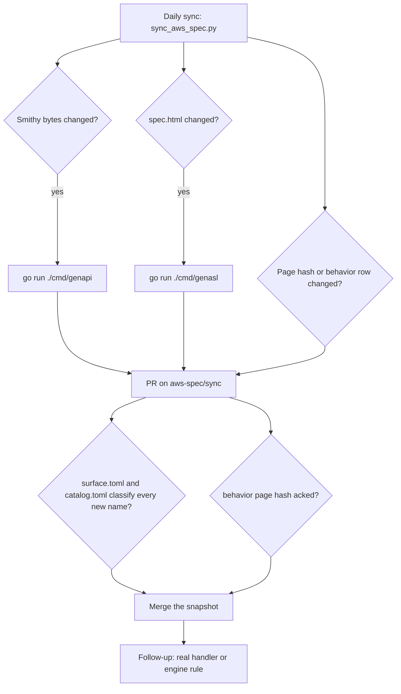

# Roadmap: local Step Functions in Go

Check a box when that item is true in the tree. Check a phase when every box under it is checked. Design notes under [Reference](#reference) stay as written. They are not tasks.

| | |
|---|---|
| Status | Phase 0, Phase 0b, Phase 1, Phase 2, Phase 3, Phase 4, Phase T, Phase V, Phase 5, Phase 6, Phase R, and Phase I checked. Create, describe, list, update, and delete work. Pass, Succeed, Fail, Choice, and Wait run. JSONPath paths and payload templates run. Mocked tasks and direct Lambda invokes run. Retry and Catch run. Create-time validator messages match the jar fixtures. Parallel, inline Map, and the eighteen intrinsic functions run. ValidateStateMachineDefinition, versions, and aliases work. `TestState` runs one state, including a JSONata Pass. Activities and `.waitForTaskToken` callbacks run. A timed-out `SendTask*` reports `Task Timed Out: '<resource>'`. JSONata, `$states`, and JSONPath `Assign` run. `RedriveExecution` resumes a failed Standard execution. The JSONPath context still omits `RedriveCount`. Optimized integrations run when their endpoint is set. Nested `.sync` and `.sync:2` run when `STEP_FUNCTIONS_ENDPOINT` is set. Customer-managed KMS and tracing stay deferred. Distributed Map runs, including Map Run redrive. |
| Language | Go. This closes the open language question in [docs/spec.md](docs/spec.md). |
| Wire contract | The vendored Smithy model, AWS JSON 1.0. A script pointed at this process keeps the same requests and parses the same responses. |
| Execution contract | [docs/spec.md](docs/spec.md). JSONPath is checked against `amazon/aws-stepfunctions-local:2.0.0`. JSONata and variables follow the AWS pages named there. |
| Listen | `0.0.0.0:8083`. `--endpoint-url http://127.0.0.1:8083`. |
| Where the two docs disagree | This file wins for the operation set: all 37 operations are registered. docs/spec.md wins for how a state runs. |

```bash
aws stepfunctions create-state-machine \
  --endpoint-url http://127.0.0.1:8083 \
  --name rebuild-check \
  --definition file://machine.json \
  --role-arn arn:aws:iam::123456789012:role/local
```

SigV4 is not checked. Credentials in the client are ignored.

Estimates are person-weeks for one engineer who knows Step Functions, including tests. A phase leaves a process that answers every modeled operation.

| Phase | Done when the boxes under it are checked | Weeks |
|---|---|---|
| [G](#x-phase-g--protocol-shell) | Every modeled call parses. Nothing executes yet. | 1.5–2.5 |
| [0](#x-phase-0--control-plane) | Create, describe, list, update, and delete machines and activities. | 1.5–2.5 |
| [0b](#x-phase-0b--validator-messages) | Create-time messages match the jar fixtures. Can land beside phase 1. | 1–2 |
| [V](#x-phase-v--validate-versions-aliases) | `validate-state-machine-definition`, publish, and alias. | 1–2 |
| [1](#x-phase-1--pass-succeed-fail) | Smallest useful runner. Pass, Succeed, Fail. | 1.5–2.5 |
| [2](#x-phase-2--jsonpath-choice-wait) | JSONPath data flow, Choice, Wait. | 2–4 |
| [3](#x-phase-3--mocks-lambda-retry-catch) | Mock file, one Lambda endpoint, Retry, Catch. | 2–3 |
| [T](#x-phase-t--teststate) | `TestState` runs one state. Grows with later phases. | 1, then small |
| [4](#x-phase-4--parallel-map-intrinsics) | Jar-shaped JSONPath runner. | 4–6 |
| [5](#x-phase-5--activities-and-callbacks) | Activity workers after phase 3. Callbacks after phase 4. | 2–3 |
| [6](#x-phase-6--jsonata-and-variables) | JSONata runner, then JSONPath `Assign`. | 4–7 |
| [R](#x-phase-r--redrive) | `RedriveExecution` for a failed Standard execution. | 1–2 |
| [I](#x-phase-i--service-integrations) | Optimized calls run when the endpoint is set. | unbounded |
| [S](#phase-s--aws-sdk-integrations) | `aws-sdk:` actions run through the AWS SDK for Go v2 when the endpoint is set. | unbounded |
| [D](#phase-d--distributed-map) | Distributed Map children run as executions. Map Run API. | 3–5 |

Cuts: G is the protocol-compatible process. G + 0 + 1 is the smallest useful runner. V on top of 0 is the definition check. Through 4 is the jar-shaped JSONPath runner. 6 on top of that is the JSONata runner. Phase 5 after 3 is activity workers.

## [x] Phase G — protocol shell

- [x] `go mod init github.com/catdevman/sfn-local` and the package layout in [Repository layout](#repository-layout).
- [x] `cmd/genapi` reads `aws-spec/states-api/sfn-2016-11-23.json` and writes `internal/api/gen/`.
  - [x] `types.go`: one struct per structure, enums, lists, maps. JSON names are the Smithy member names. Scalar members keep presence, so omitted is distinct from zero. `@default` is data for the handler, not filled by the decoder.
  - [x] `timestamp.go`: epoch seconds as a plain JSON number, including a fraction. No scientific notation.
  - [x] `operations.go`: `Handlers` with one method per operation, `Unimplemented` for each, and the `AWSStepFunctions.<Name>` dispatch list.
  - [x] `errors.go`: shape id `com.amazonaws.sfn#<Name>`, HTTP status from `smithy.api#httpError` or 400/500 by fault.
  - [x] `validate.go`: required, `@length`, `@pattern`, `@range`, enum values. Returns `ValidationException`.
  - [x] `surface.gen.json`: every operation, input and output member, error name, and enum value.
  - [x] Protocol trait `aws.protocols#awsJson1_0` and target prefix `AWSStepFunctions` are generated constants.
  - [x] The generator fails on a shape kind outside `service`, `operation`, `structure`, `string`, `boolean`, `integer`, `long`, `float`, `timestamp`, `enum`, `list`, `map`.
- [x] `cmd/genasl` reads `aws-spec/asl/spec.html` and writes `internal/asl/specgen/`. The HTML file is not modified.
  - [x] Field matrix for the JSONata table and the JSONPath table. Single-identifier fields only. Prose rows such as `One of: Next or End` are notes.
  - [x] Appendix A error-name list. Appendix B intrinsic-name list.
  - [x] The command fails when it finds no field table, an unknown cell class, or state-type columns other than `Task`, `Parallel`, `Map`, `Pass`, `Wait`, `Choice`, `Succeed`, `Fail`.
- [x] `//go:generate` in `internal/api/gen/doc.go` and `internal/asl/specgen/doc.go`. `go generate ./...` is the regenerate step, and CI fails when the tree is dirty.
- [x] `cmd/sfnlocal` listens, parses the flag table in docs/spec.md, and adds `--compat`. Flags override environment. `-h` and `-v` exit 0. One version line on start. Banner prints port, account, region, and bind address. Help says the store is in memory and tells operators to bind `127.0.0.1` unless the port is published on purpose.
- [x] HTTP adapter implements the [wire protocol](#wire-protocol). Generated `Validate` runs before the handler. A plain `error` from a handler becomes HTTP 500 `InternalFailure` with a body. The access log line is `<operation> => <payload>` and `[status] <operation> <= <response>`.
- [x] `internal/api/surface.toml` has a row for all 37 operations. Phase G marks the whole set `deferred` except where a later box in this phase says otherwise. The classification test fails on a generated name with no row, and on `implemented` while the method is still `Unimplemented`.
- [x] `internal/asl/catalog.toml` classifies every generated ASL field, Appendix A code, and Appendix B name as `implemented` or `deferred`.
- [x] `internal/asl/page-acks.toml` records the current SHA-256 of each behavior page in `aws-spec/page-watch.json`.
- [x] `internal/invoke/allow.toml` classifies every service in `aws-spec/sdk-integrations.json` as `unsupported` or `endpoint`.
- [x] `.github/workflows/sync-aws-spec.yml` runs `go generate ./...` after the Python fetch.
  - [x] The bot may commit `aws-spec/**`, `internal/api/gen/**`, and `internal/asl/specgen/**`.
  - [x] The bot refuses every other path. It does not edit handlers, `docs/spec.md`, `surface.toml`, or `catalog.toml`.
  - [x] The pull request body lists new operations, members, ASL fields, and error names from the generated diff.
- [x] README points here and at docs/spec.md, and says the default error profile is the public Smithy shape id.
- [x] `go test ./...` passes with no AWS account and no Docker.
- [x] `aws stepfunctions list-state-machines --endpoint-url http://127.0.0.1:8083` returns a parsed response or a parsed modeled error.
- [x] The same CLI check passes for a state-machine write, `ValidateStateMachineDefinition`, `TestState`, and `DescribeMapRun`. Deferred errors still print a code and a message.

## [x] Phase 0 — control plane

Depends on phase G. `QueryLanguage` and JSONata-only fields fail validation with `InvalidDefinition` / `SCHEMA_VALIDATION_FAILED` until phase 6.

- [x] `internal/store`: in-memory state machines, activities, and tags. Definition text is stored as submitted.
- [x] `internal/api/names.go`: jar invalid-name pattern, path-capable role ARN pattern, and the ARN shapes in docs/spec.md. Smithy `Name` is only length 1..80, so this pattern stays handwritten.
- [x] State machines.
  - [x] `CreateStateMachine`. Duplicate name with a different definition is `StateMachineAlreadyExists`. The same definition returns the existing ARN and the original `creationDate`. `type` omitted means `STANDARD`.
  - [x] `DescribeStateMachine` returns `name`, `status`, `definition`, `creationDate`, `roleArn`, `stateMachineArn`, `type`, `loggingConfiguration`.
  - [x] `ListStateMachines`. `maxResults` omitted means 100. Range 0..1000. `nextToken` is the decimal index the client sends back.
  - [x] `UpdateStateMachine` applies every provided field and sets `updateDate`. At least one of definition, role ARN, or logging configuration is required when `publish` is not true.
  - [x] `DeleteStateMachine`. Unknown ARN returns `{}` in `--compat=sfn-local`. An existing machine becomes `DELETING`. The one-second sweep drops terminal executions immediately and drops the machine when none are `RUNNING`.
  - [x] Public profile requires `roleArn`. `--compat=sfn-local` allows it to be omitted.
- [x] Activities as rows: `CreateActivity`, `DescribeActivity`, `ListActivities`, `DeleteActivity`. No tokens yet.
- [x] Tags: `TagResource`, `UntagResource`, `ListTagsForResource` on a state-machine ARN or an activity ARN. At most 50. Key 1..128, value 0..256.
- [x] ASL validator uses the generated field matrix for the JSONPath generation. Unknown fields are `SCHEMA_VALIDATION_FAILED`.
- [x] Logging configuration is validated and stored. Nothing is written to disk. A null level is stored as `OFF`.
- [x] `encryptionConfiguration` and `tracingConfiguration` return a modeled error that names the field. They are not ignored. `publish` is phase V.
- [x] Execution operations stayed deferred through the control plane. `StartExecution` idempotency is specified and tested in phase 1.
- [x] Tests: Create response shape, duplicate name, bad definition, deleting status, role path `role/service-role/MyRole`.

## [x] Phase 0b — validator messages

Depends on phase 0. Phase 1 does not wait on this.

- [x] EXPRESS rejects an activity ARN, a resource ending in `.sync`, and a resource ending in `.waitForTaskToken`, including the trailing space on the callback sentence.
- [x] `Parameters` is required for the registered `arn:aws:states:::` connectors the jar fixtures list.
- [x] `StartAt`, `Next`, Choice `Next`, Choice `Default`, and Catch `Next` name a state in the same `States` object. Message `Missing 'Next' target`.
- [x] Unreachable state and missing terminal state use the codes in docs/spec.md.
- [x] Logging configuration: exactly one destination when the level is not `OFF`, and the destination has a CloudWatch log-group ARN.
- [x] `States.ALL` is alone in `ErrorEquals` and that Retry or Catch object is the last entry. Message `States.ALL must appear alone and at end of list`.
- [x] Tag length failures use `Member must have length less than or equal to 80` in `--compat=sfn-local`.

## [x] Phase V — validate, versions, aliases

Depends on phase 0. The validator already exists. These operations replace their deferred rows.

- [x] `ValidateStateMachineDefinition` returns diagnostics in the generated output shape.
- [x] `PublishStateMachineVersion`, `ListStateMachineVersions`, `DeleteStateMachineVersion`.
- [x] `CreateStateMachineAlias`, `DescribeStateMachineAlias`, `ListStateMachineAliases`, `UpdateStateMachineAlias`, `DeleteStateMachineAlias`.
- [x] `publish: true` on create publishes a version and returns `stateMachineVersionArn`.
- [x] `StartExecution` and `StartSyncExecution` accept a version ARN and an alias ARN.
- [x] Customer-managed KMS and tracing stay `deferred` and return a modeled error. The server does not call KMS.

## [x] Phase 1 — Pass, Succeed, Fail

Depends on phase 0. This is the smallest useful runner together with G and 0.

- [x] `internal/exec`: the accept loop never runs a state. One execution is one sequential loop on a worker. Stop cancels that worker.
- [x] `internal/store` executions and history. An execution stores the definition text it started with. A later update does not change it. History id starts at 1. `previousEventId` chains from 0 on `ExecutionStarted`. Cap 25000 events.
- [x] `StartExecution` returns when the row exists. Omitted `name` is a UUID. Omitted `input` is `{}`. Input is JSON and at most 262144 UTF-8 bytes. Same name, same input, status `RUNNING` returns the existing row. A different input or a terminal status is `ExecutionAlreadyExists`.
- [x] `DescribeExecution`. While `RUNNING`, comparison ignores a null `output`. Standard describe has status, input, output, dates, name, and ARNs. `error` and `cause` are not added there.
- [x] `GetExecutionHistory`. `includeExecutionData` omitted means true. `reverseOrder` is honored. Detail member names match the history table in docs/spec.md.
- [x] `StopExecution` appends `ExecutionAborted`, sets `ABORTED`, and returns `stopDate`. A second stop returns the existing `stopDate` and does not append another terminal event.
- [x] `StartSyncExecution` is EXPRESS only, blocks that request, rejects `#` in the ARN, and returns status plus `error` and `cause`. EXPRESS history is dropped at completion. EXPRESS executions are capped at 300 seconds. Standard executions are capped at 365 days.
- [x] `ListExecutions` on STANDARD sorts by start date descending. On EXPRESS it is `InvalidParameterValue` before any sort.
- [x] `DescribeStateMachineForExecution`.
- [x] Describe and history of a real express ARN use the jar's `Invalid Arn` messages from docs/spec.md. Results for EXPRESS are observed through `StartSyncExecution`.
- [x] Pass with a literal `Result`. History: `ExecutionStarted`, `PassStateEntered`, `PassStateExited`, `ExecutionSucceeded`.
- [x] Succeed. History includes `SucceedStateEntered`, `SucceedStateExited`, `ExecutionSucceeded`.
- [x] Fail. History includes `FailStateEntered` and `ExecutionFailed`. There is no `FailStateExited`.
- [x] Fixtures from docs/spec.md: Pass literal Result, Fail, and Stop. Jar oracle compares status, output JSON, and event types when Docker is present.
- [x] A running STANDARD execution keeps a `DELETING` machine alive. An in-flight EXPRESS execution does not. The running execution fails at the next state boundary with `States.Runtime`.

## [x] Phase 2 — JSONPath, Choice, Wait

Depends on phase 1. No variable writes. A `$name` that is not `$.` or `$$` fails with a clear error.

- [x] `internal/jsonpath` behind a small interface. Reference paths and payload templates. Phase 2 fixtures are the acceptance test for the library.
- [x] `InputPath`, `Parameters` with `.$` keys, `ResultPath`, `OutputPath`. `null` paths behave as docs/spec.md says. 262144-byte caps on parameters and state output.
- [x] Minimal context object: `Execution`, `State`, `StateMachine`. `$$` reads it.
- [x] Choice comparators, including `StringMatches` and the six `Is*` tests. `Is*` result equals the boolean operand. A wrong JSON type is a failed comparison for value comparators. `And`, `Or`, and `Not` short-circuit.
- [x] Wait. `Seconds` is multiplied by 1000 before scaling. The scale multiply is float32, then cast toward zero. A negative `WAIT_TIME_SCALE` is stored as its absolute value. Retry sleep is not scaled.
- [x] Fixtures: Choice, type mismatch, `IsTimestamp` false, `And` short-circuit, Parameters `.$`, Wait scale, `InputPath` null, `ResultPath` null, `OutputPath` null.

## [x] Phase 3 — mocks, Lambda, Retry, Catch

Depends on phase 2.

- [x] `internal/mock`. `SFN_MOCK_CONFIG`, default `./MockConfigFile.json`, cap 1_000_000 bytes, reload when the SHA-256 changes.
- [x] Test name is the suffix after one `#` on `stateMachineArn`. More than one `#` is HTTP 400 `InvalidArn`. A missing file or unknown test is HTTP 400 `InvalidDefinition`.
- [x] Attempt keys and inclusive ranges. Overlapping selectors are rejected at load. The mock attempt counter is per state name for the life of the execution. The Retry backoff counter clears on transition.
- [x] `Return` and `Throw`. A missing attempt is `States.Runtime` and does not call the network.
- [x] Direct Lambda function ARN against `LAMBDA_ENDPOINT`. A `Return` without `Payload` is the payload. An `Error` containing `timeout` is `LambdaFunctionTimedOut` / `States.Timeout`.
- [x] Any other resource that passed create-time checks fails at execution with `States.Runtime` and a cause that contains the resource and `unsupported resource`.
- [x] Retry backoff, `FULL` jitter, `States.TaskFailed` and `States.ALL` matchers. Interruptible sleep, not scaled by `WAIT_TIME_SCALE`.
- [x] Catch `ResultPath` into the original state input. Task catches append `TaskStateExited`.
- [x] Task timeout.
- [x] Fixtures: RetryOnce and Catch from docs/spec.md.

## [x] Phase T — TestState

Depends on phase 1. Widen it as phases 2, 3, and 6 add state types. The operation is registered in phase G and becomes real here.

- [x] `TestState` runs one state through the same state handlers as an execution.
- [x] The first cut supports Pass, Succeed, Fail, and the Choice and Wait behavior phase 2 has.
- [x] Mocked Task and Lambda Invoke work once phase 3 has landed.
- [x] JSONata states work once phase 6 has landed.
- [x] `surface.toml` marks `TestState` `implemented` for the state types the current binary runs, and the handler returns a modeled error for a state type the binary does not run yet.

## [x] Phase 4 — Parallel, Map, intrinsics

Depends on phase 3. This is the jar-shaped JSONPath release. JSONPath `Assign` stays in phase 6.

- [x] Parallel. Concurrent branches, result array in declaration order, cancel siblings on failure. Events `ParallelStateStarted`, `ParallelStateSucceeded`, `ParallelStateFailed`, `ParallelStateExited`. A Catch on Parallel writes `ParallelStateExited`.
- [x] History for Parallel is compared as a multiset plus the ordering constraints in docs/spec.md.
- [x] Inline Map. `ItemsPath`, `MaxConcurrency` including 0 as unbounded, `Iterator` and `ItemProcessor` with `Mode: INLINE` only. `DISTRIBUTED` fails validation.
- [x] `Map.Item.Index` and `Map.Item.Value` are visible on the Map state and inside the iteration.
- [x] Iteration events and index-ordered output. Fixture: the two-item Map in docs/spec.md.
- [x] Full JSONPath context object. `RedriveCount` is absent on this object. `RetryCount` is present on Task, Parallel, and Map.
- [x] `GetExecutionHistory` emits only names on the generated `HistoryEventType` enum. A test fails when the server emits any other string.
- [x] Intrinsics. Each box includes the fixture in docs/spec.md.
  - [x] `States.Format`
  - [x] `States.StringToJson`
  - [x] `States.JsonToString`
  - [x] `States.Array`
  - [x] `States.ArrayPartition`
  - [x] `States.ArrayContains`
  - [x] `States.ArrayRange`
  - [x] `States.ArrayGetItem`
  - [x] `States.ArrayLength`
  - [x] `States.ArrayUnique` in first-seen order. Jar diffs do not compare that order.
  - [x] `States.Base64Encode` and `States.Base64Decode`
  - [x] `States.Hash`
  - [x] `States.JsonMerge`
  - [x] `States.MathAdd`
  - [x] `States.MathRandom`, including `States.MathRandom(0, 10, 1)` = `5`
  - [x] `States.StringSplit` as a character set
  - [x] `States.UUID` checked for shape only

## [x] Phase 5 — activities and callbacks

`GetActivityTask` and `SendTask*` depend on phase 3. `.waitForTaskToken` depends on phase 4 and on this phase.

- [x] Activity resource `arn:aws:states:<region>:<account>:activity:<name>` schedules a token and parks that execution.
- [x] `GetActivityTask` waits up to 60 seconds and returns `{}` when none arrives. The wait does not stall other connections.
- [x] `SendTaskSuccess`, `SendTaskFailure`, `SendTaskHeartbeat`. Heartbeat and activity timeout use `States.Timeout`.
- [x] History detail members for activity events match the table in docs/spec.md. Success ends with `TaskStateExited`.
- [x] An activity state named in the mock file fails with `States.Runtime` and does not schedule.
- [x] Capture the jar's `TaskTimedOut` message once and lock it in a test.
- [x] `.waitForTaskToken` on STANDARD suspends without calling a service endpoint. The token exists before `Parameters` runs, as `$$.Task.Token`.
- [x] Callback history order: `TaskStateEntered`, `TaskScheduled`, `TaskStarted`, `TaskSubmitted` with output `""`, then the wait. Success, failure, timeout, and `StopExecution` append the events docs/spec.md names.
- [x] A mock `Return` for a callback state completes through the mock path.
- [x] `.sync` and `.sync:2` on `arn:aws:states:::states:startExecution` poll `DescribeExecution` when `STEP_FUNCTIONS_ENDPOINT` is set. `.sync` returns the describe document. `.sync:2` returns the nested output. A failed start appends `TaskSubmitFailed`.

## [x] Phase 6 — JSONata and variables

Depends on phase 4 for the context object, and on phase 4's Map for the scope fixtures. The JSONPath release is green before this starts.

- [x] The language reference stays `jsonata-js` 2.0.6 at commit `6f1fc886aa1e3e6bdbfffcdd80e63ede1d7d6b6b` under `aws-spec/jsonata/2.0.6/` (MIT). The runtime is `github.com/recolabs/gnata` v0.6.2. It is not a vendored JavaScript file and not goja. `?:` and `??` are rejected at validation because gnata accepts those 2.1 operators.
- [x] `internal/jsonata` evaluates through gnata behind `Expr.Eval`. The input document is separate from bindings, so a binding does not hide an input field. One-second interrupt. Evaluator memory cap starts at 32 MiB. No host function reads the environment, opens a file, or fetches a URL. `$eval` returns an error.
- [x] Accept `QueryLanguage` on the machine and on a state. JSONPath fields and JSONata fields are mutually exclusive for the effective language of that state.
- [x] `` detection, including strings nested in objects and arrays.
- [x] `$states.input` and `$states.context`. `Execution.RedriveCount` is `0` on the JSONata context.
- [x] Step Functions functions, with the contracts in docs/spec.md.
  - [x] `$partition`
  - [x] `$range`
  - [x] `$hash`
  - [x] `$random()` in `[0, 1)`, and one recorded seeded value
  - [x] `$uuid` checked for shape only
  - [x] `$parse`
- [x] Choice `Condition`. Explicit Succeed `Output` fixture.
- [x] A failed `Arguments` expression has an entered event and no exited event. Undefined is `States.QueryEvaluationError`. Pass cannot catch it.
- [x] Variable store. Assign and Output run against the entry snapshot. Writes commit after every expression. Names: length at most 80, Unicode `ID_Start` / `ID_Continue`. 256 KiB per value, 256 KiB per Assign, 10 MiB per execution.
- [x] Worked Store / Swap / After fixture, output `{"x":6,"nextX":3,"a":6}`.
- [x] Negative fixture: `Swap.Output` of `` fails with `States.QueryEvaluationError`.
- [x] Child scopes for inline Map iterations and Parallel branches. Sibling writes stay invisible. The two-branch Parallel fixture fails in the parent with `States.QueryEvaluationError`.
- [x] Choice rule `Assign` excludes the state-level `Assign`. Fixture `outputValue` from docs/spec.md.
- [x] Catch `Assign` on a Map writes the parent scope. Fixture output `"Boom"`. Reusing that name inside the iterator fails validation.
- [x] Direct `$states.result` and `$states.errorOutput` are rejected at create time outside their legal fields. In JSONata 2.0.6 a non-numeric bracket is a predicate, so `$states["result"]` keeps the object. `$lookup($states, "result")` is a runtime `States.QueryEvaluationError` when the key is absent.
- [x] Map `Items` as an array or an expression that returns an array, including `[1, "", 3]`. An object fails validation or, from an expression, fails at runtime.
- [x] JSONPath `Assign` with `key.$`. Variable reads in Choice `Variable` and in `States.Format`. `ResultPath` referencing a variable fails validation.
- [x] JSONPath variable-read fixture from docs/spec.md, output `{"label":"id=A"}`. No live AWS or LocalStack run was available. The jar rejects `Assign`, so this fixture is not compared to 2.0.0. A later live run wins if it disagrees.
- [x] `catalog.toml` marks the JSONata fields `implemented`.

## [x] Phase R — redrive

Depends on phase 1 history, and on phase 6 for the JSONata context count.

- [x] `RedriveExecution` resumes a failed Standard execution from the history this server stored. The resume point is the outermost state that was entered and not exited. States that already exited are not run again.
- [x] `RedriveCount` on the JSONata context is the real count. The JSONPath context still omits it.
- [x] A redrive of an execution that cannot be redriven returns the modeled `ExecutionNotRedrivable`.

## [x] Phase I — service integrations

The endpoint flag gates each integration. An empty endpoint is an unsupported resource. `internal/invoke/allow.toml` has no row for these optimized resources, and AWS Lambda Core stays unsupported. `.sync` and `.sync:2` run only for nested `states:startExecution`.

- [x] `arn:aws:states:::lambda:invoke` returns `{StatusCode, Payload}`. A direct function ARN still returns the raw payload.
- [x] SQS `sendMessage`, SNS `publish`, DynamoDB `getItem`, `putItem`, `updateItem`, and `deleteItem`, and EventBridge `putEvents` run through the Phase S clients. Errors are `<Service>.<Code>Exception`.
- [x] Nested Step Functions `startExecution` posts JSON 1.0 to `STEP_FUNCTIONS_ENDPOINT`.
- [x] `.sync` and `.sync:2` on `arn:aws:states:::states:startExecution` poll `DescribeExecution`. `.sync` returns the describe document. `.sync:2` returns the nested output. A failed start appends `TaskSubmitFailed`.

These stay deferred for the life of this plan.

- Batch, ECS, Glue, SageMaker, Athena, EKS, DataBrew, API Gateway, and EMR on EKS

## Phase S — aws-sdk integrations

`arn:aws:states:::aws-sdk:<service>:<action>` runs through the AWS SDK for Go v2. Each service is a hand-written table from action to client method. A service runs only when `AWS_ENDPOINT_URL_<SERVICE>` or `AWS_ENDPOINT_URL` is set.

- [x] `internal/sdk`: the `op` adapter, error names `<Prefix>.<Code>Exception`, and per-service endpoints.
- [x] `internal/invoke/operations.toml` from `cmd/genops`, kept current by `TestGenerateClean` and checked by `TestOperations`.
- [x] S3: 25 operations, with `getObject` and `putObject` bodies as strings.
- [x] DynamoDB: 23 operations, with a codec for `AttributeValue`. Parameter names match exactly at every depth.
- [x] SQS, SNS, and EventBridge as `aws-sdk:` services. The Phase I DynamoDB, SQS, SNS, and EventBridge resources run through the same clients.
- [x] Lambda (30 operations, `invoke` payloads as strings), Secrets Manager (all 23), SSM (Parameter Store, Run Command, and tags), and Step Functions (all 37, which can call this server).
- [x] `internal/awscheck` scenarios, `cmd/awsrecord`, and `TestAWSRecordings`. docs/spec.md has the workflow.
- [ ] Record against AWS, then fix or document each difference.

## Phase D — Distributed Map

`ProcessorConfig.Mode` `DISTRIBUTED` runs each item, or each batch, as a child execution in the store. docs/spec.md has the rules.

- [x] Validation: `ExecutionType`, `Label`, tolerances, `ItemBatcher`, `ResultWriter.WriterConfig`, the `Path` forms, and JSONata expressions. Refused in EXPRESS machines and on `INLINE` Maps.
- [x] Map Runs and child executions, `MaxConcurrency`, failure thresholds, a new run per retry, and stop.
- [x] `COMPACT`, `FLATTEN`, and `NONE` results, with records for tolerated failures.
- [x] `DescribeMapRun`, `ListMapRuns`, `UpdateMapRun`, `ListExecutions` by `mapRunArn`, and child `DescribeExecution` and `DescribeStateMachineForExecution`.
- [x] `ItemReader` from S3: JSON with `ItemsPointer`, JSONL, CSV, `ListObjectsV2` with `LOAD_AND_FLATTEN`, S3 inventory manifests, gzip, and `MaxItems`.
- [x] `ResultWriter` export to S3: `manifest.json` and the `SUCCEEDED`, `FAILED`, and `PENDING` files.
- [x] Map Run redrive through the parent's `RedriveExecution`: succeeded children kept, STANDARD children redriven in place, EXPRESS children and unstarted items started again, `MapRunRedriven`, and the run's redrive counts.
- [x] Unique labels, zstd input, and `redriveStatus` on `DescribeExecution`.
- [ ] Parquet and Athena manifest input.
- [ ] Check the parent event sequence, the threshold cause, the manifest layout, and the redrive counts against AWS.

## Standing CI

These boxes are part of phase G's test harness, then stay green. Check them when the suite exists, and leave them checked.

- [x] Generator freshness: `go generate ./...` leaves a clean tree.
- [x] Surface classification: every generated operation, member, and error is `implemented` or `deferred`.
- [x] ASL catalog: every generated field, Appendix A code, and Appendix B name is classified, and `genasl` found both field tables.
- [x] Page acks: every behavior-page hash in `page-watch.json` matches `page-acks.toml`.
- [x] Protocol golden: each implemented operation has one HTTP request and response covering the target header, member names, a numeric timestamp, and error `__type` plus status.
- [x] Spec fixtures: the acceptance fixtures in docs/spec.md for the phases that have landed. Recorded JSON. No AWS account.
- [x] Jar oracle: when Docker is present, compare status, output JSON, and history event types with `amazon/aws-stepfunctions-local:2.0.0`. Developer CI may skip with a loud message. The release pipeline may not skip quietly.
- [x] JSONata pin: `upstream.json` stays commit `6f1fc886aa1e3e6bdbfffcdd80e63ede1d7d6b6b`, the runtime is gnata, the Assign example passes, the negative `$nextX` example passes, and `$eval` is absent.
- [x] Compat profile: the jar `__type` strings in docs/spec.md are asserted only with `--compat=sfn-local`.

## When AWS publishes a change

The daily sync opens one pull request. Most days it prints `no file changes`. On a real change, do these in order and check them on that pull request. They are not part of the phase list above.

1. Read the generated diff. That diff is the API diff.
2. Add a `surface.toml`, `catalog.toml`, or `page-acks.toml` row. `deferred` is a complete answer when this server will not perform that behavior.
3. Merge the snapshot. The bot has already regenerated Go and the field matrix.
4. When the row should be real behavior, change `docs/spec.md` if the semantics are new, then replace `Unimplemented` and add the fixture. `go test` is the gate.

A new shape kind fails `cmd/genapi` until the generator learns it. A new state type fails `cmd/genasl` until this plan is revised. A JSONata version sentence does not move the pin. Update `upstream.json`, re-record the seeded `$random` value against the gnata version, and re-run the Assign example. The language pin stays jsonata-js 2.0.6.

## Reference

### Contracts

| Contract | Source in this repo | Who changes it | What the server does with it |
|---|---|---|---|
| HTTP API | [aws-spec/states-api/sfn-2016-11-23.json](aws-spec/states-api/sfn-2016-11-23.json) | AWS, via the daily sync | Generate Go types, the operation interface, constraints, and error types. |
| Workflow language, field matrix | [aws-spec/asl/spec.html](aws-spec/asl/spec.html) | AWS, copied verbatim | Generate the state-type field matrix, the Appendix A error-name list, and the Appendix B intrinsic-name list. |
| How a state actually runs | [docs/spec.md](docs/spec.md) | This project | Handwritten engine. The sync job does not edit this file. |
| JSONata 2.0.6 | [aws-spec/jsonata/](aws-spec/jsonata/) | Pinned on purpose | Language reference only. The runtime is `github.com/recolabs/gnata` v0.6.2. Step Functions functions are bound in Go. |
| Product behavior pages | `aws-spec/page-watch.json`, release notes, document history | AWS, hashes and rows only | A human ack. No code is generated from prose. |

The current snapshot is Smithy 2.0 JSON: 37 operations, 170 structures, 18 enums, one timestamp shape. `states-api/operations.json` stays the human-readable index. It drops length, pattern, and range traits. The Go generator reads the Smithy file.

Step Functions Local 2.0.0 implements 23 operations. These 14 are still registered from the first binary, as real handlers or as deferred modeled errors:

`CreateStateMachineAlias`, `DeleteStateMachineAlias`, `DeleteStateMachineVersion`, `DescribeMapRun`, `DescribeStateMachineAlias`, `ListMapRuns`, `ListStateMachineAliases`, `ListStateMachineVersions`, `PublishStateMachineVersion`, `RedriveExecution`, `TestState`, `UpdateMapRun`, `UpdateStateMachineAlias`, `ValidateStateMachineDefinition`.

Generated files carry `Code generated ... DO NOT EDIT` and are committed. `@idempotent` is a boolean on the operation descriptor. `StartExecution` same-input behavior stays the rule in docs/spec.md.

The service struct embeds `gen.Unimplemented` and overrides finished operations:

```go
type Service struct {
    gen.Unimplemented
    store *store.Store
    exec  *exec.Engine
}
```

`internal/jsonata` calls gnata. The input document stays separate from the bindings. `Limits` carries the one-second timeout and the memory cap.

```go
type Expr interface {
    Eval(ctx context.Context, expression string, input any, bindings map[string]any, limits Limits) (any, error)
}
```

### Repository layout

```text
cmd/sfnlocal/           main: flags, listen, signal
cmd/genapi/              Smithy JSON AST → internal/api/gen
cmd/genasl/              spec.html tables → internal/asl/specgen
internal/api/            server, handlers, compat, surface.toml
internal/api/gen/        generated, committed
internal/store/
internal/exec/
internal/asl/            validator overlay, states, catalog.toml, page-acks.toml
internal/asl/specgen/    generated, committed
internal/jsonpath/
internal/intrinsic/
internal/jsonata/        gnata evaluator
internal/mock/
internal/invoke/         allow.toml, operations.toml
internal/sdk/            aws-sdk: tables over the AWS SDK for Go v2
cmd/genops/              SDK clients → internal/invoke/operations.toml
aws-spec/                snapshots and the Python sync
docs/spec.md             execution semantics
```

| Package | Owns |
|---|---|
| `cmd/sfnlocal` | Process, flags, environment, startup banner. The flag table in docs/spec.md, plus `--compat`. |
| `internal/api` | HTTP adapter, dispatcher, compat error map, handlers, the surface manifest. |
| `internal/store` | In-memory state machines, executions, activities, tokens, tags, history. |
| `internal/exec` | One sequential loop per execution, timeouts, stop, the deleting sweep. |
| `internal/asl` | Validator overlay, state handlers, payload templates, context object. |
| `internal/jsonpath` | Reference paths, payload templates, `$$`. |
| `internal/intrinsic` | The eighteen `States.*` functions. |
| `internal/jsonata` | gnata v0.6.2. `$eval` disabled. jsonata-js 2.0.6 is the language reference, not the runtime. |
| `internal/mock` | Mock file, `#` test-case suffix, attempt keys. |
| `internal/invoke` | Lambda Invoke, then the allow-list and the operations inventory. |
| `internal/sdk` | `aws-sdk:` tasks: one table per service, error names, endpoints. |

### Wire protocol

One route. AWS JSON 1.0, as the model declares.

- Method POST. The protocol identity is `POST /`. The server also accepts any path, because Step Functions Local does and some proxies rewrite it. GET `/dashboard` serves the embedded console and is not part of the API. POST `/dashboard` stays AWS JSON. GET `/dashboard/assets/htmx.min.js`, GET `/dashboard/assets/tailwind.css`, and POST `/dashboard/stop` belong to the console and are not access-logged.
- Header `X-Amz-Target`, matched case-insensitively. The operation is the substring after the first dot. A missing header or a value with no dot is HTTP 400 with a modeled missing-header error.
- Request `Content-Type` may be `application/x-amz-json-1.0` or `application/json`. Response `Content-Type` is `application/x-amz-json-1.0`, including when the output has no members. Those responses are `{}`.
- Body is one JSON object, UTF-8. An empty body is `{}`. Unknown members are ignored. Trailing tokens after one value are rejected.
- Success is HTTP 200 and the output structure. Omit a member the handler did not set.
- Failure: HTTP status from the error shape, `__type` and `X-Amzn-Errortype` set to the full shape id `com.amazonaws.sfn#<ShapeName>`. Clients reduce that value to the name after `#`, and to the substring before `:` when a colon is present.
- A target the generated list does not contain is HTTP 400 with `__type` `UnknownOperationException` and a message that names the target. Capture one real AWS response for this case and lock the status and the code. The 14 operations the jar never shipped are in the list.
- Timestamps are JSON numbers in epoch seconds. `1715990400.123` is legal. Tests compare numerically.
- Two Smithy defaults disagree with docs/spec.md. Omitted `maxResults` means 100, while `PageSize`'s trait default is 0. Omitted `includeExecutionData` on `GetExecutionHistory` means true.

Handlers add the cross-field rules: ASL validation, ARN patterns, at least one of definition, role, or logging on update, and tag counts.

Botocore matches `com.amazonaws.sfn#StateMachineDoesNotExist` and the jar's `com.amazonaws.swf.service.v2.model#StateMachineDoesNotExist` as the same code. The default profile emits the Smithy shape id. `--compat=sfn-local` uses the jar strings in docs/spec.md, including `com.amazon.coral.validate#ValidationException` and `com.amazonaws.services.stepfunctions.model.#ResourceNotFound`. The map lives in `internal/api/compat.go`. A new Smithy error needs a compat row only after a jar fixture captures it.

`--compat=sfn-local` also allows an omitted `roleArn`, uses the tag sentence that says 80, returns `{}` for `DeleteStateMachine` on an unknown ARN, and returns the jar's HTTP 500 `UnsupportedOperation` for operations outside the original 23.

`--bind-address` defaults to `0.0.0.0`. Port, account, region, mock file, and `WAIT_TIME_SCALE` are the same in both profiles.

Handler rules that keep scripts working:

- Return an error value from `internal/api/gen`, or `ValidationException` from generated `Validate`.
- A deferred behavior-changing field returns a modeled client error that names the field. `encryptionConfiguration` and `tracingConfiguration` stay in that class. `publish: true` publishes a version and returns `stateMachineVersionArn`. The server does not call KMS.
- Pagination tokens are opaque to the client. The server may use the decimal index from docs/spec.md.
- The history enum contains types this server does not emit (`ParallelStateAborted`, `TaskStateAborted`, `WaitStateAborted`, schedule-failed variants, Map Run events). A new enum value does not force emission.
- `previousEventId` is a correct chain. Conformance compares event types and detail member names.
- Standard `DescribeExecution` carries status, input, output, dates, name, and ARNs. `error` and `cause` are on the history event and on `StartSyncExecution`.
- Caps: 262144 UTF-8 bytes on execution input, parameters, and state output. 25000 history events. 10 MiB of variables. 1_000_000 bytes for the mock file.
- Logging configuration is stored. Nothing is written from a log-group ARN.

### How a sync pull request is built



`go generate` must succeed for the pull request to open. Classification uses rows like:

```toml
[[operation]]
name = "DescribeMapRun"
status = "deferred"          # deferred | implemented
reason = "Distributed Map is not executed locally."
error = "ValidationException"
message = "Distributed Map is not supported by this local server."

[[member]]
operation = "CreateStateMachine"
name = "encryptionConfiguration"
status = "deferred"
reason = "KMS encryption is not performed. The public profile rejects a customer-managed key."
```

`local_runtime_hint` comes from `aws-spec/tools/sync_aws_spec.py`. CI fails while a behavior page's hash differs from `page-acks.toml`. Documentation-only rows and `unclassified` rows are listed in the pull request and do not fail CI. A new SDK service name gets an `allow.toml` row. The Phase I handlers call the endpoint the operator configured. An empty endpoint does not call the network.

The intrinsic algorithms stay in docs/spec.md. The generated Appendix B list is the inventory. Extra validator rules stay handwritten: `States.ALL` placement, EXPRESS resource bans, logging-configuration shape, reachable states, and mutual exclusion of JSONPath and JSONata fields.

### Security

docs/spec.md's security section is the requirement. Generation adds these:

- Decoders ignore unknown JSON members and enforce size limits before a handler runs.
- The JSONata runtime has no `$eval` and no host I/O.
- Endpoint URLs come from flags and environment. A `Resource` string is not fetched.
- Customer-managed KMS members return a modeled error. The server does not call KMS.

### Out of scope

- Persistence, clustering, and durability across process exit.
- SigV4 verification.
- A reflective AWS SDK. Phase S tables are written by hand.
- CloudWatch log delivery, X-Ray, and `traceHeader`.
- LocalStack's CLI, gateway, and configuration file.
- An interpreter generated from the prose of spec.html.
- A second copy of the States API maintained by hand.
