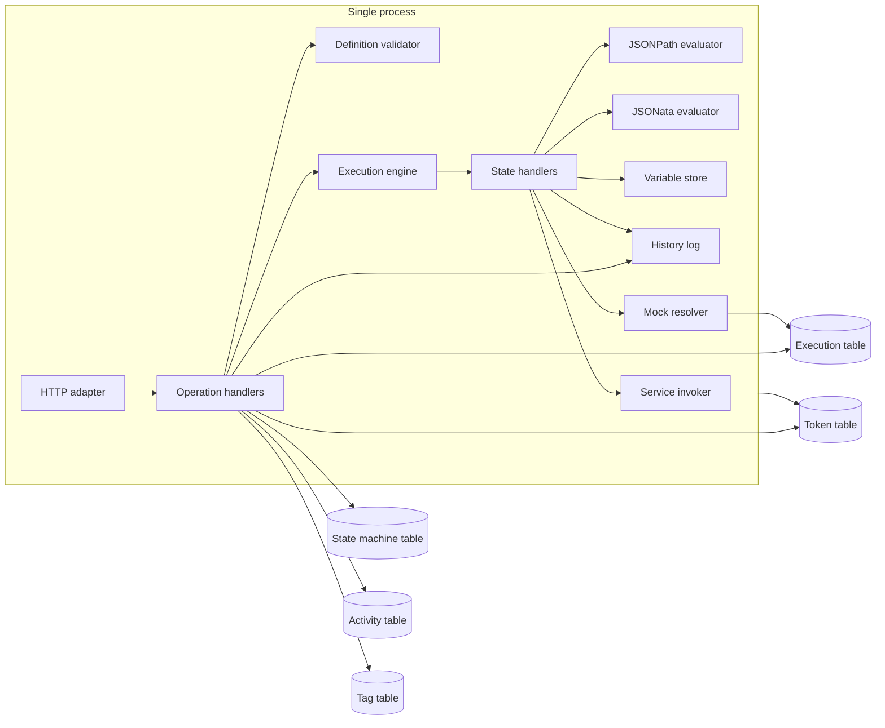

# Clean-room local AWS Step Functions server

| | |
|---|---|
| Author | TBD |
| Date | 2026-11-10 |
| Status | Draft |
| Audience | Senior engineers implementing the server in a language that is not yet chosen |
| Behavior oracle (JSONPath) | `amazon/aws-stepfunctions-local:2.0.0` (build date 2024-05-18, `StepFunctionsLocal.jar`) |
| Behavior oracle (JSONata, variables) | AWS Step Functions as documented on 2026-11-10. LocalStack is an offline stand-in only where a case is already known to match AWS. |
| License constraint | The image is under the AWS Customer Agreement (`LICENSE.txt` in the image). This server is original code that matches the external interface. It must not vendor, translate, or mechanically rewrite the decompiled Java. Class names below are citations of observed behavior, not a porting map. |

The implementation language is an open question. Go is the leading candidate, Rust is acceptable, Zig is a poor fit. This document does not use Go types, Go modules, or a Go repository layout. Where the language changes the estimate, that delta is in the effort table and in Appendix A.

---

## Overview

Developers need a local Step Functions control plane and interpreter, including `QueryLanguage: JSONata` and workflow variables. JSONata shipped in AWS Step Functions on 2024-11-22. The last Step Functions Local image, 2.0.0, does not implement it: a definition with top-level `QueryLanguage` is rejected at create time with HTTP 400 and `SCHEMA_VALIDATION_FAILED: Field 'QueryLanguage' is not supported at /`. The image is archived. It is about 1.9 GB because it reflects over the AWS SDK for Java v2 (`AwsSdkConnector` plus an 8 MB `service-list.json`). Patching that jar can recompile and run a literal Pass state, but it remains closed code and still rejects `QueryLanguage`.

This document specifies a clean-room process that speaks the same AWS JSON 1.0 HTTP interface as 2.0.0, runs the JSONPath state set the jar runs, and adds the JSONata and variable semantics AWS documents. Nothing is persisted. Executions, state machines, activities, tokens, and history live in process memory and are gone on exit.

The smallest useful release executes Pass, Succeed, and Fail. The jar-shaped release adds JSONPath data flow, Choice, Wait, mocked and Lambda tasks, Retry, Catch, Parallel, inline Map, the context object, and the eighteen intrinsic functions the jar implements. JSONata and variables run on that engine. Phase I adds the optimized integrations named in the service invoker section when their endpoint is set. The reflective SDK layer stays out.

A CreateStateMachine plus StartExecution of a Pass state with a literal `Result` was verified against a rebuilt 2.0.0 jar: status `SUCCEEDED`, output equal to that Result JSON.

---

## Background & Motivation

### Current state

2.0.0 is a single Jetty process. `Launcher` prints the version, calls `Config.readEnv`, then `parseArgs`, then starts the HTTP server. `HttpRequestHandlers` dispatches on `X-Amz-Target`. Twenty-three operations are registered in `RequestHandlers`. The ASL validator is `WorkflowValidator`, driven by the resource `com/amazonaws/awl/validator/rule/validatorRule.json`. The interpreter is `StateMachineExecutor` plus one executor per state type. JSONPath is Jayway JsonPath. Intrinsics are a separate grammar (`intrinsic_function.jj`) evaluated by `ParserUtils`, not JSONata. `JsonPathValue` already tokenizes `$name` as a variable reference distinct from `$.path` and `$$`, but nothing in 2.0.0 assigns variables.

### Pain

- Local JSONata workflows cannot be run against the archived image.
- The image cannot be maintained. A private fork of the decompiled jar would be a derivative of closed code and would still be tied to the Java SDK reflection layer.
- The reflection layer makes the process large, surprising (any API in the SDK model can be invoked), and the wrong place to add an expression language.
- LocalStack already runs JSONata, but it is a different product with a different compatibility surface. Teams that pin the Step Functions Local port, error `__type` strings, mock file, and `WAIT_TIME_SCALE` still need this interface.

### What this server is for

Drop-in replacement for clients that already point `aws stepfunctions --endpoint-url http://127.0.0.1:8083` at 2.0.0, plus definitions those clients cannot create today because of `QueryLanguage`.

---

## Goals & Non-Goals

### Goals

1. Match the 2.0.0 wire protocol, the 23 operation names, the error `__type` strings, ARN shapes, and the JSONPath evaluation order closely enough that the same definition and input produce the same status, the same output JSON, and the same history event-type sequence as the jar.
2. Accept and run `QueryLanguage` `JSONPath` and `JSONata` per the AWS docs cited in References, including `Assign`, `$states`, and variable scope.
3. Keep every phase independently runnable and testable.
4. Stay language-neutral. Expression engines are specified by behavior, not by a host type.
5. Refuse, at execution time and with a clear error, any service call that is not a mock, a configured direct Lambda Invoke, a Phase I integration whose endpoint is set, or an `aws-sdk:` action that `internal/sdk` runs and whose endpoint is set, once the definition has passed validation. Create-time checks still reject what the jar rejects: EXPRESS activity, `.sync`, and `.waitForTaskToken` resources, and a registered `arn:aws:states:::` connector that omits `Parameters`. Resources that pass those checks and are not implemented fail at execution.
6. Bind the control plane in a way that matches the jar's default listen address, and ship a bind-address flag so operators can restrict it.

### Non-goals

- Persistence, clustering, or durability across process restart.
- SigV4. Credentials are not required to call the local API.
- Inventing jar behavior for `TestState`, `ValidateStateMachineDefinition`, `RedriveExecution`, `PublishStateMachineVersion`, aliases, and versions. The jar returns these as absent. `--compat=sfn-local` still returns `UnsupportedOperation` for that set, except `TestState`. The default profile implements validate, versions, aliases, and `RedriveExecution`. Do not invent jar fixtures for them.
- Parquet and Athena manifest input to `ItemReader`. Distributed Map runs, and so does Map Run redrive. See Distributed Map.
- The reflective `AwsSdkConnector` path and `service-list.json`.
- Batch, ECS, Glue, SageMaker, Athena, EKS, DataBrew, API Gateway, EMR on EKS, and the reflective SDK layer. `arn:aws:states:::aws-sdk:` tasks run through hand-written tables over the AWS SDK for Go v2 instead. See the service invoker. Phase I runs Lambda `arn:aws:states:::lambda:invoke`, SQS `sendMessage`, SNS `publish`, DynamoDB `getItem`, `putItem`, `updateItem`, `deleteItem`, EventBridge `putEvents`, and nested `states:startExecution` (including `.sync` and `.sync:2` on that resource) when the matching endpoint is set. `.waitForTaskToken` is Phase 5, not Phase 3.
- CloudWatch log delivery. The logging-configuration field is accepted and validated. It is not shipped anywhere.
- Copying jar bugs that mislead the CLI, except where an oracle test would otherwise be unsatisfiable. Each such bug is called out. The normative behavior is the corrected one unless a test says otherwise.
- JSONPath variable assignment before the variables phase. `JsonPathValue` recognizing `$name` is not a reason to implement it early.

---

## Proposed Design

### Components and data ownership



| Component | Owns | Does not own |
|---|---|---|
| HTTP adapter | Socket, header parse, JSON codec, error envelope, access log line | Business rules |
| Operation handlers | Request validation, ARN checks, status codes | How a state runs |
| Definition validator | ASL accepted at Create and Update, per query language | Runtime values |
| State machine table | Definitions, name, type, role, status, dates, logging configuration | Executions |
| Execution table | Status, input, output, dates, link to the definition snapshot used at start | History bytes |
| Execution engine | One sequential state loop per execution, timeouts, stop | HTTP threads |
| State handlers | Per-type steps and the history events those steps emit | The variable map of another execution |
| JSONPath evaluator | Paths, payload templates, intrinsics | JSONata, variable writes before the variables phase |
| JSONata evaluator | `` expressions, `$states`, Step Functions functions, the ban on `$eval` | JSONPath `.$` keys |
| Variable store | Per-execution scope tree. Child scopes for inline Map iterations and Parallel branches | Sibling scopes |
| History log | Append-only event list per execution ARN | Metrics |
| Mock resolver | Parsed mock file, keyed by state-machine name plus test-case name | How a Task is scheduled |
| Service invoker | Direct Lambda Invoke, and the Phase I optimized calls when that service's endpoint is set | Arbitrary URLs taken from ASL |
| Activity table | Activity name and ARN | Task tokens |
| Token table | Callback and activity tokens, queued work, heartbeat and timeout deadlines | State-machine definitions |
| Tag table | Up to 50 tags per state machine or activity | AWS tagging service |

There is no database. All six tables are in-memory maps guarded by the process lock described under Concurrency. A definition snapshot is copied onto the execution at `StartExecution`. A later `UpdateStateMachine` does not change executions that have already started.

### Process configuration

`Config` maps each setting to a short flag, a long flag, and an environment variable. `Launcher` reads the environment first and then parses flags, so a flag overrides the environment. Invalid arguments print help and exit 1. `-h`/`--help` and `-v`/`--version` print and exit 0. The jar also prints the version banner on every startup before parsing flags. Do that: one version line on start, and a second print-and-exit when `-v` is passed.

The 6-argument option constructor stores the environment name it is given. The 3-argument constructor derives names from the label: split on whitespace, short name is the first word reduced to a leading-lowercase stem plus the remaining words unchanged, long name is the words lowercased and joined by `-`, environment name is the words uppercased and joined by `_`. Confirmed from `ConfigOption`.

| Setting | Default | Short | Long | Environment | Notes |
|---|---|---|---|---|---|
| Account | `123456789012` | `-account` | `--aws-account` | `AWS_ACCOUNT_ID` | Not a real account. Used only inside ARNs. |
| Region | `us-east-1` | `-region` | `--aws-region` | `AWS_DEFAULT_REGION` | |
| Global region | `aws-global` | `-gr` | `--aws-global-region` | `AWS_DEFAULT_GLOBAL_REGION` | Stored. Unused until a global service integration exists. |
| Help | | `-h` | `--help` | none | No argument. Exit 0. |
| Version | | `-v` | `--version` | none | No argument. Exit 0. |
| Lambda endpoint | empty | `-lambdaEndpoint` | `--lambda-endpoint` | `LAMBDA_ENDPOINT` | |
| Batch | empty | `-batchEndpoint` | `--batch-endpoint` | `BATCH_ENDPOINT` | |
| DynamoDB | empty | `-dynamoDBEndpoint` | `--dynamodb-endpoint` | `DYNAMODB_ENDPOINT` | Short name keeps the `DB` capitals. |
| ECS | empty | `-ecsEndpoint` | `--ecs-endpoint` | `ECS_ENDPOINT` | |
| Glue | empty | `-glueEndpoint` | `--glue-endpoint` | `GLUE_ENDPOINT` | |
| SageMaker | empty | `-sageMakerEndpoint` | `--sagemaker-endpoint` | `SAGEMAKER_ENDPOINT` | |
| SQS | empty | `-sqsEndpoint` | `--sqs-endpoint` | `SQS_ENDPOINT` | |
| SNS | empty | `-snsEndpoint` | `--sns-endpoint` | `SNS_ENDPOINT` | |
| Step Functions | empty | `-stepFunctionsEndpoint` | `--step-functions-endpoint` | `STEP_FUNCTIONS_ENDPOINT` | Map key inside the jar is `sfn`. The environment name is **not** `SFN_ENDPOINT`. |
| Athena | empty | `-stepFunctionsAthena` | `--step-functions-athena` | `STEP_FUNCTIONS_ATHENA` | Label is `Step Functions Athena`, not `Athena Endpoint`. |
| EKS | empty | `-stepFunctionsEKS` | `--step-functions-eks` | `STEP_FUNCTIONS_EKS` | |
| DataBrew | empty | `-stepFunctionsDataBrew` | `--step-functions-databrew` | `STEP_FUNCTIONS_DATABREW` | |
| API Gateway | empty | `-apiGatewayEndpoint` | `--api-gateway-endpoint` | `API_GATEWAY_ENDPOINT` | See the jar bug below. |
| EventBridge | empty | `-eventBridgeEndpoint` | `--eventbridge-endpoint` | `EVENTBRIDGE_ENDPOINT` | See the jar bug below. |
| EMR on EKS | empty | `-emronEKSEndpoint` | `--emr-on-eks-endpoint` | `EMR_ON_EKS_ENDPOINT` | Short name is `emr` plus `on` plus `EKS` plus `Endpoint`. |
| aws-sdk endpoint | empty | `--aws-endpoint-url` | `--aws-endpoint-url` | `AWS_ENDPOINT_URL` | New flag. Shared by every `aws-sdk:` service. `AWS_ENDPOINT_URL_<SERVICE>`, such as `AWS_ENDPOINT_URL_S3`, overrides it for one service. Both names are the AWS SDK convention. |
| Wait scale | unset | `-waitTimeScale` | `--wait-time-scale` | `WAIT_TIME_SCALE` | Unset means no scaling. |
| Port | `8083` | `-port` | `--port` | `PORT` | Confirmed. The 3-argument constructor uppercases words joined by `_`. |
| Bind address | `0.0.0.0` | `-bindAddress` | `--bind-address` | `BIND_ADDRESS` | New flag. The jar has no equivalent. See Security. |
| Mock file | `./MockConfigFile.json` | none in the jar | none in the jar | `SFN_MOCK_CONFIG` | Read by `MockDataRepo`, not by `Config`. |

**Jar bug, API Gateway and EventBridge.** `Config` constructs both options and inserts them into the service-endpoint map (`apigateway`, `eventbridge`). Neither is placed in the `options` list that `parseArgs` and `readEnv` walk. On 2.0.0, `-apiGatewayEndpoint`, `--api-gateway-endpoint`, `API_GATEWAY_ENDPOINT`, and the EventBridge equivalents do nothing. This server accepts both, on the derived names above. Document the bug in the README so operators do not expect 2.0.0 to honor those variables.

**Wait scale.** `setWaitTimeScale` parses a float and stores `abs(value)`. `0.5` halves Wait durations, `0` skips them, `2` doubles them, `-2` is stored as `2`. A non-numeric value logs an error and leaves the scale unset. The scale applies to the Wait state's millisecond delay only. Retry `Thread.sleep` in the jar is not scaled. Match that: do not scale Retry, heartbeat, or task timeout. Scaling those is a possible later flag, not part of jar parity.

**Credentials.** Not required for the local API. The jar loads environment, then profile, then system properties, and on total failure logs `Failed to load credentials, default to dummy credentials...` and uses access key `abcd`, secret `1234`. Local endpoint calls still work. This server logs the same warning when no credentials are present. It does not invent a credential chain for services it does not call. Lambda Invoke uses the dummy credentials only if the configured endpoint requires them. Calls through the AWS SDK for Go v2 are signed with these credentials, because DynamoDB Local refuses a request without an `Authorization` header. Do not log the secret at info. The jar's success path logs the dummy key pair from `getProviderName`. Do not copy that log line.

**Startup order.** Environment, then flags. Then bind. Print `Starting server on port <port> with account <account>, region <region>` at info, matching the jar's useful line. Also print `Console at http://<host>:<port>/dashboard`. When the bind address is `0.0.0.0`, `::`, or empty, that host is `127.0.0.1`. An IPv6 bind address is bracketed.

### Wire protocol

- Listen on `BIND_ADDRESS:PORT`, default `0.0.0.0:8083`. The jar's `new Server(port)` binds all interfaces. This default matches that. The flag exists so operators can pass `127.0.0.1` without rebuilding.
- One API route. Any path accepts POST as AWS JSON 1.0. GET `/dashboard` and GET `/dashboard/` return the embedded console (`text/html; charset=utf-8`, `Cache-Control: no-store`). GET `/dashboard/assets/htmx.min.js` and GET `/dashboard/assets/tailwind.css` return the console assets. POST `/dashboard/stop` stops an execution from that page. Those responses are not access-logged. POST `/dashboard` stays AWS JSON. Every other method, and GET on any other path, is HTTP 400 `HTTP method must be POST`.
- Header name `X-Amz-Target` is matched case-insensitively (`x-amz-target` in `HttpRequestHandlers`). The operation is the substring after the first dot: `AWSStepFunctions.CreateStateMachine` yields `CreateStateMachine`. A missing header is HTTP 400 `__type` `com.amazonaws.swf.service.v2.model#MissingRequiredHeader`. A value with no dot is the same 400. The jar throws and returns HTTP 500 with an empty body. Do not copy the empty 500.
- An unknown operation is HTTP 500 `__type` `com.amazonaws.swf.service.v2.model#UnsupportedOperation`, message `Unsupported Operation: '<name>'`.
- Body is JSON, UTF-8. Empty body is `{}`. Unknown properties are ignored (`FAIL_ON_UNKNOWN_PROPERTIES` disabled). Trailing non-JSON after one value should fail validation. The ASL validator enables `FAIL_ON_TRAILING_TOKENS`; the HTTP mapper does not. For the HTTP body, accept a single JSON value and reject trailing tokens so a concatenated body cannot be silently truncated. Confirm against the jar only if a client depends on trailing junk being ignored. Mark that check as "confirm against the jar" if a compatibility test fails.
- Success is HTTP 200 and the result object as JSON.
- Response `Content-Type` is `application/json`. The jar sets it after writing the body. Clients key off the target header, not off `application/x-amz-json-1.0`.
- **Timestamps are Unix epoch seconds as a JSON number, not milliseconds.** `UnixTimestampSerializer` writes `date.getTime() / 1000.0`. A timestamp of 1_715_990_400_123 ms is the number `1715990400.123`. The AWS CLI's JSON 1.0 decoder accepts that number. Emitting milliseconds makes the CLI display dates centuries in the future. Tests compare numerically within 1 ms. Do not require a particular decimal formatting, but do not use scientific notation (`1.7E9`); write a plain JSON number.
- Log at info `<operation> => <request json>` and on success `<status> <operation> <= <response json>`. That is the jar's useful line. Also log one structured line per state transition (see Observability).

### Error catalog

HTTP errors use `{"__type":"...","message":"..."}`. Strings below are from `HttpError`. Status is 400 unless noted.

| Condition | `__type` | Message shape |
|---|---|---|
| ASL validation failed | `com.amazonaws.swf.service.v2.model#InvalidDefinition` | `Invalid State Machine Definition: '<problems>'`. Problems are joined as `'<ErrorCode>: <message> at <pointer>', `. `ErrorCode` includes `SCHEMA_VALIDATION_FAILED`. |
| Bad state-machine or execution or activity name | `com.amazonaws.swf.service.v2.model#InvalidName` | `Invalid Name: '<name>'` |
| Role ARN failed the IAM role pattern | `com.amazonaws.swf.service.v2.model#InvalidArn` | `Invalid Role Arn: '<arn>'` |
| Any other bad ARN | `com.amazonaws.swf.service.v2.model#InvalidArn` | `Invalid Arn: '<arn>'` |
| Duplicate state machine name | `com.amazonaws.swf.service.v2.model#StateMachineAlreadyExists` | `State Machine Already Exists: '<arn>'` |
| Unknown state machine | `com.amazonaws.swf.service.v2.model#StateMachineDoesNotExist` | `State Machine Does Not Exist: '<arn>'` |
| State machine status is `DELETING` | `com.amazonaws.swf.service.v2.model#StateMachineDeleting` | `State Machine is being deleted: '<arn>'` |
| Standard execution name already used with a different input, or already used by a terminal execution | `com.amazonaws.swf.service.v2.model#ExecutionAlreadyExists` | `Execution Already Exists: '<arn>'`. A second `StartExecution` with the same name, the same input string, and status still `RUNNING` is not this error. It returns the existing execution. |
| Unknown execution | `com.amazonaws.swf.service.v2.model#ExecutionDoesNotExist` | `Execution Does Not Exist: '<arn>'` |
| Input is not JSON or exceeds 256 KiB | `com.amazonaws.swf.service.v2.model#InvalidExecutionInput` | `Invalid State Machine Execution Input: '<parser message>'` for bad JSON. Oversize uses `ValidationException` below. |
| `StartSyncExecution` on a STANDARD machine | `com.amazonaws.swf.service.v2.model#StateMachineTypeNotSupported` | `State Machine Type Not Supported: 'StartSyncExecution is not supported for STANDARD State Machines'` |
| `ListExecutions` on an EXPRESS machine | `com.amazonaws.swf.service.v2.model#InvalidParameterValue` | `This operation is not supported by this type of state machine`. Jar parity. |
| Bean constraint (`maxResults`, `type`, lengths) | `com.amazon.coral.validate#ValidationException` | `1 validation error detected: Value '<value>' at '<field>' failed to satisfy constraint: <constraint>` or the null-value variant without quotes around the value. |
| Bad task token | `com.amazonaws.swf.service.v2.model#InvalidToken` | `Invalid Token: '<token>'` |
| Unknown activity | `com.amazonaws.swf.service.v2.model#ActivityDoesNotExist` | `Activity Does Not Exist: '<arn>'` |
| `SendTaskSuccess` / `SendTaskFailure` / `SendTaskHeartbeat` on a token whose task already timed out | `com.amazonaws.swf.service.v2.model#TaskTimedOut` | `Task Timed Out: '<resource>'`. Captured from `amazon/aws-stepfunctions-local:2.0.0`. The quoted argument is the activity ARN, or a callback resource with an empty region and account filled in, so `arn:aws:states:::sqs:sendMessage.waitForTaskToken` becomes `arn:aws:states:<region>:<account>:sqs:sendMessage.waitForTaskToken`. `SendTaskSuccess`, `SendTaskFailure`, and `SendTaskHeartbeat` use that same message. The default profile of this server emits `com.amazonaws.sfn#TaskTimedOut` and that message. A token that already succeeded, failed, or was stopped is `TaskDoesNotExist` here. The jar returns the same `TaskTimedOut` message for those. An unknown token stays `Invalid Token: '<token>'`. |
| Missing `X-Amz-Target` | `com.amazonaws.swf.service.v2.model#MissingRequiredHeader` | `Missing Required Header: '<header>'` |
| More than 50 tags | `com.amazonaws.swf.service.v2.model#TooManyTags` | `Too many tags provided.` |
| Bad tag or other parameter | `com.amazonaws.swf.service.v2.model#InvalidParameterValue` | The handler's message, not a fixed prefix. A tag key or value whose length is outside 1..128 or 0..256 uses the jar's hardcoded text `Member must have length less than or equal to 80`, including when the real limit is 128 or 256 and when the key is empty. Do not substitute the real limit into that sentence. Jar parity. |
| Bad EXPRESS logging configuration | `com.amazonaws.services.stepfunctions.model.InvalidLoggingConfigurationException` | `Invalid Logging Configuration: '<message>'` |
| Unknown operation | `com.amazonaws.swf.service.v2.model#UnsupportedOperation` | `Unsupported Operation: '<operation>'`, **HTTP 500** |
| `StartSyncExecution` ARN containing `#` | `com.amazonaws.swf.service.v2.model#UnsupportedOperation` | `Unsupported Operation: 'Service integration mocking is not supported for the StartSyncExecution operation.'`, HTTP 500 |
| Resource not found (tag path) | `com.amazonaws.services.stepfunctions.model.#ResourceNotFound` | `Resource not found: '<resource>'`. The extra dot before `#` is what `HttpError.resourceNotFound` emits. Preserve it. |

Uncaught exceptions in the jar become HTTP 500 with **no** JSON body. For defects, log the stack and return HTTP 500 with `__type` `com.amazonaws.swf.service.v2.model#InternalFailure` and a message that does not include the stack. That `__type` is **not** in `HttpError`. Mark it "not emitted by 2.0.0; added so clients do not see an empty body." Do not use it for client errors.

Runtime failures inside an execution are not HTTP errors. They end the execution with `status: FAILED` and an error name. Names the interpreter must produce:

| Error name | When |
|---|---|
| `States.Runtime` | Path failure, no Choice match and no Default, bad ARN at scheduling time, intrinsic failure, mock-file shape errors while a task runs, history overflow, deleted state machine (`Cause`: `The state machine has been deleted.`) |
| `States.DataLimitExceeded` | Effective parameters or state output larger than 262144 UTF-8 bytes. Lambda payload over the same limit. |
| `States.Timeout` | Task, activity, heartbeat, or execution deadline. Cause may be null for a Lambda timeout. |
| `States.ReferencePathConflict` | Result injection would overwrite a non-array with an array, or the reverse. The jar raises this name from the reference-path conflict helper. Use it for that case. |
| `States.TaskFailed` | Not emitted as a primary error. It is a **matcher**: in `ErrorHandlingPolicy.shouldHandleError` it matches every error name except `States.Timeout`. |
| `States.ALL` | Matcher only. At runtime it matches every error name. At create time `ErrorEquals` must be exactly `["States.ALL"]`, and that Retry or Catch object must be the last entry of its array. Otherwise `SCHEMA_VALIDATION_FAILED` with `States.ALL must appear alone and at end of list` (`StateValidator`). A later retrier or catcher after a `States.ALL` entry is rejected. |
| `Lambda.Unknown` | Lambda `FunctionError` whose payload has no `errorType`. |
| `Lambda.<exception>` | Transport failure. The jar uses `Lambda.` plus the exception class simple name. For this server use `Lambda.ServiceException` for a non-2xx or connection failure against `LAMBDA_ENDPOINT`, and put the detail in `Cause`. Do not leak raw exception class names from the host language. |
| `States.QueryEvaluationError` | JSONata only. Not in the jar. Type error, range error, undefined result, evaluation over 1 second, memory limit, stack limit. |
| Fail state's `Error` | Whatever the definition set. May be null if both `Error` and `ErrorPath` are omitted. The jar allows that. |

`States.HeartbeatTimeout` is not a distinct name in 2.0.0 activity timeout events; those events use `States.Timeout`. Phase 5 matches the jar (`States.Timeout`) unless an AWS oracle test for heartbeat is added later. Do not invent `States.BranchFailed` or `States.NoChoiceMatched` for the JSONPath oracle. No-choice is `States.Runtime` with cause containing `Failed to transition out of the state`.

### Operations

All 23. Names are the simple handler names: `CreateActivity`, `CreateStateMachine`, `DeleteActivity`, `DeleteStateMachine`, `DescribeActivity`, `DescribeExecution`, `DescribeStateMachine`, `DescribeStateMachineForExecution`, `GetActivityTask`, `GetExecutionHistory`, `ListActivities`, `ListExecutions`, `ListStateMachines`, `ListTagsForResource`, `SendTaskFailure`, `SendTaskHeartbeat`, `SendTaskSuccess`, `StartExecution`, `StartSyncExecution`, `StopExecution`, `TagResource`, `UntagResource`, `UpdateStateMachine`.

Not registered on the jar, and returned as `UnsupportedOperation` by `--compat=sfn-local`: `ValidateStateMachineDefinition`, `RedriveExecution`, `PublishStateMachineVersion`, alias and version operations. `TestState` is implemented in both profiles. The default profile implements validate, versions, aliases, and `RedriveExecution`.

`RedriveExecution` resumes a failed, aborted, or timed-out STANDARD execution from the history this server stored. It appends `ExecutionRedriven`, increments `RedriveCount`, and continues at the outermost state that was entered and not exited, using that state's entered input. States that already exited are not run again. A Task there resumes in place, as on AWS: no new `TaskStateEntered`, and the first event after `ExecutionRedriven` has the original entered event as its `previousEventId`. An inline Map or Parallel that is still open runs again as a whole, entered again. A Distributed Map whose Map Run failed resumes that run instead. See Distributed Map. A retry while that redrive is `RUNNING` returns the same `redriveDate` when the client token matches, and `ExecutionNotRedrivable` when it does not. EXPRESS, `SUCCEEDED`, and an original `RUNNING` execution return `ExecutionNotRedrivable`. `DescribeExecution` returns `redriveStatus`: `REDRIVABLE`, `NOT_REDRIVABLE` with `redriveStatusReason` (the same reason `RedriveExecution` would refuse with, or `State machine is in DELETING status`), or `REDRIVABLE_BY_MAP_RUN` for an unsuccessful Map Run child. The JSONPath context still omits `RedriveCount`. The JSONata context reports the stored count. Variable values and mock attempt counters from the failed run stay in memory for the redrive. Do not invent jar fixtures for this operation.

#### Names, ARNs, pagination

- Name length 1..80. Empty is rejected. A name is also rejected when it fully matches `Validation.INVALID_NAME_PATTERN`. Publish that pattern, do not restate it as a prose character list (a backtick inside an inline span made the old list ambiguous). The pattern is a full-string match of:

```text
.*[\s<>"#%{}\\^|~\[\]`$&,;:/?*\u0000-\u001f\u007f-\u009f]+.*
```

  Inside the brackets, `\\` is one backslash character and `\s` is whitespace. The class also contains `&`, the backtick, U+0000 through U+001F, and U+007F through U+009F. Jar parity.
- State machine ARN: `arn:aws:states:<region>:<account>:stateMachine:<name>`.
- Standard execution ARN: `arn:aws:states:<region>:<account>:execution:<stateMachineName>:<executionName>`.
- Express execution ARN uses the resource type `express` instead of `execution`: `arn:aws:states:<region>:<account>:express:<stateMachineName>:<executionName>`.
- Activity ARN: `arn:aws:states:<region>:<account>:activity:<name>`.
- Region and account in ARNs this server **creates** are the configured values. Lookup is exact string match on the ARN. A client that sends a different region gets `StateMachineDoesNotExist` or `InvalidArn` according to the pattern check. The state-machine pattern allows any region and any 12-digit account, then the map lookup fails closed.
- `#` in a state-machine ARN is the mock test-case suffix, not part of the name. At most one `#`. Zero hashes means no mock. The suffix is stripped before lookup (`ArnUtils.getStateMachineArnFromInput`, `ExecutionInitiator.getTestNameFromInputIfPresent`). The execution **name** is not the test name.
- `roleArn` is optional. If present it must match `Validation.ROLE_ARN_PATTERN` exactly:

```text
arn:[\w-]+:iam::\d{12}:role((/)|(/[!-\u007f]+/))[\w+=,.@-]+
```

  `\w` is ASCII `[A-Za-z0-9_]`. The path alternative allows `arn:aws:iam::123456789012:role/service-role/MyRole`. The earlier expression without that alternative is wrong and must not be implemented. If the role is absent, log a warning and continue. AWS itself requires it. Local does not. Jar parity.
- `type` omitted means `STANDARD`. Allowed values `STANDARD` and `EXPRESS` only.
- List operations default `maxResults` to 100. Legal range 0..1000. `nextToken` is the decimal index to skip, not an opaque cursor. A token that does not parse as an integer, is longer than 1024 characters, or is `>=` the collection size is `InvalidToken`. `ListExecutions` on a STANDARD machine sorts by start date descending and filters by `statusFilter` and `redriveFilter` when set. `REDRIVEN` is a redrive count above 0. `ListExecutions` on an EXPRESS machine is `InvalidParameterValue` with message `This operation is not supported by this type of state machine`, before any sort. Jar parity. `GetExecutionHistory` defaults `includeExecutionData` to true (`false` only when the caller sends boolean false). `reverseOrder` true sorts by event id descending.
- Tags: at most 50 per resource. Key length 1..128, value length 0..256, charset Unicode letters, digits, whitespace, or `_.:/=+-@`. `TagResource` and `UntagResource` and `ListTagsForResource` accept a state-machine ARN or an activity ARN.
- `DeleteStateMachine` on an unknown ARN still returns `{}`. It does not return `StateMachineDoesNotExist`. When the ARN exists, set status `DELETING` and return `{}`. Do not remove the row in the request. Jar parity.
- The deleting sweep runs every 1 second. On each pass, for every machine whose status is `DELETING`, drop every execution that is not `RUNNING`, and drop that execution's future and history, immediately. Drop the state machine and its tags only when no execution of that machine is `RUNNING`. A terminal row does not wait for the last running sibling. Running executions notice `DELETING` at the next state boundary and stop with `States.Runtime` / `The state machine has been deleted.` The sweep itself does not abort them. EXPRESS executions are not in the map this scan uses, so an in-flight `StartSyncExecution` does not keep an EXPRESS machine alive. Jar parity.
- `CreateStateMachine` while the name still exists compares definition strings. A different definition is `StateMachineAlreadyExists`. The same definition re-tags and returns the existing ARN and the original `creationDate`. It does not set status back to `ACTIVE`. If the row was `DELETING`, it stays `DELETING`, and the sweep can still remove it. Jar parity.
- `StartExecution` idempotency for a STANDARD name: if that execution ARN exists, the input string is equal, and status is `RUNNING`, return the existing row with no error (same `executionArn`, original `startDate`). A different input, or any terminal status, is `ExecutionAlreadyExists`. Jar parity. This replaces the earlier blanket "every duplicate name is `ExecutionAlreadyExists`."
- `UpdateStateMachine` requires at least one of definition, role ARN, or logging configuration. Re-validate the definition against the machine's existing type. Return `updateDate`. The jar skips the write when the new definition string equals the stored one (`!curModel.getDefinition().equals(definition)`), which drops a same-definition role change if the client resends the definition. Do not copy that. Apply every provided field and set `updateDate`.
- `StopExecution` cancels the execution task, appends `ExecutionAborted`, sets status `ABORTED` and `stopDate`. Returns `stopDate`. Error and cause are length-checked (256 and 32768). Stopping an already-terminal execution still returns the existing `stopDate` and does not append a second terminal event.
- `StartSyncExecution` is EXPRESS only, rejects `#` in the ARN, starts the execution, and blocks the HTTP call until the execution finishes. The response is the describe shape plus `error`, `cause`, and `status`. `billingDetails` stays null. Do not hold the accept loop; block only that request's worker. EXPRESS history is discarded when the execution completes (`ExecutionHistoryRepo.addExecutionCompletedEvent` removes it). Standard history is kept until process exit or the deleting sweep. `GetExecutionHistory` on a finished EXPRESS execution therefore returns `ExecutionDoesNotExist` in the jar once the row is gone. Match that.
- `DescribeStateMachineForExecution` returns the state machine fields for the execution's state machine ARN.
- `DescribeStateMachine` returns `name`, `status`, `definition`, `creationDate`, `roleArn`, `stateMachineArn`, `type`, `loggingConfiguration`, and `revisionId`. A version ARN returns that version's snapshot, description, and revision. The jar omits `revisionId`. Oracle comparison ignores the extra field. Do not emit nulls for fields the handler never set if that is easy; the jar's HTTP mapper does emit null bean properties.

#### Create, start, describe shapes

Dates in the examples are illustrative seconds-since-epoch numbers.

`CreateStateMachine`

```json
POST /
X-Amz-Target: AWSStepFunctions.CreateStateMachine

{
  "name": "rebuild-check",
  "definition": "{\"StartAt\":\"P\",\"States\":{\"P\":{\"Type\":\"Pass\",\"Result\":{\"ok\":true},\"End\":true}}}",
  "roleArn": "arn:aws:iam::123456789012:role/local"
}
```

```json
HTTP/1.1 200
Content-Type: application/json

{"stateMachineArn":"arn:aws:states:us-east-1:123456789012:stateMachine:rebuild-check","creationDate":1762771200.123}
```

`StartExecution`

```json
{
  "stateMachineArn": "arn:aws:states:us-east-1:123456789012:stateMachine:rebuild-check",
  "name": "run1",
  "input": "{\"n\":1}"
}
```

```json
{"executionArn":"arn:aws:states:us-east-1:123456789012:execution:rebuild-check:run1","startDate":1762771201.456}
```

If `name` is omitted, generate a UUID. If `input` is omitted, use `{}`. Input must be JSON and at most 262144 UTF-8 bytes.

`DescribeExecution` after the Pass above:

```json
{
  "executionArn": "arn:aws:states:us-east-1:123456789012:execution:rebuild-check:run1",
  "input": "{\"n\":1}",
  "inputDetails": {"included": true},
  "name": "run1",
  "output": "{\"ok\":true}",
  "outputDetails": {"included": true},
  "startDate": 1762771201.456,
  "stateMachineArn": "arn:aws:states:us-east-1:123456789012:stateMachine:rebuild-check",
  "status": "SUCCEEDED",
  "stopDate": 1762771201.480
}
```

`output` and `outputDetails` are present once status is `SUCCEEDED`. While `RUNNING`, `output` is null and `outputDetails` is absent. A failed execution's `DescribeExecution` has `error` and `cause`, and every `DescribeExecution` has `redriveCount`, 0 included, as the AWS recordings show. The jar's handler copies neither, so `--compat=sfn-local` leaves out `error`, `cause`, `redriveCount` when 0, `redriveStatus`, and `redriveStatusReason`. Marked "confirm against the jar" only for whether a null `output` key is present while running. Compare status and output JSON, not key absence of nulls.

`StartExecution` returns as soon as the execution row exists and the worker is queued. It does not wait for SUCCEEDED. `StartSyncExecution` does.

### In-memory data model

No persistence. Document that in the binary's help text.

**State machine.** ARN, name, definition string (the original text, not a re-serialized form), type (`STANDARD` or `EXPRESS`), role ARN or null, status (`ACTIVE` or `DELETING`), creation date, update date or null, logging configuration or null. Identity is the ARN.

**Execution.** ARN, name, state-machine ARN, a snapshot of the definition (so update does not race the runner), role ARN, input string, output string or null, status `RUNNING | SUCCEEDED | FAILED | TIMED_OUT | ABORTED`, start date, stop date or null, Retry backoff counters (`numOfRetries`, cleared on transition to another state), per-state mock attempt counters (not cleared on transition; see Mock file), optional mock map, variable store (empty until an `Assign` commits). EXPRESS and STANDARD share the struct. EXPRESS history is dropped at completion. The jar keeps EXPRESS completion on a queue, not in the standard execution map that `getExecutionsForStateMachine` scans. Implement whichever structure is simpler, with two jar-parity constraints. `DescribeExecution`, `GetExecutionHistory`, `StopExecution`, and `DescribeStateMachineForExecution` call the standard-execution ARN check. That check is not "resource type is `express`." It matches the literal pattern `arn:aws:states:[a-z0-9-]+:[0-9]{12}:express:stateMachineName:.*` first. Only an ARN that contains the placeholder token `express:stateMachineName:` gets `Invalid Arn: 'Resource type not valid in this context: express'`. A real express ARN such as `arn:aws:states:us-east-1:123456789012:express:rebuild-check:run1` matches neither that pattern nor `arn:aws:states:[a-z0-9-]+:[0-9]{12}:execution:.*?:.*`, so the message is `Invalid Arn: '<the arn>'`. Do not clean this up. EXPRESS results are observed through `StartSyncExecution`.

**Activity.** ARN, name, creation date.

**Token.** Opaque string, activity or task ARN, execution ARN, state name, input JSON, status (`scheduled`, `started`, `succeeded`, `failed`, `timed_out`), worker name or null, output or error. Activity tokens sit in a per-activity queue. `GetActivityTask` waits up to 60 seconds (`TokenManager.DEFAULT_POLLING_TIMEOUT`) and returns `{}` if none arrives. The wait must not stall other connections.

**History.** Ordered list of events per execution ARN. Id is `size + 1`, starting at 1. `timestamp` is the wall clock when the event is appended. `previousEventId` of `ExecutionStarted` and of the event after it is 0. Every later event's `previousEventId` is the id of the event before it, except where this document names another event: the Distributed Map events, a redrive that resumes a state in place, and an aborted Map Run child. In the default profile, every event detail with `inputDetails` or `outputDetails` sets it to `{"truncated": false}`.

**Jar and AWS agree.** The jar's `addStateEnteredEvent` rewrites `previousEventId` from 1 to 0, so the first state-entered event does not point at `ExecutionStarted`. The AWS recordings show AWS does the same, so this server does too.

**Cap.** 25000 events. When 24999 events exist, the only event that may still be appended is a terminal one (`ExecutionSucceeded`, `ExecutionFailed`, `ExecutionAborted`, `ExecutionTimedOut`). Otherwise fail the execution with `States.Runtime` and cause `The execution reached the maximum number of history events (25000).`

**Tags.** Map from resource ARN to a list of `{key, value}`.

**Mock cache.** Held by the mock resolver, not by the state-machine table. Rebuilt when the file's SHA-256 changes.

### Concurrency

Language-neutral:

- The accept loop never runs a state. It validates, mutates a table under a short lock, enqueues work, and returns.
- One execution is one sequential state loop on a worker. The worker may block on Wait, Retry sleep, Lambda, or a token. That blocks only that execution.
- Map iterations and Parallel branches run concurrently, bounded by `MaxConcurrency` for Map. `MaxConcurrency` 0, the default in `MapStateDefinition`, means unbounded. Parallel has no bound other than the number of branches.
- Shared tables use one mutex per table, or a single process mutex if that is simpler. Event append is atomic. Variable commits are atomic per state. Iterations do not share a child scope.
- `GetActivityTask` parks the request on the activity queue for at most 60 seconds. `StartSyncExecution` parks that request until the EXPRESS execution completes or the 5-minute cap hits.
- Cancellation (`StopExecution`, delete, timeout) interrupts the worker. Wait and Retry sleep must be interruptible. A second terminal history event is rejected.
- Worker pool size is an implementation detail. A cached pool is acceptable. Do not run execution work on the HTTP thread.
- The deleting sweep is a single periodic task, period 1 second. It is not required to be a separate thread if the runtime has a timer wheel.

Timeouts:

- State machine `TimeoutSeconds` defaults to 99999999. Standard executions are capped at 365 days. EXPRESS executions are capped at 300 seconds. The deadline is armed when the execution starts (`ExecutionManager`).
- Task `TimeoutSeconds` / `TimeoutSecondsPath` null means the Lambda path waits up to the 365-day cap. A resolved path value must be an integer in `0..99999999`.
- Heartbeat is Phase 5. `HeartbeatSeconds` must be less than the task timeout when both are set. The jar checks the path form against the timeout. Do the same for the literal form in Phase 5.

### ASL accepted from the jar (JSONPath generation)

Source: `validatorRule.json` types and mixins, plus the Java defaults on the definition model. Unknown fields fail with `SCHEMA_VALIDATION_FAILED: Field '<name>' is not supported`.

State machine: `Comment`, `StartAt` (required), `TimeoutSeconds` integer `0..99999999`, `Version` string `"1.0"` only, `States` (required, non-empty). Omitted `Version` is treated as `"1.0"`. Omitted `TimeoutSeconds` is 99999999.

State `Type` is one of `Pass`, `Task`, `Choice`, `Wait`, `Succeed`, `Fail`, `Parallel`, `Map`.

Common fields from mixins:

| Mixin | Fields | Rule |
|---|---|---|
| `CommonStatesRules` | `InputPath`, `OutputPath`, `ResultPath` | Defaults `$`, `$`, `$`. Used by Pass, Task, Parallel, Map. |
| `InputAndOutputOnly` | `InputPath`, `OutputPath` | Choice, Wait, Succeed. No `ResultPath`. |
| `TransitionOrTerminalState` | `Next`, `End` | Exactly one. Choice and Fail and Succeed do not use this mixin. |
| `Commentable` | `Comment` | |
| `RetryCatch` | `Retry`, `Catch` | Task, Parallel, Map. |
| `TimeoutSecondsMixin` | `TimeoutSeconds`, `TimeoutSecondsPath` | At most one. Task only. |
| `HeartbeatSecondsMixin` | `HeartbeatSeconds`, `HeartbeatSecondsPath` | At most one. Task only. |
| `ParametersOrItemSelector` | `Parameters`, `ItemSelector` | At most one. Map only. |
| `IteratorOrItemProcessor` | `Iterator`, `ItemProcessor` | Exactly one. Map only. |
| `ErrorMixin` / `CauseMixin` | `Error` or `ErrorPath`, `Cause` or `CausePath` | At most one of each pair. Fail only. |

Per type:

- **Pass.** `Result` (any JSON), `Parameters` (payload template). Neither is required.
- **Task.** `Resource` required. `Parameters`, `ResultSelector`, `Retry`, `Catch`, timeout, heartbeat.
- **Wait.** Exactly one of `Seconds` (`0..99999999`), `Timestamp` (ISO-8601 extended offset date-time; offset required, `Z` or `±hh:mm`; `2020-01-01T00:00:00+00:00` is valid), `SecondsPath`, `TimestampPath`.
- **Choice.** `Choices` required, non-empty. `Default` optional. No `End`. No top-level `Next`.
- **Succeed.** No transition fields. Input and output paths only.
- **Fail.** Error and cause mixins. No `Next`. Entering it fails the execution.
- **Parallel.** `Branches` required, non-empty. Each branch is `{StartAt, States, Comment?}`. `Parameters`, `ResultSelector`, `Retry`, `Catch`.
- **Map.** `ItemsPath` default `$`. `MaxConcurrency` integer `>= 0`, default `0` (unbounded). `Parameters` or `ItemSelector`. `Iterator` or `ItemProcessor`. `ResultSelector`, `Retry`, `Catch`.
- **ItemProcessor.** `StartAt`, `States`, optional `ProcessorConfig`, optional `Retry`. `ProcessorConfig.Mode` is `INLINE` or `DISTRIBUTED`. `DISTRIBUTED` requires `ExecutionType` `STANDARD` or `EXPRESS`, is refused in an EXPRESS machine, and validates the child as that type. `ExecutionType` with `INLINE` is refused. See Distributed Map for the fields only `DISTRIBUTED` accepts.
- **Retrier.** `ErrorEquals` required. `IntervalSeconds` default 1, range `0..99999999`. `MaxAttempts` default 3, range `0..99999999`. `BackoffRate` default 2.0, minimum 1.0. `MaxDelaySeconds` default 0 (no cap), if set range `1..31622400`. `JitterStrategy` `NONE` or `FULL`. Omitted means no jitter, same as `NONE`.
- **Catcher.** `ErrorEquals` required. `Next` required, must name a state in the same `States` object. `ResultPath` default `$`, and null is legal (discard the error object, keep the state input).
- **`States.ALL`.** On a retrier or a catcher, `ErrorEquals` may be exactly `["States.ALL"]` only when that object is the last element of its `Retry` or `Catch` array. Any other placement, including `States.ALL` beside another name, or a later entry after a `States.ALL` entry, is `SCHEMA_VALIDATION_FAILED` / `States.ALL must appear alone and at end of list`. Phase 0b locks that message.

Choice rule, JSONPath. `Variable` and `Next` required on a top-level comparison, plus exactly one comparator. Comparators from `ChoiceMixin`:

`StringEquals`, `StringLessThan`, `StringGreaterThan`, `StringLessThanEquals`, `StringGreaterThanEquals`, `NumericEquals`, `NumericLessThan`, `NumericGreaterThan`, `NumericLessThanEquals`, `NumericGreaterThanEquals`, `BooleanEquals`, `TimestampEquals`, `TimestampLessThan`, `TimestampGreaterThan`, `TimestampLessThanEquals`, `TimestampGreaterThanEquals`, and the same names with a `Path` suffix, plus `StringMatches`, `IsNull`, `IsPresent`, `IsNumeric`, `IsString`, `IsBoolean`, `IsTimestamp`.

`And` and `Or` are non-empty arrays of nested rules. `Not` is one nested rule. Nested rules must not carry `Next`. `Next` exists only on the top-level rule. Rules are tried in order. First match wins.

`StringMatches` is a glob: `*` is the only wildcard, `\*` is a literal star, no other escapes (`StringMatcher`). String comparison is Unicode code-unit order, the same order as Java `String.compareTo`. Numeric comparison is IEEE-754 binary64. Do not promise exact integer comparison outside `[-2^53+1, 2^53-1]`. Timestamps compare as instants parsed with the same offset date-time rule as Wait. A timestamp-shaped string can also match `StringEquals`.

Comparison result, not a third behavior. The six `Is*` operators are type tests. Once the value is resolved, the comparison result is whether the predicate equals the boolean operand. Operand `false` is the complement: a failed predicate matches, and the rule's `Next` runs.

- `IsNull`: the value is JSON null. A present null with `true` matches. A present null with `false` does not. A present non-null value with `false` matches. A missing path is `States.Runtime`, not a false predicate.
- `IsPresent`: the path resolved. The JSON value at the path does not matter. This operator does not throw on a missing path. A missing path is predicate false, so `IsPresent: true` does not match and `IsPresent: false` does. A resolved path with operand `false` does not match.
- `IsNumeric`: the value is a number. `IsString`: the value is a string. `IsBoolean`: the value is a boolean. `IsString: false` on a number is true. `IsBoolean: false` on a non-boolean is true. `IsNumeric: false` on a non-number is true.
- `IsTimestamp`: the value is a string that parses as an ISO-8601 extended offset date-time (`Z` or `±hh:mm`), the same rule as Wait. A non-string, and a string that is not an offset date-time, are predicate false. `IsTimestamp: true` on `"nope"` does not match. `IsTimestamp: false` on `"nope"` matches. That is not `States.Runtime`.
- Value comparators are not type tests. A present value of the wrong JSON type is a failed comparison (false). It does not fail the state, and it is not the complement of the expected value. `StringEquals` on a number and `NumericEquals` on a string are false. `BooleanEquals` on a non-boolean is false for either expected boolean. `BooleanEquals` is not `IsBoolean`. Timestamp comparators (`TimestampEquals`, `TimestampLessThan`, `TimestampGreaterThan`, `TimestampLessThanEquals`, `TimestampGreaterThanEquals`, and the same names with a `Path` suffix) return false when the value is not a string or the string is not an offset date-time. They do not take the complement, and they do not raise `States.Runtime`.
- `And` returns false on the first false child and does not evaluate the rest. `Or` returns true on the first true child and does not evaluate the rest. `Not` evaluates its one child. A later missing path inside an `And` whose first child is false is not evaluated, so it does not fail the state.

Reference paths (`ResultPath`, `ItemsPath`, `Variable`, `*Path` fields) are a single node: `$`, `$.a.b`, `$[0]`, `$$.Execution.Id`. They are not general Jayway filters. Payload-template values (`Parameters`, `ResultSelector`, `ItemSelector`) are full JSONPath or one `States.*` intrinsic call.

**State-name scope.** Names are unique inside one `States` object. The same name may occur in a different branch or iterator. The jar's `WorkflowDefinition.build` flattens every branch into one map and can overwrite collisions. Do not copy that. Transition lookup uses the `States` object that contains the current state.

**Create-time checks beyond the field table.** These are jar parity. They narrow Goal 5. A resource that passes them and is not a mock, a direct Lambda invoke, an activity, `.waitForTaskToken`, or a Phase I integration whose endpoint is set, still fails at execution as an unsupported resource.

- `StartAt`, `Next`, Choice `Next`, Choice `Default`, and Catch `Next` must name a state in the **same** `States` object. A missing target is `MISSING_TRANSITION_TARGET` with message `Missing 'Next' target: <name>` (or `Missing transition pointer` when the field is null). An unreachable state is `MISSING_TRANSITION_TARGET` with `State "<name>" is not reachable.` A workflow with no Succeed, Fail, or `End: true` is `MISSING_END_STATE` / `Workflow has no terminal state`. The jar's name set is global across branches; this server keeps names per `States` object (Key Decision 22) and does not copy that global duplicate check.
- EXPRESS, at create, rejects an activity ARN (`Express state machine does not support Activity ARN`), a resource ending in `.sync` (`Express state machine does not support '.sync' service integration`), and a resource ending in `.waitForTaskToken` (`Express state machine does not support '.waitForTaskToken' service integration ` — the jar's message has a trailing space). Error code `SCHEMA_VALIDATION_FAILED`. STANDARD machines may contain those resources.
- A `states`-service ARN that 2.0.0's registry knows, with no `Parameters` on that state, is `SCHEMA_VALIDATION_FAILED` / `Parameters field is required for resource ARN: <arn>`. This server does not ship the registry or `service-list.json`. PR 2b checks in the resource strings the jar fixtures show as registered. An ARN not on that list does not require `Parameters`. A direct Lambda function ARN and an activity ARN do not require `Parameters`. The Lambda runtime pattern is not this create-time rule.
- Logging configuration is accepted and not written to disk. Null configuration is valid. A null level is stored as `OFF`. `OFF` with no destinations is valid. Any other level requires exactly one destination. More than one destination fails even when the level is `OFF`. The destination must include a CloudWatch log-group ARN that passes the general ARN pattern. Messages, jar parity: `Must specify exactly one Log Destination`, `Must set valid CloudWatch Log Group ARN`. The check runs for EXPRESS on create, and for every type on update when logging configuration is present. An unknown level string is HTTP 400 `InvalidLoggingConfiguration` naming the level. The jar instead throws outside `HttpError` and returns an empty HTTP 500. That empty body is not copied.
- `States.ALL` placement is the rule in the retrier section. The phase 0b fixture is a `Retry` whose first entry is `{"ErrorEquals":["States.ALL"],"MaxAttempts":1}` and whose second entry is `{"ErrorEquals":["States.Timeout"],"MaxAttempts":1}`. Create fails with `SCHEMA_VALIDATION_FAILED` and `States.ALL must appear alone and at end of list`. The same message is required for `Catch`, and for `ErrorEquals` that contains `States.ALL` next to another name.
- Tag length failures use the message in the error catalog (`Member must have length less than or equal to 80`) even though the limits are 1..128 and 0..256.

**Payload limits.** 262144 bytes UTF-8 on execution input, on the parameters document, and on the state output. Error name length 256. Cause length 32768. When truncating for a history event, keep the name within 256 characters and the cause within 32768, ellipsis allowed.

### Normative evaluation, JSONPath

This is the order `StateExecutor` and the per-type executors implement. History types are the `HistoryEventType` names the CLI prints.

```mermaid
sequenceDiagram
  participant Loop as Execution loop
  participant Hist as History log
  participant F as Data filter
  participant S as State handler
  Loop->>Hist: TypeStateEntered input
  Loop->>F: InputPath
  alt Parameters or ItemSelector
    Loop->>F: payload template
  end
  Loop->>S: action
  alt ResultSelector on Task Map Parallel
    S->>F: ResultSelector against raw result
  end
  S->>F: ResultPath into original input
  S->>F: OutputPath
  S->>Hist: TypeStateExited output
  Loop->>Loop: Next or terminal event
```

Shared steps:

1. Append `<Type>StateEntered`. Detail object `stateEnteredEventDetails`: `name`, `input` (the raw state input, before InputPath). For a STANDARD execution the input is always stored. EXPRESS stores it only when execution data is included. Local logging configuration does not strip it in this server unless we are matching an EXPRESS history line. Keep the input on the event. The CLI shows it.
2. `InputPath`. `$` is identity. `null` yields `{}`. A path under `$$` reads the context object with the leading `$` removed (`$$.Execution.Id` is `$.Execution.Id` against the context). Failure is `States.Runtime` and does not append an Exited event.
3. Payload template, if `Parameters` is set (Pass, Task, Parallel) or the Map iteration override (`Parameters` if set, else `ItemSelector`). A key ending in `.$` is a string whose value is a JSONPath (`$...` or `$$...`) or a `States.*` call. Any other key is a literal, recursed into. The `. $` key is replaced by the key without the suffix. Both `foo` and `foo.$` is a validation error. The value of a `.$` key must be a string. Result larger than 262144 bytes is `States.DataLimitExceeded` with the parameters cause.
4. Action, per type below.
5. `ResultSelector`, Task, Map, and Parallel only, interpolates against the raw result the same way as `Parameters`.
6. `ResultPath` injects that result into the **original** state input, not the filtered input. `$` replaces the input. `null` discards the result and keeps the original input. A reference path creates missing objects along the way only as far as the jar's `updateOutput` does: it must succeed for `$.a.b` when `a` exists. A type conflict is `States.ReferencePathConflict` or `States.Runtime`. Match the jar's message in the cause during Phase 2 tests; the error **name** for a path conflict that the helper classifies is `States.ReferencePathConflict`.
7. `OutputPath` filters the injected document. `null` yields `{}`. `$` is identity.
8. Oversize output is `States.DataLimitExceeded`.
9. Append `<Type>StateExited` with `stateExitedEventDetails.name` and `.output`.
10. If the result has no next state and status is success, append `ExecutionSucceeded` with `executionSucceededEventDetails.output` and mark `SUCCEEDED`. If the result is an error and no catcher took it, append `ExecutionFailed` with `error` and `cause` and mark `FAILED`. `Next` selects the next state. Its input is this state's output. On transition to another state, clear the Retry backoff counters (`numOfRetries`). Do not clear them between retry attempts of the same state. Do not clear the mock attempt counter. That counter is per state name for the life of the execution.

Terminal execution events also include `ExecutionStarted` (id 1, `previousEventId` 0, detail `input` and `roleArn`), `ExecutionAborted`, `ExecutionTimedOut` (`error` `States.Timeout`).

**Pass.** Compute the effective input (steps 2–3). If `Result` is present, the action result is that literal JSON and the effective input is discarded. `Result` is still only used after `Parameters` has been evaluated, so a bad `Parameters` path fails the state even when `Result` is set. If `Result` is absent, the action result is the effective input. Then steps 6–9. There is no `ResultSelector` on Pass. History: `PassStateEntered`, `PassStateExited`.

**Succeed.** Effective input is the action result. No `Parameters`. Then output filtering. The jar calls `getEffectiveOutput(effectiveInput)`, and `ResultPath` is not on this state. With default `OutputPath` `$`, the execution output is the state input after `InputPath`. History: `SucceedStateEntered`, `SucceedStateExited`, then `ExecutionSucceeded`.

**Fail.** Resolve `Error` or `ErrorPath`, then `Cause` or `CausePath`, against the filtered input. `ErrorPath` and `CausePath` must yield strings. No `FailStateExited`. The state-entered event is `FailStateEntered`. The execution event is `ExecutionFailed`. Status `FAILED`.

**Choice.** Effective input only. Evaluate rules in order against that input and the context object. `And`, `Or`, and `Not` short-circuit as specified above. For a value comparator, a wrong JSON type is a failed comparison, not a failed state. For an `Is*` test, the result is whether the predicate equals the boolean operand, including when that operand is false. On match, next is that rule's `Next`. Else `Default`. Else `States.Runtime`, cause containing `Failed to transition out of the state`. Output filtering treats the effective input as the result. History: `ChoiceStateEntered`, `ChoiceStateExited`.

**Wait.** Effective input. Compute a delay in milliseconds from the one time field, then scale. `Seconds` is an integer. Multiply it by 1000 as an integer **before** scaling. `Timestamp` is an ISO-8601 extended offset date-time (`DateTimeFormatter.ISO_OFFSET_DATE_TIME`): offset required, `Z` or `±hh:mm`. `2020-01-01T00:00:00Z` and `2020-01-01T00:00:00+00:00` are both valid. A value with no offset is `States.Runtime`. The unscaled delay is `max(0, timestamp - now)` in milliseconds. Paths read a number or a timestamp string and use the same conversion. If a wait scale is set, convert the millisecond delay to a 32-bit float, multiply by the 32-bit float scale, then cast to a 64-bit integer toward zero. A float64 multiply is a divergence and fails large-delay jar parity; the 0.5×1 second test does not show the difference. Sleep only if the scaled delay is `> 0`. Sleep is interruptible and is not on the accept thread. Retry sleep is not scaled. Output filtering uses the effective input as the result. History: `WaitStateEntered`, `WaitStateExited`. The jar does not emit a separate "wait started" event.

**Task.** Resolve the resource after the effective input is built.

- If this execution has a mock map and the state name is in it, return the mock (Phase 3). Do not call the network.
- Else if the resource matches `arn:aws:lambda:<region>:<account>:function:<name>` and `LAMBDA_ENDPOINT` is non-empty, Invoke (Phase 3).
- Else if the resource is a Phase I optimized integration and that integration's endpoint is non-empty, call it. `.sync` and `.sync:2` are accepted only on `arn:aws:states:::states:startExecution`. The contract is the service invoker section.
- Else fail the state at execution time with `States.Runtime` and a cause that includes the resource string and says the resource is not supported. The definition was already accepted. This replaces `AwsSdkConnector`.

Lambda history, in order: `TaskStateEntered`, `LambdaFunctionScheduled` (`resource`, `input`, `timeoutInSeconds`), `LambdaFunctionStarted`, then one of `LambdaFunctionSucceeded` (`output` is the raw payload), `LambdaFunctionFailed` (`error`, `cause`), or `LambdaFunctionTimedOut` (`error` `States.Timeout`). On success, `TaskStateExited`. On uncaught failure, no `TaskStateExited`; the execution fails or a catcher writes the exit (below). The state result of a successful direct function invoke is the response payload JSON, not the Invoke envelope. `FunctionError` uses the payload's `errorType` string as the error name, or `Lambda.Unknown`.

Optimized integration history uses the generic task names: `TaskStateEntered`, `TaskScheduled`, `TaskStarted`, then `TaskSucceeded`, `TaskFailed`, or `TaskTimedOut`. `arn:aws:states:::lambda:invoke` is this family, not the `LambdaFunction*` family. A direct function ARN stays on the Lambda event names, and its result stays the raw payload.

Mock history uses the same task events as the resource family being mocked. A mocked Lambda uses the Lambda event names. A mocked anything-else uses `TaskScheduled`, `TaskStarted`, `TaskSucceeded` / `TaskFailed` / `TaskTimedOut`. Phase 3 may emit the generic task events for every mock. That is allowed until Phase 4 history parity, and the acceptance test for Phase 3 compares status and output, not Lambda-versus-Task event names. Phase 4 tightens Lambda event names for real Invoke.

**Retry.** After a failed action, before any catcher: walk `Retry` in order. The first retrier whose `ErrorEquals` matches is used. Backoff for attempt `n` (1 on the first retry):

```
raw = IntervalSeconds * (BackoffRate ** (n - 1))
candidate = min(31622400, floor(raw))
if JitterStrategy is FULL: candidate = uniform_integer(0, candidate) inclusive
if MaxDelaySeconds > 0: candidate = min(candidate, MaxDelaySeconds)
if n > MaxAttempts: do not retry
```

Sleep `candidate` seconds, interruptible, not scaled by `WAIT_TIME_SCALE`. Do not append a new `StateEntered`. Increment the attempt counter used by mocks **after** the attempt, so the first attempt is mock key `"0"`. `MaxAttempts` 0 means no retry. The jar's `getNextRetryDelaySeconds` returns `-1` when `n > maxAttempts`, and the caller sleeps only when the value is `>= 0`. A computed delay of 0 retries immediately.

**Catch.** Walk `Catch` in order. On a match, build the error document `{"Error":"<name>","Cause":"<cause or empty string>"}`. Inject it with the catcher's `ResultPath` (default `$`) into the **original** state input. Append `<Type>StateExited` with that document as output. Transition to `Next`. The jar always appends `TaskStateExited` from `tryHandleCatch`, even for Map and Parallel. For a Task, match the jar. For Map and Parallel, append `MapStateExited` or `ParallelStateExited`. Document the divergence. Oracle tests for Catch on Task expect `TaskStateExited`.

**Parallel.** Append `ParallelStateEntered`, then `ParallelStateStarted`. Each branch receives the effective input (after `Parameters`) and runs its own state loop. Branches run concurrently. The branch result array is ordered by the `Branches` array, not by completion order. On first branch failure, cancel the other branches and append `ParallelStateFailed`. On all success, append `ParallelStateSucceeded`, apply `ResultSelector` and output filtering to the JSON array of branch outputs, append `ParallelStateExited`. The jar does not emit per-branch `ParallelBranch*` events beyond the state events above. Do not invent branch-entered events the jar does not write. Child state events are written on the same history list and will interleave. That interleaving is not stable. Conformance for Parallel compares the multiset of event types plus the final output, not a total order of branch-internal events, except that `ParallelStateStarted` precedes branch events and `ParallelStateSucceeded` precedes `ParallelStateExited`.

**Map.** Append `MapStateEntered`. Resolve `ItemsPath` to an array or fail. Append `MapStateStarted` with `mapStateStartedEventDetails.length`. For each index, if `Parameters` or `ItemSelector` is set, interpolate it as the iteration input; otherwise the iteration input is the array element. Context available to that interpolation includes `Map.Item.Index` and `Map.Item.Value`. Run the iterator or item processor as a nested state machine. Append `MapIterationStarted` with `index` and `name` (the Map state's name), then the inner events, then `MapIterationSucceeded`, `MapIterationFailed`, or `MapIterationAborted`. Bound in-flight iterations by `MaxConcurrency` (0 means unbounded). On all success, the raw result is a JSON array of iteration outputs in index order. Then `ResultSelector`, output filtering, `MapStateSucceeded`, `MapStateExited`. On failure, `MapStateFailed` or `MapStateAborted` and stop scheduling new iterations. Cancel queued ones.

**Jar gap, Map context.** `ExecutionContextProvider` attaches `Map` only when the current executor object is the Map executor. States **inside** the iterator therefore do not see `$$.Map` in 2.0.0. AWS does expose `Map.Item` inside the iteration. This server attaches `Map.Item.Index` and `Map.Item.Value` both to the Map state's own payload template and to every state executed inside that iteration. Oracle tests that read `$$.Map` from inside the iterator are compared to this spec, not to 2.0.0.

**Context object** built by `ExecutionContextProvider`. ISO-8601 instants (`DateTimeFormatter.ISO_INSTANT`), not epoch numbers.

```json
{
  "Execution": {
    "Id": "arn:aws:states:us-east-1:123456789012:execution:rebuild-check:run1",
    "Input": {},
    "Name": "run1",
    "RoleArn": "arn:aws:iam::123456789012:role/local",
    "StartTime": "2026-11-10T00:00:00.000Z"
  },
  "State": {
    "EnteredTime": "2026-11-10T00:00:00.010Z",
    "Name": "P",
    "RetryCount": 0
  },
  "StateMachine": {
    "Id": "arn:aws:states:us-east-1:123456789012:stateMachine:rebuild-check",
    "Name": "rebuild-check"
  }
}
```

`RetryCount` is present on Task, Parallel, and Map (the error-handled states). It is the number of retries already started for this visit, summed across retriers the way the jar sums `numOfRetries`. It is omitted on Pass, Choice, Wait, Succeed, and Fail. `RoleArn` is null when the machine has none; emit JSON `null`.

`Task` is added only for activity, `.waitForTaskToken`, `.sync`, and a mocked service task:

```json
"Task": {"Token": "<opaque>"}
```

A plain Lambda invoke does not get `Task`. Do not emit `RedriveCount` on this JSONPath context. It is not in `ExecutionContextProvider`. Adding it would change `$$` snapshots under the jar oracle.

`Map`, on the Map state and, in this server, inside the iteration:

```json
"Map": {"Item": {"Index": 0, "Value": {"n": 1}}}
```

#### History detail members

Conformance compares event types **and** these detail member names. It still ignores ids, `previousEventId`, and timestamps. Names are the AWS JSON 1.0 bean names (camelCase). Absent optional numbers are JSON null when the state did not set them, matching the jar's mapper. Do not require a member the table does not list.

| Event | Detail object | Members this server emits |
|---|---|---|
| `ExecutionStarted` | `executionStartedEventDetails` | `input`, `roleArn` |
| `ExecutionSucceeded` | `executionSucceededEventDetails` | `output` |
| `ExecutionFailed` | `executionFailedEventDetails` | `error`, `cause` |
| `ExecutionAborted` | `executionAbortedEventDetails` | `error`, `cause` |
| `ExecutionTimedOut` | `executionTimedOutEventDetails` | `error` (`States.Timeout`), `cause` when the runtime has one |
| `<Type>StateEntered` | `stateEnteredEventDetails` | `name`, `input` |
| `<Type>StateExited` | `stateExitedEventDetails` | `name`, `output` |
| `LambdaFunctionScheduled` | `lambdaFunctionScheduledEventDetails` | `resource`, `input`, `timeoutInSeconds` |
| `LambdaFunctionStarted` | none | |
| `LambdaFunctionSucceeded` | `lambdaFunctionSucceededEventDetails` | `output` |
| `LambdaFunctionFailed` | `lambdaFunctionFailedEventDetails` | `error`, `cause` |
| `LambdaFunctionTimedOut` | `lambdaFunctionTimedOutEventDetails` | `error` (`States.Timeout`) |
| `MapStateStarted` | `mapStateStartedEventDetails` | `length` |
| `MapIterationStarted`, `MapIterationSucceeded`, `MapIterationFailed`, `MapIterationAborted` | `mapIterationStartedEventDetails` and the matching `Succeeded` / `Failed` / `Aborted` detail | `index`, `name` (the Map state's name) |
| `MapStateSucceeded`, `MapStateFailed`, `MapStateAborted` | none | |
| `TaskScheduled` | `taskScheduledEventDetails` | `resource`, `resourceType`, `region`, `parameters`, `timeoutInSeconds`, `heartbeatInSeconds` |
| `TaskStarted` | `taskStartedEventDetails` | `resource`, `resourceType` |
| `TaskSubmitted` | `taskSubmittedEventDetails` | `resource`, `resourceType`, `output` |
| `TaskSucceeded` | `taskSucceededEventDetails` | `resource`, `resourceType`, `output` |
| `TaskFailed` | `taskFailedEventDetails` | `resource`, `resourceType`, `error`, `cause` |
| `TaskTimedOut` | `taskTimedOutEventDetails` | `resource`, `resourceType`, `error` (`States.Timeout`) |
| `ActivityScheduled` | `activityScheduledEventDetails` | `input`, `resource`, `timeoutInSeconds`, `heartbeatInSeconds` |
| `ActivityStarted` | `activityStartedEventDetails` | `workerName` |
| `ActivitySucceeded` | `activitySucceededEventDetails` | `output` |
| `ActivityFailed` | `activityFailedEventDetails` | `error`, `cause` |
| `ActivityTimedOut` | `activityTimedOutEventDetails` | `error` (`States.Timeout`) |

`ParallelStateStarted`, `ParallelStateSucceeded`, and `ParallelStateFailed` carry no detail object.

**Not emitted in v1.** Do not invent these, even though they sit on the jar's logging allow-list: `ParallelStateAborted`, `TaskStateAborted`, `WaitStateAborted`, `ActivityScheduleFailed`, `LambdaFunctionScheduleFailed`, `LambdaFunctionStartFailed`, `TaskStartFailed`. `MapStateAborted` and `MapIterationAborted` **are** emitted when a Map iteration is aborted (stop or a sibling failure). `TaskSubmitFailed` is emitted when `states:startExecution.sync` or `.sync:2` fails before the nested execution is accepted. A start that is accepted and then fails while polling appends `TaskFailed`. Stopping a Wait or a Parallel appends `ExecutionAborted`. It does not append `WaitStateAborted` or `ParallelStateAborted`.

### Intrinsic functions

The jar registers these eighteen, by the `name()` of each class under `com.amazonaws.asl.json.intrinsic.function`. The call text is `States.<Name>(...)`. They are legal in payload templates and in `.$` strings. They are not JSONata. Do not implement `$eval` here either. A bad call is `States.Runtime`. There is no `States.IntrinsicFailure`.

Where this list matches the jar, a Phase 4 diff against 2.0.0 includes the fixture. `States.ArrayUnique` order is the exception: see that row and Key Decisions. Do not re-open a row by reading the class.

**`States.Format(template, values...)`.** At least the template is required. Walk the template left to right. A backslash escapes the next character, which is copied as itself, so `\{` is a literal `{` and `\\` is a literal backslash. A trailing backslash is consumed and does not appear. `{` must be followed immediately by `}`; that pair inserts the next value. A bare `}` fails. The number of `{}` pairs must equal the number of values. Inserted strings are their characters, numbers their decimal text, booleans `true` or `false`, null `null`. Fixture: `States.Format('id={}', 'A')` is `id=A`. `States.Format('\\{\\}')` is `{}`. `States.Format('a\\')` is `a`. `States.Format('{}')` and `States.Format('{')` fail.

**`States.StringToJson(text)`.** One string. Parses one JSON value. Invalid JSON fails. Fixture: `States.StringToJson('{"a":1}')` is `{"a":1}`.

**`States.JsonToString(value)`.** One value, any JSON. Compact JSON text. Object key order is the value's order. Fixture: `States.JsonToString({"a":1})` is `{"a":1}`.

**`States.Array(values...)`.** Zero or more arguments, returned as a JSON array. No arity failure. Fixture: `States.Array(1, "a", true)` is `[1, "a", true]`. `States.Array()` is `[]`.

**`States.ArrayPartition(array, chunkSize)`.** `chunkSize` truncates toward zero and must be an integer `>= 1`. The last chunk may be short. An empty array is `[]`. Fixture: `States.ArrayPartition([1,2,3,4,5], 2)` is `[[1,2],[3,4],[5]]`. `chunkSize` 0 fails.

**`States.ArrayContains(array, value)`.** Boolean. Equality is the value's textual form, so the number `1` matches the string `"1"`. Null matches only null. A non-array fails. Fixture: `States.ArrayContains([1, "b"], "1")` is true. `States.ArrayContains([1, 2], 3)` is false.

**`States.ArrayRange(start, end, step)`.** Each argument must be inside signed 32-bit range; a fractional input truncates toward zero. `step` 0 fails. Otherwise `size = ceil(0.9999 + (end - start) / step)` where `(end - start) / step` is 32-bit integer division toward zero, then `ceil` of that sum. `size > 1000` fails. `size <= 0` returns `[]`, which is how a step that points the wrong way fails closed without an error. Elements are `start + i * step` for `i` in `0 .. size-1`. Fixture: `States.ArrayRange(0, 10, 3)` is `[0, 3, 6, 9]`. `States.ArrayRange(5, 1, 1)` is `[]`. `States.ArrayRange(5, 1, -1)` is `[5, 4, 3, 2, 1]`. `States.ArrayRange(0, 1, 0)` fails.

**`States.ArrayGetItem(array, index)`.** `index` truncates toward zero to a 32-bit integer. No wrap. `index < 0` and `index == length` fail. `index > length` returns JSON null. Fixture on `[10, 20, 30]`: index `1` is `20`, index `5` is null, index `3` fails, index `-1` fails.

**`States.ArrayLength(array)`.** The length. A non-array fails. Fixture: `States.ArrayLength([1, 2, 3])` is `3`. `States.ArrayLength([])` is `0`.

**`States.ArrayUnique(array)`.** Stable first-seen order. Equality is JSON equality (`1` and `1.0` are the same number; objects compare by keys and values). The jar builds a hash set and returns that set's iteration order, which is not insertion order and is not a contract another language can implement without copying that hash table. This server follows the AWS order rule. Jar diffs must not compare `ArrayUnique` order. The set of elements is still compared. Fixture: `States.ArrayUnique(["b", "a", "b"])` is `["b", "a"]`.

**`States.Base64Encode(text)` and `States.Base64Decode(text)`.** One string. Reject length greater than 10000 UTF-16 code units (`length > 10000`; 10000 is allowed). Standard Base64 alphabet, `=` padding, no line breaks. The normative charset is UTF-8. The jar encodes and decodes with the platform default charset. The published 2.0.0 image uses UTF-8, so these fixtures match that image. A non-UTF-8 default charset is not a target. Fixture: `States.Base64Encode("ab")` is `YWI=`. `States.Base64Decode("YWI=")` is `ab`.

**`States.Hash(data, algorithm)`.** `algorithm` is exactly one of `MD5`, `SHA-1`, `SHA-256`, `SHA-384`, `SHA-512`. Data is the value's text; its length must be at most 10000 UTF-16 code units. Output is lowercase hex of the UTF-8 bytes. Fixture: `States.Hash("ab", "MD5")` is `187ef4436122d1cc2f40dc2b92f0eba0`.

**`States.JsonMerge(left, right, deep)`.** Three arguments. If the third value's JSON text is `true`, fail (deep merge is not supported). Otherwise both values must be objects. Shallow merge, `right` wins on a shared key, nested objects are replaced. Fixture: `States.JsonMerge({"a":1,"b":2}, {"b":3,"c":4}, false)` is `{"a":1,"b":3,"c":4}`.

**`States.MathAdd(x, y)`.** Both must be numbers. Before rounding, each raw value must be `>= -2147483648` and `<= 2147483647`. Round each with half toward positive infinity (`floor(x + 0.5)`), then add the two 32-bit integers. Overflow of the sum fails. Fixture: `States.MathAdd(1.5, 2.5)` is `5`. `States.MathAdd(2147483647, 1)` fails. `States.MathAdd(2147483647.5, 0)` fails the pre-round check.

**`States.MathRandom(min, max, seed?)`.** `min` inclusive, `max` exclusive, both in signed 32-bit range, `min < max`. The optional seed is the number as a 64-bit integer. The generator is the public `java.util.Random` algorithm, which is the compatibility promise for every seed, not only one pin:

- `mask = 2^48 - 1`, `state = (seed xor 0x5DEECE66D) and mask`.
- `next(bits)` sets `state = (state * 0x5DEECE66D + 0xB) and mask` and returns the top `bits` of `state`.
- `nextInt(bound)` is that class's rejection sample of `next(31)` for `bound > 0`, including the power-of-two shortcut.
- The result is `nextInt(max - min) + min`.

Unseeded calls use a nondeterministic seed and are not compared. Fixture: `States.MathRandom(0, 10, 1)` is `5`.

**`States.StringSplit(text, separator)`.** Both arguments are strings. The separator is a set of characters, not a literal string and not a regular expression. Empty tokens are dropped, including those from a repeated separator. Fixture: `States.StringSplit("a--b", "-")` is `["a", "b"]`. `States.StringSplit("a-b", "-x")` is `["a", "b"]`. AWS documents a literal delimiter; those tests are excluded from the JSONPath jar diff. This row is what Phase 4 implements.

**`States.UUID()`.** A version-4 UUID string. Not stable across runs. Argument count is not checked. Do not compare the value.

### Mock file

`SFN_MOCK_CONFIG`, default `./MockConfigFile.json`. Maximum 1_000_000 bytes. SHA-256 of the bytes. Re-read when the hash changes. Re-read happens when an execution asks for mocks, not on a timer.

Top-level keys used: `MockedResponses`, `StateMachines`, `TestCases`. Shape:

```json
{
  "StateMachines": {
    "rebuild-check": {
      "TestCases": {
        "HappyPath": {
          "Call": "SomeResponse"
        }
      }
    }
  },
  "MockedResponses": {
    "SomeResponse": {
      "0": {"Throw": {"Error": "CustomError", "Cause": "first try"}},
      "1-3": {"Return": {"ok": true}}
    }
  }
}
```

Selection rule, from `ExecutionInitiator` and `MockDataRepo`, not from the execution name:

1. Take the `stateMachineArn` request field.
2. If it contains no `#`, `testName` is null. `getMocksForExecution` returns null. No mock file is required. Tasks use the real invoker.
3. If it contains one `#`, `testName` is the suffix and the ARN looked up is the prefix. Example: `arn:aws:states:us-east-1:123456789012:stateMachine:rebuild-check#HappyPath`.
4. More than one `#` character is HTTP 400 `InvalidArn` with message `Invalid Arn: '<arn>'`. The jar counts hashes with `String.split` and throws a non-HTTP execution error, which the HTTP layer turns into an empty body and status 500. This server counts `#` characters and returns 400. A trailing `#` is one hash with an empty test name, which then fails as an unknown test. Do not copy the empty body.
5. The mock row is `StateMachines[<state machine name>].TestCases[<testName>]`. The value is an object from **state name** to **mocked-response name**.
6. The mocked response is `MockedResponses[<name>]`. Keys are attempt selectors: a decimal integer without leading zeros (`0`, `1`, … up to 8 digits) or an inclusive range `start-end` with `start <= end`. The mock attempt counter is per state name for the life of the execution. It starts at 0 the first time that state is entered and is incremented after every attempt, including a thrown attempt. It is **not** cleared when the execution moves to another state and comes back. The Retry backoff counter is a different counter and **is** cleared on that transition. Re-entering the task continues at the next integer.
7. Overlapping selectors (`"0-5"` and `"1"` both contain attempt 1) are rejected when the file is loaded for an execution that asks for a test name. HTTP 400 `InvalidDefinition`, naming the response. The jar walks a hash map and returns whichever range it sees first, which is not reproducible. This rejection is an intentional divergence.
8. The selected object is either `{"Return": <json>}` or `{"Throw": {"Error": "<name>", "Cause": "<optional>"}}`. Both, or neither, is `States.Runtime` at execution time. `Throw` without `Error` is `States.Runtime`. An attempt number that falls in no selector is `States.Runtime` with a cause that says no data was found for that attempt. The state does not call the network.

A missing file or unknown test name when `#` was passed fails `StartExecution`. The jar throws a raw runtime exception and the HTTP layer returns 500 with an empty body. Do not copy that. Return HTTP 400 `InvalidDefinition` with a message that names the path or the test name. This is a deliberate divergence.

`StartSyncExecution` rejects the `#` suffix with `UnsupportedOperation` as the jar does.

An activity resource cannot be mocked. If the mock map names an activity state, the execution fails with `States.Runtime` and a cause that says the activity state cannot be mocked. Do not append `ActivityScheduled`. The jar throws an ordinary runtime exception instead of `States.Runtime`. The defined execution error is the divergence. PR 9 tests this.

Direct function-ARN mocks use the Lambda mock path. `Return` may include `Payload`, `StatusCode`, and `FunctionError`. If `Payload` is absent, the whole `Return` object is the payload, and that payload is the state result. The Phase 3 `RetryOnce` fixture depends on that: `{"ok": true}` with no `Payload` field becomes the state output. A `Throw` whose `Error` string contains the substring `timeout` (case-sensitive) is `LambdaFunctionTimedOut` / `States.Timeout`, not a normal failure with that error name. Jar parity. A generic non-Lambda mock, when one exists, uses the same substring rule and does not pretend the error was a successful `Return`.

### Service invoker

Phase 3 Lambda, direct function ARN only:

- Pattern `arn:aws:lambda:<region>:<account>:function:<name>` with optional alias or version suffix. Empty region or account is filled from the process config the way `ArnUtils.injectRegionAndAccountId` does.
- HTTP API: `POST` to the configured endpoint's Lambda Invoke shape. The practical contract is the AWS Lambda `Invoke` API, `InvocationType` `RequestResponse`, `Payload` equal to the effective input string, `FunctionName` equal to the parsed function name. The endpoint is `LAMBDA_ENDPOINT` (for example `http://127.0.0.1:3001`). If the endpoint is empty and the task is not mocked, the state fails with `States.Runtime` / unsupported resource. Do not call real AWS.
- Response payload is the state result. Payload over 262144 bytes is `States.DataLimitExceeded`.
- No SigV4 is required against a local endpoint. If the endpoint returns 403, surface `Lambda.ServiceException`.

Phase I optimized integrations run only when the matching endpoint is set. An empty endpoint fails the state with `States.Runtime` and a cause that contains the resource and `unsupported resource`. That includes `arn:aws:states:::lambda:invoke`, `arn:aws:states:::sqs:sendMessage`, and `arn:aws:states:::states:startExecution` on a STANDARD machine. Do not call real AWS. `internal/invoke/allow.toml` does not gate these calls. A mock still wins and does not call the endpoint. `.waitForTaskToken` on STANDARD does not call a service endpoint.

- `arn:aws:states:::lambda:invoke` uses `LAMBDA_ENDPOINT` and the same Invoke HTTP call as a direct function ARN. `FunctionName` is required. An omitted `Payload` is `{}`. The state result is `{"StatusCode": <http status>, "Payload": <parsed JSON>}`. `FunctionError`, a non-2xx status, and a non-JSON payload fail the task. A direct function ARN still returns the raw payload. History for this resource uses `TaskScheduled`, `TaskStarted`, and `TaskSucceeded`, not the `LambdaFunction*` names.
- DynamoDB `getItem`, `putItem`, `updateItem`, and `deleteItem`, SQS `sendMessage`, SNS `publish`, and EventBridge `putEvents` run through the same AWS SDK for Go v2 clients as the `aws-sdk:` actions below, so parameters, results, and signing follow those rules. The endpoint is `AWS_ENDPOINT_URL_<SERVICE>`, then the service's flag (`DYNAMODB_ENDPOINT`, `SQS_ENDPOINT`, `SNS_ENDPOINT`, `EVENTBRIDGE_ENDPOINT`), then `AWS_ENDPOINT_URL`. Requests are signed with SigV4 and `AWS_ACCESS_KEY_ID` / `AWS_SECRET_ACCESS_KEY` or the dummy `abcd` / `1234`. DynamoDB Local refuses an unsigned request, and without `-sharedDb` it keeps one database per access key and region.
- The wire protocol is the SDK's. SQS uses AWS JSON 1.0 (`AmazonSQS.SendMessage`), not the query form, so an SQS emulator must speak JSON. SNS uses the query form. EventBridge uses AWS JSON 1.1. The SQS client checks `MD5OfMessageBody`.
- SQS `MessageBody`, SNS `Message`, and each EventBridge `Entries[].Detail` may be any JSON value. A value that is not a string is sent as its JSON text.
- A service error is `<Service>.<Code>`, with `Exception` appended when the code lacks it: `DynamoDB.ConditionalCheckFailedException`, `SQS.QueueDoesNotExistException`. `<Service>` is `DynamoDB`, `SQS`, `SNS`, or `EventBridge`. A namespace before `#` and a suffix after `:` are dropped from the code. A failure with no error code is `<Service>.ServiceException`.
- Nested `states:startExecution` POSTs JSON 1.0 with target `AWSStepFunctions.StartExecution` to `STEP_FUNCTIONS_ENDPOINT`. A non-2xx response is `StepFunctions.ServiceException` with the response body in the cause. The success result is the parsed JSON body.
- `.sync` and `.sync:2` are accepted only on `arn:aws:states:::states:startExecution`. Any other `.sync` or `.sync:2` resource is an unsupported resource even when that service's endpoint is set. A start that returns 2xx and has no suffix returns the start JSON and does not append `TaskSubmitted`. `.sync` and `.sync:2` append `TaskSubmitted` whose output is that start JSON, then poll `AWSStepFunctions.DescribeExecution` until `SUCCEEDED`, `FAILED`, `TIMED_OUT`, or `ABORTED`. `.sync` returns the describe document. `.sync:2` returns the nested `output` string, which must be JSON, and an empty output becomes `null`. A nested `FAILED`, `TIMED_OUT`, or `ABORTED` fails the task with the describe `error` and `cause`, or `States.TaskFailed` when `error` is empty. A failed start, a non-JSON start body, or a missing `executionArn` on a sync start appends `TaskSubmitFailed` instead of `TaskFailed`.

`arn:aws:states:::aws-sdk:<service>:<action>` runs through the AWS SDK for Go v2 in `internal/sdk`.

- Each service is a hand-written table from action name to client method. Most rows are `op(client.Method)`: the parameters decode into the method's input struct, and the output struct encodes back to JSON. A union, such as DynamoDB's `AttributeValue`, has a registered codec that reads and writes its wire shape, such as `{"S":"x"}`. An action with a member the codec cannot carry, such as a streaming body, gets its own handler. `op` panics when it is built for such an action, and the inventory test builds every table.
- A service runs only when its endpoint is set: `AWS_ENDPOINT_URL_<SERVICE>`, then `--aws-endpoint-url` / `AWS_ENDPOINT_URL`. An empty endpoint, or an action with no table row, fails at execution with `unsupported resource`. Clients never read shared config files or instance metadata. Credentials are `AWS_ACCESS_KEY_ID` / `AWS_SECRET_ACCESS_KEY` or the dummy pair. SDK retries are off, because the state's `Retry` owns retries.
- A parameter name must match the API member exactly, at every depth. An unknown name, or a value of the wrong JSON type, fails the task with `States.Runtime` and names the member path, such as `KeyConditions.pk.comparisonOperator`. Blobs are base64. Timestamps are RFC 3339 or epoch seconds.
- The result leaves out `ResultMetadata`, nil members, and unset enums. Timestamps are RFC 3339.
- A service error is `<Prefix>.<Code>`, with `Exception` appended when the code lacks it, such as `S3.NoSuchKeyException`. The cause is the message plus `(Service: <Prefix>, Status Code: <status>, Request ID: <id>) (SDK Attempt Count: 1)`, with `, Extended Request ID: <id>` after the request ID for S3. A service error with no message uses `Service returned error code <Code>`. The AWS recordings confirm the names and this shape for S3, Step Functions, SSM, Secrets Manager, and Lambda. A transport failure is `<Prefix>.<Prefix>Exception`, such as `S3.S3Exception`, which is not checked against AWS.
- A task event reports an integration resource the way AWS does: `arn:aws:states:::aws-sdk:s3:getObject` is `resourceType` `aws-sdk:s3` and `resource` `getObject`, and `arn:aws:states:::sqs:sendMessage.waitForTaskToken` is `sqs` and `sendMessage.waitForTaskToken`. Lambda function and activity ARNs are reported whole.
- S3 uses path-style addressing and sends checksums only when an operation requires one. `getObject` returns `Body` as a string, and `getObject` and `headObject` always return `Metadata`, `{}` when the object has none, as AWS does, and a body over 262144 bytes is `States.DataLimitExceeded`. `putObject` takes `Body` as a string, and any other JSON value is written as its JSON text.
- DynamoDB takes and returns attribute values in the wire shape. Its errors use the prefix `DynamoDb`, such as `DynamoDb.ConditionalCheckFailedException`. The Phase I `arn:aws:states:::dynamodb:` resources use the same client with the prefix `DynamoDB`. `aws-sdk:dynamodb` falls back to `--dynamodb-endpoint` / `DYNAMODB_ENDPOINT` when `AWS_ENDPOINT_URL_DYNAMODB` is unset, before `AWS_ENDPOINT_URL`.
- Lambda, Secrets Manager, SSM, and Step Functions use the prefixes `Lambda`, `SecretsManager`, `Ssm`, and `Sfn`, such as `Ssm.ParameterNotFoundException`. Their environment variables are `AWS_ENDPOINT_URL_LAMBDA`, `AWS_ENDPOINT_URL_SECRETS_MANAGER`, `AWS_ENDPOINT_URL_SSM`, and `AWS_ENDPOINT_URL_SFN`. `aws-sdk:lambda` falls back to `--lambda-endpoint` / `LAMBDA_ENDPOINT`, and `aws-sdk:sfn` to `--step-functions-endpoint` / `STEP_FUNCTIONS_ENDPOINT`, before `AWS_ENDPOINT_URL`. `aws-sdk:sfn` can call this server.
- Lambda `invoke` takes `Payload` as a string, and any other JSON value is sent as its JSON text. It returns `Payload` as a string, so a workflow reads it with `States.StringToJson`. No recording invokes a real function, so this is not checked against AWS. SSM covers Parameter Store, Run Command, and tags. Secrets Manager and Step Functions cover every operation.
- `internal/invoke/operations.toml` lists every operation of every client in `internal/sdk`, with status `implemented`, `codec`, or `unsupported`, and the members the codec cannot carry. `cmd/genops` writes it from the client's methods through `go generate`, so an SDK upgrade that adds an operation adds a row. `.waitForTaskToken` on an `aws-sdk:` resource is still a callback that does not make the call.

Anything else that passed the create-time checks still fails at execution with `unsupported resource`. Batch, ECS, Glue, SageMaker, Athena, EKS, DataBrew, API Gateway, and EMR on EKS stay in that set. Never choose an SDK method by reflection. Never fetch a URL that appeared inside ASL unless it is the configured endpoint for that integration.

### Distributed Map

A Map whose `ItemProcessor.ProcessorConfig.Mode` is `DISTRIBUTED` runs each item, or each batch, as a child execution. AWS documents the fields and the ARN shapes. The parent's event sequence, the threshold cause text, the Map Run counts, redrive, the child records, and the ResultWriter files follow the AWS recordings (see AWS recordings).

- **Fields.** Besides the inline Map fields: `Label`, `MaxConcurrencyPath`, `ToleratedFailurePercentage` (number `0..100`) or `ToleratedFailurePercentagePath`, `ToleratedFailureCount` (integer `>= 0`) or `ToleratedFailureCountPath`, `ItemBatcher`, `ResultWriter`, and `ItemReader`. A field and its `Path` form are mutually exclusive. JSONata states take an expression for `MaxConcurrency`, the tolerances, and the batcher sizes, and have no `Path` forms. These fields on an `INLINE` Map are `SCHEMA_VALIDATION_FAILED`.
- **Label.** At most 40 characters, with no whitespace, control characters, `? *`, brackets, or `: ; , \ | ^ ~ $ # % & \` "`. Without one, each run gets a UUID label. Two Distributed Map states in one definition, nested ones included, may not share a label: `SCHEMA_VALIDATION_FAILED` / `Label '<label>' is already used by another Distributed Map state`. AWS documents that a label identifies one Map state. The message is this server's.
- **Map Run.** Each attempt of the state, a retry included, is a new Map Run: `arn:aws:states:<region>:<account>:mapRun:<machine>/<label>:<uuid>`. Children run under `arn:aws:states:<region>:<account>:stateMachine:<machine>/<label>`, named by a UUID: `execution:<machine>/<label>:<uuid>`, or `express:` for `ExecutionType` `EXPRESS`. The child definition is the ItemProcessor's `Comment`, `StartAt`, and `States`, with `QueryLanguage` when the parent's is JSONata. A child uses the parent's role, the parent's mock test case, and the parent's machine name for mock lookups.
- **Input.** Items come from `ItemsPath`, `Items`, or `ItemReader`, which excludes `ItemsPath` and `Items`. `ItemSelector` applies to each item with `$$.Map.Item` set. Without a batcher each child gets one item.
- **ItemReader.** `Resource` is `arn:aws:states:::s3:getObject` or `arn:aws:states:::s3:listObjectsV2`, with `Parameters` (`Arguments` for JSONata) evaluated against the state input. It reads through the same S3 endpoint as `aws-sdk:s3`. `ReaderConfig`:
  - `getObject` needs `InputType`: `JSON` (an array, or the array at `ItemsPointer`, an RFC 6901 pointer), `JSONL` (one value per line, blank lines skipped), `CSV`, or `MANIFEST` (an S3 inventory `manifest.json`; `ManifestType` `S3_INVENTORY` is the same, with no `InputType`). The data files a manifest lists are read from its `destinationBucket` and keyed by its `fileSchema`.
  - `CSV` needs `CSVHeaderLocation` `FIRST_ROW` or `GIVEN` with `CSVHeaders`. `CSVDelimiter` is `COMMA` (default), `PIPE`, `SEMICOLON`, `SPACE`, or `TAB`. Every field is a string. Quotes may wrap a field that holds delimiters or newlines, and `""` inside them is one quote. A backslash escapes a backslash, a quote, or the delimiter, and is dropped before any other character. A short row gets empty strings, fields past the header are dropped, and empty lines are skipped.
  - `listObjectsV2` without `Transformation` gives one item per object: `Etag`, `Key`, `LastModified` (epoch seconds), `Size`, `StorageClass`, following continuation tokens. `Transformation` `LOAD_AND_FLATTEN` with an `InputType` reads each listed object, skipping keys that end in `/`, and gives its rows.
  - `MaxItems` (`0..100000000`, 0 is no limit), `MaxItemsPath`, or a JSONata expression stops reading after that many items.
  - A gzip or zstd object is decompressed, found by its magic bytes. `PARQUET` and `ManifestType` `ATHENA_DATA` are refused at run time. Objects are read into memory, up to 256 MiB each.
  - Any read or parse failure, a missing S3 endpoint included, fails the state with `States.ItemReaderFailed`. A service error's name starts the cause, such as `S3.NoSuchKeyException: The specified key does not exist. (...)`.
- **ItemBatcher.** `MaxItemsPerBatch`, `MaxInputBytesPerBatch` (at most 262144, the default), their `Path` forms, and `BatchInput`. At least one size is required. A child gets `{"BatchInput": ..., "Items": [...]}`, filled greedily in item order. An item that does not fit alone fails the state with `States.Runtime`.
- **Concurrency.** `MaxConcurrency` 0 is unbounded. The limit is read before each child starts, so `UpdateMapRun` takes effect on a running Map Run.
- **Failure threshold.** Failed and timed-out items count. Without either tolerance, one failed item fails the run. With a percentage, the run fails when failed items exceed that share of all items. With a count, it fails when failed items exceed the count. With both, either fails it. The tolerances are read after each child finishes. A failed run aborts its running children, leaves unstarted items pending, and fails the state with `States.ExceedToleratedFailureThreshold` / `The specified tolerated failure threshold was exceeded`, which `Retry` and `Catch` see.
- **Output.** An array in item order. A succeeded child contributes its output. A failed, timed-out, or aborted child that the threshold tolerated contributes its execution record: `ExecutionArn`, `Input`, `InputDetails`, `Name`, `Output` and `OutputDetails` when set, `Error` and `Cause` when set, `RedriveCount` (the child's own count), `RedriveStatus`, `StartDate`, `StopDate`, `StateMachineArn`, `Status`. `OutputDetails` is on every record, a failed one included. `ResultWriter.WriterConfig.Transformation` `COMPACT` (the default) keeps that shape, `FLATTEN` splices array outputs into the result, and `NONE` gives every child its record. A result over 262144 bytes is `States.DataLimitExceeded`.
- **ResultWriter export.** `Resource` `arn:aws:states:::s3:putObject` with `Parameters` (`Arguments` for JSONata) giving `Bucket` and an optional `Prefix`, evaluated against the state input. When the Map Run ends, the writer puts `<Prefix>/<run id>/SUCCEEDED_0.json`, `FAILED_0.json` (failed, timed-out, and aborted children), and `PENDING_0.json` (items that never started, as `{"Input": ..., "Status": "PENDING"}`), each only when it has entries, then `manifest.json`: `{"DestinationBucket", "MapRunArn", "ResultFiles": {"FAILED": [], "PENDING": [], "SUCCEEDED": [{"Key", "Size"}]}}`. The run id is the last segment of the Map Run ARN. `Transformation` defaults to `NONE` for an export and applies to succeeded children. Failed children are always records. `OutputType` `JSONL` writes one value per line to `.jsonl` files. The state result is `{"MapRunArn": ..., "ResultWriterDetails": {"Bucket": ..., "Key": "<Prefix>/<run id>/manifest.json"}}`, and `resultsWritten` counts the exported children. A failed run still exports, and a write error then does not replace the threshold error. Any other write failure is `States.ResultWriterFailed`. The `dmap-writer` recording confirms the file names, the manifest, and the records. No recording has pending items or `JSONL`, so the pending record and the `.jsonl` extension are this server's choices.
- **History.** The parent records `MapStateEntered`, `MapStateStarted` with `length` (the item count, or 0 when an `ItemReader` supplies the items), `MapRunStarted` with `mapRunStartedEventDetails.mapRunArn`, then `MapRunSucceeded` and `MapStateSucceeded`, `MapRunFailed` with the error and cause and `MapStateFailed`, or `MapRunAborted`. `MapStateExited` follows a success, and its `previousEventId` is the run's `MapRunStarted` or `MapRunRedriven`. No iteration events. Each child has its own history.
- **Counts.** A run that succeeds or fails reports `resultsWritten` equal to `total`, pending items included, with or without a `ResultWriter`. `DescribeMapRun` reports an unbounded `maxConcurrency` as 2147483647.
- **Stop.** Stopping the parent, or a failed run, aborts every running child. The child's `ExecutionAborted` has `previousEventId` 0 and the cause `The map run execution [<map run ARN>] which was managing this resource was aborted`. Stopping the parent marks the Map Run `ABORTED`.
- **Redrive.** A Map Run is redriven by redriving its parent. When the redrive resumes at the Distributed Map, and the run started by that state's latest entry `FAILED` or was `ABORTED`, the state resumes that run instead of starting one, without a new `MapStateEntered`. It does not read the items again. It uses the inputs, batches, settings, and export target the run started with, and `UpdateMapRun` changes made before the failure stay. Succeeded children are kept. An unsuccessful STANDARD child is redriven in place, with the same ARN and its own `ExecutionRedriven`. An EXPRESS child, or a child with no state to redrive, is replaced by a new child with the same input. Items that never started get new children. The parent records `ExecutionRedriven`, then `MapRunRedriven` with `mapRunRedrivenEventDetails.mapRunArn` and `redriveCount`, whose `previousEventId` is the run's `MapStateStarted`. The run's `redriveCount` and `redriveDate` go up. Its failed, timed-out, aborted, and written counts start at 0, and the children waiting to be redriven count as `pendingRedrive` until they start. `failuresNotRedrivable` is always 0. The failure threshold applies to the new failures. An export overwrites the run's files. A retry after the redrive, or a later entry of the state, starts a new run. `RedriveExecution` on a child returns `ExecutionNotRedrivable`, and `DescribeExecution` gives an unsuccessful child `redriveStatus` `REDRIVABLE_BY_MAP_RUN`. A Distributed Map inside an inline Map iteration is not checked: every iteration would find the same run.
- **API.** `DescribeMapRun` returns the status, settings, item and execution counts, `redriveCount`, and `redriveDate`. `ListMapRuns` lists a parent's runs oldest first, with the parent's machine ARN. `UpdateMapRun` needs a `RUNNING` run and at least one setting. `ListExecutions` takes `mapRunArn` instead of `stateMachineArn`, and a machine listing does not include children. `DescribeExecution` returns `mapRunArn` for a child. `ListExecutions` gives each child `mapRunArn` and `itemCount` (1, or its batch size), and every item has `redriveCount`. `DescribeStateMachineForExecution` for a child returns the ItemProcessor definition as written (without the `QueryLanguage` a JSONata parent passes down), the parent machine's name, `label`, `mapRunArn`, and logging `OFF`, `AWS_OWNED_KEY` encryption, and tracing off.
- **Not yet.** `PARQUET` and Athena manifests. Result files are not split at 5 GB.

### JSONata and variables

Normative references, fetched 2026-11-10:

- [Transforming data with JSONata](https://docs.aws.amazon.com/step-functions/latest/dg/transforming-data.html) (JSONata 2.0.6, `$eval` forbidden).
- [Passing data between states with variables](https://docs.aws.amazon.com/step-functions/latest/dg/workflow-variables.html).
- [Choice workflow state](https://docs.aws.amazon.com/step-functions/latest/dg/state-choice.html) for the two `Assign` placements.

The jar does not implement this section. Do not look for it there.

#### Query language selection

`QueryLanguage` is `JSONPath` or `JSONata`. Omitted at the top level means `JSONPath`, so every 2.0.0 definition still validates. A state-level value overrides the machine value for that state only. States without their own field inherit.

JSONPath fields and JSONata fields are mutually exclusive **on a state**, based on the effective query language of that state.

| Effective language | Fields the state may use | Fields that fail validation |
|---|---|---|
| JSONPath | `InputPath`, `Parameters`, `ResultSelector`, `ResultPath`, `OutputPath`, `ItemsPath`, `TimeoutSecondsPath`, `HeartbeatSecondsPath`, `SecondsPath`, `TimestampPath`, `ErrorPath`, `CausePath`, Choice `Variable` and comparators, `.$` keys | `Arguments`, `Output`, `Condition`, `Items`, `` as an expression (a literal string that happens to contain the characters is still just a string in JSONPath; do not evaluate it) |
| JSONata | `Arguments`, `Output`, `Assign`, Choice `Condition`, Map `Items`, and `` inside value fields `Seconds`, `Timestamp`, `TimeoutSeconds`, `HeartbeatSeconds`, `Error`, `Cause`, `MaxConcurrency`, and inside `Arguments` / `Output` / `Assign` / `Items` | `InputPath`, `Parameters`, `ResultSelector`, `ResultPath`, `OutputPath`, `ItemsPath`, every `*Path` field, Choice `Variable` and comparators, `.$` keys |

`Resource`, `Type`, `Next`, `End`, `StartAt`, `Comment`, `Retry` (except where a value is itself an expression field), `ErrorEquals`, and state names stay literal strings in both languages.

A string is an expression only when the entire string is `` with no leading or trailing characters outside the delimiters. Spaces inside the body are part of the expression. `""` is an expression. `"  "` is a validation error if the field requires an expression, and a literal if the field allows any string. `$customerName` with no delimiters is the literal six-or-more character string, not a variable read.

#### `$states`

On state entry:

```json
{
  "input": "<original state input, before Arguments>",
  "context": "<context object>"
}
```

`$states.input` does not change when `Arguments` is evaluated.

`$states.result` is the raw Task, Map, or Parallel result. It is legal only in `Output` and `Assign` of those states. It is illegal in `Arguments`, in Pass, and in Choice conditions. A direct reference fails validation at create time. The evaluation-order section defines which spellings are direct and which dynamic reads are a runtime `States.QueryEvaluationError`.

`$states.errorOutput` is the error document. It is legal only in a Catch `Output` or Catch `Assign`.

`$states.context` is the context object. For JSONata, include `Execution.RedriveCount` from the execution. It is `0` until `RedriveExecution` resumes the run, then the number of accepted redrives. Do not include `RedriveCount` on the JSONPath `$$` object (jar parity). `RedriveTime` stays omitted. This split is intentional.

#### Assign and Output are one snapshot

All expressions in the state's `Assign` and `Output` run against the variable map as it was **on entry**, before any write from this state. Writes commit after every expression has produced a value. A name written in this `Assign` is invisible to this state's `Output` and visible to the next state.

Within one `Assign`, every expression runs before any write. Order of keys does not matter.

Entering with `x = 3`, `a = 6`:

```json
"Assign": {"x": "", "nextX": ""}
```

yields `x = 6`, `nextX = 3`. If `x` had never been assigned, `` returns nothing and the state fails with `States.QueryEvaluationError`. It does not become JSON `null`.

An expression that fails for a type error, a value outside the field's range, an empty result, evaluation longer than 1 second, a memory limit, or a stack limit is `States.QueryEvaluationError`. Task, Map, and Parallel may `Retry` and `Catch` that name. Pass, Choice, Wait, Succeed, and Fail may not; the execution fails.

#### Output when the field is omitted

| State | Omitted `Output` |
|---|---|
| Task, Map, Parallel | The raw result (`$states.result`). |
| Pass, Choice, Wait | The original state input (`$states.input`). |
| Succeed | Treated as the original state input. |
| Fail | No output. The execution fails. |
| Catch, when the catcher omits `Output` | `$states.errorOutput`. |

**Frozen for this server.** The transforming-data page says a specified `Output` overrides "the state output default" and does not spell the default in one sentence. The task-state page says the same. The CDK `JsonataStateOptions` default is `$states.result` or `$states.errorOutput`, which covers Task and caught failures, not Pass. The input-output concepts page says state input passes through as output unless modified, which covers Pass, Choice, and Wait. The table above is the rule for an **omitted** `Output`. No live AWS or LocalStack run was available when Phase 6 locked it. `TestPhase6OmittedOutput` locks the implementation to the table. If a later live run disagrees, the run wins and this table is edited.

An **explicit** `Output` or `Arguments` is any JSON value and replaces the default. All of these are legal: `"Output": ""`, `"Output": 42`, `"Output": true`, a nested object, and an array element such as `"Items": [1, "", 3]`. The Succeed state on the transforming-data page is the explicit-Output fixture below. `Result` on a JSONata Pass is a validation error. Omitted `Arguments` means the action receives the original state input.

#### Evaluation order, JSONata

Same history types as the JSONPath path. Expressions do not run before the entered event.

1. Append `<Type>StateEntered`. The detail `input` is the original state input.
2. `$states` at this point has `input` (that original input, and it does not change when `Arguments` is evaluated) and `context`. It does not have `result` or `errorOutput`.
3. If `Arguments` is present, evaluate it. If it is omitted, the action input is the original state input. `Arguments` may be any JSON value. Walk objects and arrays to any depth. A string is an expression only when the entire string is ``. Every such string is evaluated against the variable map from **entry** to this state. Sibling order does not matter, because nothing in this step writes variables. A failure here is `States.QueryEvaluationError`: the entered event is already written, and there is no exited event. Task, Map, and Parallel may `Retry` or `Catch` that error. Pass, Choice, Wait, Succeed, and Fail may not.
4. Run the action. Choice evaluates `Condition` expressions in order against the same entry snapshot and stops at the first true rule. Wait sleeps. Map evaluates `Items` here (see below). Pass has no side effect beyond steps 3 and 6.
5. On success of Task, Map, or Parallel, set `$states.result` to the raw result for the next step only. On a Catch, set `$states.errorOutput` to `{"Error":"<name>","Cause":"<cause or empty>"}` and do not set `result`. Other states do not gain either field.
6. Evaluate `Output`, if present, and every `Assign` expression, against the entry variable map and the `$states` from step 5. Do not write during this step. Omitted `Output` uses the table above. Explicit `Output` replaces it, including on Succeed.
7. Commit `Assign`. Names written here are invisible to this state's `Output` and visible to the next state. Within one `Assign`, key order does not matter.
8. Append `<Type>StateExited` whose `output` is the value from step 6. That value is the next state's input. A Catch on this state uses `MapStateExited` or `ParallelStateExited` for those types, and `TaskStateExited` for Task, same as JSONPath.

`$states.result` and `$states.errorOutput` are rejected at create or update when the expression text contains a direct reference the field may not use. A direct reference is the bare name or a dot path: `$states.result`, `$states.result.foo`, `$states.errorOutput`, `$states.errorOutput.Error`, with any whitespace the parser allows around the dots. `$states.result` is legal only in `Output` and `Assign` of Task, Map, and Parallel. `$states.errorOutput` is legal only in a Catch `Output` or Catch `Assign`. Anywhere else, including `Arguments`, Pass, Choice `Condition`, Wait, Succeed, and Fail, is `InvalidDefinition` / `SCHEMA_VALIDATION_FAILED`.

A dynamic read is not rejected at create time. In JSONata 2.0.6 a non-numeric expression in square brackets is a predicate, not a property lookup, so `$states["result"]` keeps the `$states` object. A missing key read is `$lookup($states, "result")`, a computed key passed to `$lookup`, or any other index that yields no value. At runtime the `$states` object only has the keys step 2 and step 5 placed on it. Reading a key that is not there is an undefined result, which is `States.QueryEvaluationError`, not JSON null. Copying a legal `$states.result` into a variable and reading that variable in a later state is allowed. The variable is not `$states.result`.

#### Step Functions JSONata functions

These are not the eighteen `States.*` intrinsics. `$random` is not `States.MathRandom`. The transforming-data page calls `$random` the JSONata equivalent of that intrinsic and, in the same paragraph, defines it as a number in `[0, 1)`. Implement the paragraph, not the word "equivalent."

JSONata builtins that require an integer round a non-integer **down** (toward negative infinity) before use. The intrinsic caps of 1000 elements and 10000 characters are **not** copied onto these functions. The 256 KiB state-output cap, the 1 second evaluation cap, and the evaluator memory cap still apply.

| Function | Contract | Fixture |
|---|---|---|
| `$partition(array, size)` | Chunk the array. `size` rounds down and must be `>= 1`. The last chunk may be short. | `$partition([1,2,3,4,5], 2)` is `[[1,2],[3,4],[5]]`. |
| `$range(start, end, step)` | Integers after rounding down. Include `end` when a step lands on it. A positive step walks up, a negative step walks down, and stops once `end` is passed. The wrong direction returns `[]`. `step` 0 is `States.QueryEvaluationError`. Do not use the `ArrayRange` size formula. | `$range(0, 10, 2)` is `[0, 2, 4, 6, 8, 10]`. `$range(5, 1, -2)` is `[5, 3, 1]`. `$range(5, 1, 1)` is `[]`. |
| `$hash(data, algorithm)` | Algorithms `MD5`, `SHA-1`, `SHA-256`, `SHA-384`, `SHA-512`. Lowercase hex of the UTF-8 bytes. No 10000-character cap. | `$hash("ab", "MD5")` is `187ef4436122d1cc2f40dc2b92f0eba0`. |
| `$random()` | A number in `[0, 1)`. Not comparable across runs. | The value is `>= 0` and `< 1`. |
| `$random(seed)` | The same seed returns the same number in `[0, 1)`. The number is recorded from gnata v0.6.2: SHA-256 of the decimal seed, first 8 bytes, `(u>>11)/(1<<53)`. Do not compute it with `States.MathRandom`. | `$random(1)` is `0.42002406436877837`, equal across two calls. |
| `$uuid()` | One version-4 UUID string. No arguments. Extra arguments fail. Not stable. | Presence and shape only. |
| `$parse(text)` | Parse one JSON value. Do not evaluate code. Trailing non-whitespace fails. Invalid JSON is `States.QueryEvaluationError`. | `$parse('{"a":1}')` is `{"a":1}`. |

#### Choice

JSONata rules have `Condition` (expression that must be boolean), `Next`, and optional `Assign`. Comparators and `Variable` are illegal.

State-level `Assign` and per-rule `Assign` are mutually exclusive at runtime (Choice page, "Using Assign with Choice states"):

- If a rule's `Condition` is true, apply **that rule's** `Assign` only, even if the rule has no `Assign`. Do not also apply the state-level `Assign`.
- If no rule matches, apply the state-level `Assign` and take `Default`.
- If no rule matches and there is no `Default`, `States.Runtime` or `States.QueryEvaluationError` is wrong; use `States.Runtime` with the same no-transition cause as JSONPath, unless the condition expression itself failed.

Rules are still first-match in order.

#### Map `Items`

`Items` replaces `ItemsPath`. It may be a JSON array, or `` that evaluates to an array. Expressions inside the array are walked like any other `Arguments` value, so `[1, "", 3]` is three iterations whose values are `1`, `2`, and `3`. `Map.Item.Index` and `Map.Item.Value` are set. v1 does **not** iterate a JSON object. An object literal fails validation. An expression that returns an object fails at runtime with `States.QueryEvaluationError`. The AWS page allows an object. That is not the v1 oracle. A later release would have to change this on purpose. It is not an open question for the implementer.

`ItemSelector` is JSONPath. The JSONata equivalent is `ItemSelector` as a JSONata object, or `Arguments` on the inner states. Accept `ItemSelector` on a JSONata Map only if its values use ``. Do not accept `Parameters` on a JSONata Map.

#### Variable scope

- Scope is workflow-local: one map for the top-level `States`.
- Each Map iteration and each Parallel branch gets a child scope. The child reads parent variables. It does not see sibling writes. The child map is dropped when that iteration or branch completes. Data leaves only through the iteration or branch output.
- A Catch `Assign` on the Map or Parallel state itself writes to the **parent** scope (the scope in which that Map or Parallel exists). A Catch `Assign` on a state **inside** an iteration writes to the child scope.
- A name assigned anywhere in an outer scope cannot be assigned in an inner scope. Enforce at validation time. Choice-rule `Assign` and Catch `Assign` count toward the outer-name set of the scope they **write to**. A rule `Assign` writes the Choice state's scope, so it may not reuse a name from outside that scope, and an inner state may not reuse a name that rule assigns. A Catch on a state inside an iteration writes the child scope. A Catch on the Map or Parallel state writes the parent scope and may assign names that parent already assigns.
- Distributed Map cannot read outer variables. Each child is its own execution and starts with no variables, so its `Assign` may reuse an outer name. Inline Map follows the child-scope rules.
- Assign is legal on Pass, Task, Map, Parallel, Choice, and Wait. It is not legal on Succeed or Fail. It is legal on a catcher and on a Choice rule.

#### Limits

- Variable name: at most 80 characters. First character Unicode `ID_Start`, the rest `ID_Continue` (UAX #31). Reject `x.y` and `x[2]` as assignment targets.
- One variable value: at most 256 KiB UTF-8 of its JSON encoding.
- All values written by one `Assign`: at most 256 KiB combined.
- All variable values stored on one execution: at most 10 MiB. Child scopes count toward the execution total while they exist.
- Exceeding a limit is `States.QueryEvaluationError` on a JSONata state that can catch it, and fails the execution otherwise. Use cause text that says which limit.

#### JSONPath-side Assign

In the same phase as JSONata, or the immediately following package. Justification: the scope tree, the snapshot rule, and the history of "variables changed here" are one mechanism. Shipping JSONata `Assign` without JSONPath `Assign` leaves mixed-language machines, which AWS allows, half-implemented. The package split below puts the store and the JSONata writer first, and the JSONPath `key.$` writer immediately after, so each review is smaller. Do not put JSONPath `Assign` in Phase 2. `JsonPathValue` may recognize `$name` early and fail it with a clear "variables are not enabled" error if a template uses it before that package. Failing closed is better than treating `$name` as a path.

JSONPath `Assign` is a payload template. Keys ending in `.$` are expressions. The `$` root inside that template means:

- Task, Map, Parallel: the raw action result (before `ResultSelector`).
- Choice and Wait: the effective input after `InputPath`.
- Pass: the Pass result (`Result` if present, otherwise the effective input after `Parameters`).

`ResultSelector` and `Assign` both see that same pre-assignment snapshot. A variable written by `Assign` is not visible to `ResultSelector` or `OutputPath` of this state. `$$` is still the context object. `$name` reads a variable. `$.name` reads the payload root.

After the JSONPath-Assign package, `$identifier` is a variable read in **every** JSONPath expression and intrinsic argument: `InputPath`, `OutputPath`, `ItemsPath`, Choice `Variable`, `Parameters`, `ResultSelector`, `SecondsPath`, `TimestampPath`, and `States.Format('id={}', $saved)`. It is an error only in `ResultPath`. Before that package, a `$name` that is not `$.` or `$$` fails closed with a clear error, including inside `Assign`. `ResultPath` referencing a variable is a validation error in both periods.

#### Worked JSONata machine

Phase 6 must run this definition. Input is `{"seen": true}`.

```json
{
  "QueryLanguage": "JSONata",
  "Comment": "Assign snapshot. Output must not read names this state assigns.",
  "StartAt": "Store",
  "States": {
    "Store": {
      "Type": "Pass",
      "Assign": {"x": 3, "a": 6},
      "Output": "",
      "Next": "Swap"
    },
    "Swap": {
      "Type": "Pass",
      "Assign": {
        "x": "",
        "nextX": ""
      },
      "Output": {
        "xBefore": "",
        "a": "",
        "seen": ""
      },
      "Next": "After"
    },
    "After": {
      "Type": "Pass",
      "Output": {
        "x": "",
        "nextX": "",
        "a": ""
      },
      "End": true
    }
  }
}
```

| After state | Variables | State output, which is the next state's input |
|---|---|---|
| Store | `x=3`, `a=6` | `{"seen": true}` |
| Swap | `x=6`, `nextX=3`, `a=6` | `{"xBefore": 3, "a": 6, "seen": true}` |
| After | unchanged | `{"x": 6, "nextX": 3, "a": 6}` |

Execution status `SUCCEEDED`. Execution output `{"x":6,"nextX":3,"a":6}`.

`Swap`'s `Output` must not reference `$nextX`. That name does not exist until the writes commit, so the expression returns nothing and the state fails with `States.QueryEvaluationError`. A separate negative test asserts that failure.

History types: `ExecutionStarted`, `PassStateEntered`, `PassStateExited`, `PassStateEntered`, `PassStateExited`, `PassStateEntered`, `PassStateExited`, `ExecutionSucceeded`.

### What is deliberately not ported

- `service-list.json` and `AwsSdkConnector`. This is the bulk of the 1.9 GB image and the unsafe surface. Excluding it removes reflection, most of the dependency tree, and every integration we did not mean to support. The cost is that unmocked optimized integrations fail at runtime until they are added one by one.
- Per-service request shapers under `runtime/executors/task/external/` (DynamoDB, ECS, Batch, Glue, SageMaker, Athena, EKS, DataBrew, API Gateway, EventBridge, EMR on EKS, nested states). Same reason.
- EXPRESS log files written under a directory derived from a caller-supplied log-group ARN (`ExecutionHistoryRepo.getLogGroupDirectoryPath`). That is a path-injection footgun. Accept and validate the logging configuration. Do not write those files.
- Global region behavior, CloudWatch, X-Ray, `traceHeader`.
- Flattened cross-branch state names.
- HTTP 500 with an empty body for a missing mock file.

---

## API / Interface Changes

This is a new process, not a change to an existing codebase. The external interface is the 2.0.0 HTTP API plus the ASL fields AWS added after that image.

New request fields the jar rejects and this server accepts, once Phase 6 is present:

- Top-level and per-state `QueryLanguage`.
- `Arguments`, `Output`, `Assign`, `Condition`, `Items`.
- `` in the value positions listed above.
- `Assign` using `key.$` on JSONPath states, in the JSONPath-Assign package.

Until that phase, `QueryLanguage` and the JSONata-only fields still fail validation with `InvalidDefinition` / `SCHEMA_VALIDATION_FAILED`, which is the jar's behavior. Do not half-accept the field.

No new operation is required for JSONata. `CreateStateMachine` and `StartExecution` stay the same. `DescribeExecution.output` is whatever the last state output was.

Internal interfaces, language-neutral. Names are conceptual.

```text
handle(operation: string, body: json) -> json | http_error

validate(definition: string, machine_type: STANDARD|EXPRESS) -> problems

start(execution) -> queued
step(execution) -> transition | suspended | terminal

eval_jsonpath(document, path) -> json
eval_intrinsic(name, args) -> json
eval_jsonata(expression, bindings, limits) -> json | query_error

assign(scope, pairs) -> scope   # snapshot already evaluated
```

`eval_jsonata` must not expose a host `eval` that compiles arbitrary code. The implementation is `github.com/recolabs/gnata` v0.6.2. The input document is not flattened into the bindings. The `$eval` name is rejected by the validator and by the runtime if a binding would call it.

---

## Data Model Changes

Greenfield. No migration.

The only schema change across phases is additive:

- Phase 1 adds the execution and history tables.
- Phase 3 adds the mock cache and the per-execution attempt counter.
- Phase 5 adds activities and tokens.
- Phase 6 adds the variable scope tree on the execution. It is empty for JSONPath executions that do not use `Assign`.

Snapshots: an execution stores the definition text it started with and the parsed graph. Updating the state machine does not rewrite the snapshot.

Size budget for a developer laptop, not a capacity plan. A single execution history of 25000 small events is on the order of a few tens of megabytes. Variable state is capped at 10 MiB per execution. The mock file is capped at 1_000_000 bytes. There is no target throughput beyond "interactive local use": tens of in-flight executions, not thousands. Wait and task timeouts must still be able to sit for minutes without a stuck accept loop.

---

## Conformance plan

### JSONPath oracle

Run the same definition and input against 2.0.0 and against this server. Compare:

- HTTP status of Create and Start.
- `DescribeExecution.status`.
- `DescribeExecution.output` parsed as JSON (not as a string).
- `GetExecutionHistory` event `type` sequence for single-branch machines, plus the detail member names in the history table.
- For Parallel and Map, the multiset of types, plus the ordering constraints in the Parallel and Map sections.
- Error name on failure (`executionFailedEventDetails.error`).

Do not compare timestamps, event ids, `previousEventId`, or whitespace inside JSON strings. Do not compare `$$.Map` inside an iteration to the jar.

Harness shape: a script starts the jar and this server on two ports, loads fixtures, and diffs. Keep the jar invocation read-only. Do not link the jar.

### JSONata oracle

2.0.0 cannot run these. Primary oracle is AWS Step Functions in a test account, or LocalStack when the case has already been shown to match AWS on status, output JSON, and error name. Record which oracle a fixture used.

Compare:

- Execution status.
- Output JSON.
- Error name (`States.QueryEvaluationError` and the `Error` string of a Fail or a mocked Throw).
- Variable values only as they are **observed** in a later state's `Output`. Do not depend on an undocumented describe field for variables. The worked example above is the pattern.
- History event **types** against AWS, not against the jar. AWS uses the same `PassStateEntered` family.

Do not compare timestamps, billing, or `redriveCount`.

### AWS recordings

The jar has no Distributed Map, redrive, or `aws-sdk:` integrations, so those are checked against AWS itself. `internal/awscheck` holds scenarios written against the Step Functions and S3 clients. `go run ./cmd/awsrecord` runs them in a real account with the AWS CLI's credentials and region, and writes each normalized answer to `internal/awscheck/testdata/<scenario>.json`. It creates one IAM role, one bucket, and the scenario state machines, all named `sfnlocal-check-<id>-...`, and deletes them afterwards unless `-keep` is set. `-only` picks scenarios.

`TestAWSRecordings` runs each recorded scenario against this server over HTTP, with an in-memory S3 and a fake that answers Lambda, SSM, and Secrets Manager with not-found errors, and lists every path that differs. A scenario with no recording is skipped. `AWSCHECK_LOCAL_DIR=<dir>` writes this server's answers there too.

Normalization replaces the prefix, bucket, account, region, UUIDs, timestamps, request IDs, sizes, ETags, and role ARNs, inside JSON strings as well. The comparison also drops the message of an `aws-sdk:` error cause, which the fakes decide. The scenarios:

- `execution-status`: `DescribeExecution` of a succeeded and a failed execution, and the failed history.
- `dmap-success`, `dmap-threshold`: parent description and history, `DescribeMapRun`, child counts, and one child's description, history, and state machine.
- `dmap-redrive`: the same before and after a parent redrive, and `ListExecutions` with `redriveFilter` `REDRIVEN`.
- `dmap-writer`: a CSV `ItemReader` and a `ResultWriter` export with one tolerated failure, and every file it writes.
- `sdk-errors`: the error name and cause of a missing resource in S3, Step Functions, SSM, Secrets Manager, and Lambda.

A difference is fixed in this server or recorded in this document as a deliberate difference. The scenarios keep timing out of the result: a failing item is the last one to start. The in-memory S3 sends the headers real S3 sends for a plain object. Every recorded scenario matches this server.

### Acceptance fixtures

Each fixture is one definition, one input, one expected status, one expected output JSON.

**Phase 1, Pass literal Result.** Input `{"n":1}`.

```json
{"StartAt":"P","States":{"P":{"Type":"Pass","Result":{"ok":true},"End":true}}}
```

Status `SUCCEEDED`. Output `{"ok":true}`. History types: `ExecutionStarted`, `PassStateEntered`, `PassStateExited`, `ExecutionSucceeded`.

**Phase 1, Fail.** Input `{}`.

```json
{"StartAt":"F","States":{"F":{"Type":"Fail","Error":"Boom","Cause":"no"}}}
```

Status `FAILED`. History contains `FailStateEntered` and `ExecutionFailed` with error `Boom`. No `FailStateExited`.

**Phase 2, Choice.** Input `{"n":2}`.

```json
{
  "StartAt": "C",
  "States": {
    "C": {
      "Type": "Choice",
      "Choices": [{"Variable": "$.n", "NumericGreaterThan": 1, "Next": "Yes"}],
      "Default": "No"
    },
    "Yes": {"Type": "Succeed"},
    "No": {"Type": "Fail", "Error": "TooSmall", "Cause": "n<=1"}
  }
}
```

Status `SUCCEEDED`. Output `{"n":2}`.

**Phase 2, Choice type mismatch.** Same shape, one rule `Variable` `$.n`, `StringEquals` `"1"`, `Next` `Yes`, `Default` `No`. `Yes` is Succeed, `No` is Succeed. Input `{"n":1}` (a number). The comparison is false. Status `SUCCEEDED`. Output `{"n":1}`. The state does not fail.

**Phase 2, `IsTimestamp` false.** One rule `Variable` `$.s`, `IsTimestamp` `false`, `Next` `Yes`, `Default` `No`. Both targets are Succeed. Input `{"s":"nope"}`. The string is not an offset date-time, so the predicate is false and operand `false` matches. Status `SUCCEEDED`. Output `{"s":"nope"}`. The `Yes` state runs. `IsTimestamp: true` on the same input takes `No`.

**Phase 2, Choice short-circuit.** One rule whose `And` is `[{"Variable":"$.n","NumericEquals":0},{"Variable":"$.missing","StringEquals":"x"}]`, `Next` `Yes`, `Default` `No`. Both targets are Succeed. Input `{"n":1}`. The first arm is false, so the missing path is not read. Status `SUCCEEDED`. Output `{"n":1}`. If an implementation evaluates the second arm, the jar fails the state with `States.Runtime` and this fixture fails.

**Phase 2, Parameters `.$`.** Input `{"user":{"name":"ada"}}`.

```json
{
  "StartAt": "P",
  "States": {
    "P": {
      "Type": "Pass",
      "Parameters": {"name.$": "$.user.name", "static": 1},
      "End": true
    }
  }
}
```

Output `{"name":"ada","static":1}`.

**Phase 2, Wait scale.** Definition `Wait` `Seconds` 2 then `Succeed`. With `WAIT_TIME_SCALE=0`, the execution succeeds in well under a second and the output is the input. With the scale unset, the same definition waits about 2 seconds. Compare status and output to the jar. Compare duration only as a bound, not as a timestamp.

**Phase 3, Retry then success.** State machine name `retry-sm`. Start ARN suffix `#RetryOnce`. Mock file:

```json
{
  "StateMachines": {
    "retry-sm": {"TestCases": {"RetryOnce": {"Call": "Flaky"}}}
  },
  "MockedResponses": {
    "Flaky": {
      "0": {"Throw": {"Error": "CustomError", "Cause": "once"}},
      "1": {"Return": {"ok": true}}
    }
  }
}
```

Definition: a Task `Resource` `arn:aws:lambda:us-east-1:123456789012:function:unused`, `Retry` `[{"ErrorEquals":["CustomError"],"IntervalSeconds":0,"MaxAttempts":2}]`, `End` true. `LAMBDA_ENDPOINT` empty. Status `SUCCEEDED`. Output `{"ok":true}` because `ResultPath` defaults to `$` and replaces the input with the mock return. History contains one `TaskStateEntered` and one `TaskStateExited`, not two enters.

**Phase 3, Catch.** Same task, mock always throws `CustomError`, no successful attempt. Catch `ErrorEquals` `["CustomError"]`, `Next` a Succeed state, `ResultPath` `$.err`. Input `{}`. Output:

```json
{"err":{"Error":"CustomError","Cause":"once"}}
```

Status `SUCCEEDED`. History contains `TaskStateExited` from the catcher, then `SucceedStateEntered`, `SucceedStateExited`, `ExecutionSucceeded`.

**Phase 4, inline Map.** Input `{"items":[{"n":1},{"n":2}]}`.

```json
{
  "StartAt": "M",
  "States": {
    "M": {
      "Type": "Map",
      "ItemsPath": "$.items",
      "MaxConcurrency": 2,
      "Iterator": {
        "StartAt": "P",
        "States": {
          "P": {"Type": "Pass", "Parameters": {"n.$": "$.n"}, "End": true}
        }
      },
      "End": true
    }
  }
}
```

Output `[{"n":1},{"n":2}]`. History types include `MapStateEntered`, `MapStateStarted`, `MapIterationStarted`, `PassStateEntered`, `PassStateExited`, `MapIterationSucceeded`, `MapStateSucceeded`, `MapStateExited`. Two of each iteration and Pass event.

**Phase 6, JSONata Assign.** The worked machine in the JSONata section. Expected output `{"x":6,"nextX":3,"a":6}`.

**Phase 6, negative.** Same machine, but `Swap.Output` is ``. Status `FAILED`. Error `States.QueryEvaluationError`.

**Phase 6, explicit Succeed Output.** The transforming-data Succeed example. `QueryLanguage` `JSONata`. One Succeed state whose `Output` is `{"lastName":"","orderValue":""}`. Input `{"customer":{"firstName":"Martha","lastName":"Rivera"},"order":{"items":7,"total":27.91}}`. Status `SUCCEEDED`. Output `{"lastName":"Last=>Rivera","orderValue":27.91}`. This fixes explicit `Output` on Succeed. It does not freeze the omitted-Output row.

**Phase 6, JSONPath variable reads.** After the JSONPath-Assign package. Input `{"order":{"id":"A"}}`. `$` inside this Pass `Assign` is the Pass result after `Parameters`. Later states read `$saved` from Choice `Variable` and from `States.Format`, not only from a later `Parameters` block. Not compared to 2.0.0, because the jar rejects `Assign`. No live AWS or LocalStack run was available. The output below is the locked expectation. A later live run wins if it disagrees.

```json
{
  "StartAt": "P",
  "States": {
    "P": {
      "Type": "Pass",
      "Parameters": {"id.$": "$.order.id"},
      "Assign": {"saved.$": "$.id"},
      "Next": "C"
    },
    "C": {
      "Type": "Choice",
      "Choices": [{"Variable": "$saved", "StringEquals": "A", "Next": "Fmt"}],
      "Default": "No"
    },
    "Fmt": {
      "Type": "Pass",
      "Parameters": {"label.$": "States.Format('id={}', $saved)"},
      "End": true
    },
    "No": {"Type": "Fail", "Error": "No", "Cause": "no"}
  }
}
```

Status `SUCCEEDED`. Output `{"label":"id=A"}`. A sibling definition whose `ResultPath` is `$saved` fails validation.

**Phase 6, Parallel child scope.** `QueryLanguage` `JSONata`. A Parallel with two Pass branches. Each branch `Assign`s the new name `branchOnly` (`1` in the first branch, `2` in the second) and `Output`s that number. `Next` is a Pass whose `Output` is ``. Status `FAILED`. Error `States.QueryEvaluationError`. The parent does not see either branch's variable. A variant that ends on the Parallel with `Output` `` is `SUCCEEDED` with output `[1, 2]`.

**Phase 6, Choice Assign exclusion.** `QueryLanguage` `JSONata`. State-level `Assign` is `{"outputValue":"default path taken"}`. One rule: `Condition` ``, rule `Assign` `{"outputValue":"high score"}`, `Next` a Pass that outputs ``. `Default` is that same Pass. Input `{"score":95}`: status `SUCCEEDED`, output `"high score"`. The state-level assign does not run. Input `{"score":50}`: status `SUCCEEDED`, output `"default path taken"`.

**Phase 6, Catch Assign on a Map.** `QueryLanguage` `JSONata`. A Map over `[1]` whose iterator is a Fail `Error` `Boom`. The Map's Catch `Assign`s `{"caught":""}` and `Next`s a Pass that outputs ``. Status `SUCCEEDED`. Output `"Boom"`. The name is visible in the parent scope. A definition that also assigns `caught` inside the iterator fails validation, because the Catch writes the parent and the iterator must not reuse that name.

**Phase 6, Map Items array.** `QueryLanguage` `JSONata`. Map `Items` `[1, "", 3]`, iterator Pass `Output` ``, Map `End` true. Status `SUCCEEDED`. Output `[1, 2, 3]`. An object `Items` value fails validation.

---

## Phased delivery

Estimates are person-weeks for one engineer who already knows Step Functions, including tests against the oracle. They are ranges, not quotes. They do not include the optional integration backlog.

| Phase | What is usable at the end | Estimate | Language note |
|---|---|---|---|
| 0 | Process, flags, HTTP, error envelope, in-memory Create/Describe/List/Delete/Update for state machines, activities as rows, tags. Field-table ASL validation and `QueryLanguage` rejection. Name, role, and ARN patterns from the control-plane section, including the path-capable role pattern. No execution. Unknown execution operations return `UnsupportedOperation`. | 1.5–2.5 | This cell is the field table and the control plane. It is not message-level validator parity. That is phase 0b. |
| 0b | Fixture-backed create-time messages: EXPRESS activity / `.sync` / `.waitForTaskToken` bans, `Parameters` required for registered connectors, `StartAt` / `Next` / `Default` messages, logging-configuration messages, `States.ALL must appear alone and at end of list`, and the tag length sentence that says 80. | 1–2 | Not inside the 1.5–2.5. Not inside the 15–25 rollup. |
| 1 | `StartExecution`, `DescribeExecution`, `GetExecutionHistory`, `StopExecution`, `StartSyncExecution`. Pass, Succeed, Fail. Literal `Result`. History for those states. Both machine types, with the EXPRESS timeout and history-drop rules. | 1.5–2.5 | |
| 2 | JSONPath `InputPath`, `Parameters`, `ResultPath`, `OutputPath`, Choice, Wait, `WAIT_TIME_SCALE`. | 2–4 | Add 2–4 if the language has no JSONPath library and the payload-template subset must be written. Reference paths alone are not enough: template values are full JSONPath. |
| 3 | Task via mock file and Lambda endpoint. Retry, Catch, task timeout. Unsupported resources fail at runtime. | 2–3 | Lambda needs an HTTP client, not a full AWS SDK. |
| 4 | Parallel, inline Map, context object, eighteen intrinsics, history-type parity for the states above. | 4–6 | Intrinsic results, failures, and fixtures are in this document. The weeks are implementation and oracle tests, not time spent reading the decompile. Map/Parallel scheduling and history interleaving are the cost. |
| 5 | Activities, `GetActivityTask`, `SendTask*` (PR 9, after phase 3). `.waitForTaskToken` is PR 10 and waits for the phase 4 context object (PR 8). Then `.sync` only if still wanted. | 2–3, plus 1–2 if `.sync` is included | The 2–3 covers activities and callbacks together. It does not let callbacks start before PR 8. |
| 6 | JSONata 2.0.6, `Arguments`, `Output`, `Assign`, `$states`, scopes, Choice `Condition`, Map `Items`, `States.QueryEvaluationError`, then JSONPath `Assign`. | 4–7 with an embeddable engine | Add 3–8 if there is no way to embed the reference JSONata 2.0.6 engine. See Appendix A. |

### Rollup

| Cut | Phases | Person-weeks | What you can do |
|---|---|---|---|
| Smallest useful local runner | 0–1 | 3–5 | Create a machine and run Pass, Succeed, Fail. Field-table validator. No JSONPath, no tasks. No phase 0b. |
| Jar-shaped JSONPath runner | 0–4 | 11–18 | The JSONPath surface local tests actually use, mocks, one Lambda endpoint. No JSONata. No activity tokens. Behavior, output, and history types. Not phase 0b's error-string pass. |
| Validator message parity | 0b, after 0 | +1–2 | Create-time messages against the jar. Shown here so it is not hidden inside 15–25. |
| JSONata on top | 6 added to 0–4 | 15–25 | Embeddable JSONata 2.0.6 engine. Not Zig. Not activities. Not `.sync`. Not phase 0b. |
| Activities | 5 (PR 9), after phase 3 | +2–3 | `GetActivityTask` and `SendTask*`. This row does not include `.waitForTaskToken`. |
| Callbacks | PR 10, after PR 8 | inside the phase 5 +2–3 | `.waitForTaskToken`. PR 8 builds `$$`. PR 10 adds `Task` before `Parameters` runs, so `$$.Task.Token` is visible. Do not start this from the activities row. |
| `.sync` and optimized integrations | after 5, unbounded | not estimated as a block | Each integration is its own review. |

**Exclusion savings.** Dropping the reflective SDK and the unused connectors avoids porting `service-list.json` and the `external/*` tree (on the order of a hundred classes) and avoids shipping a 1.9 GB dependency set. A reasonable lower bound for that port, if someone tried it, is several engineer-months and a standing security review. Not doing it is the largest saving in the plan. Dropping persistence avoids a migration story and a locking design. Distributed Map runs its children as ordinary executions on the same runner, so it needs no second runtime.

Each phase is releasable. Phase 0 is a control-plane stub with a field-table validator. Phase 0b is the message pass and can land beside Phase 1. Phase 1 is enough for "does the definition's Pass result come back." Phase 2 is enough for JSONPath unit workflows that do not call services. Phase 3 is enough for service tests that use the mock file. Phase 4 is the jar-shaped runner. Phase 6 is the JSONata runner. Activity workers (PR 9) can land after Phase 3 without waiting for Phase 4; that estimate assumes the history and task machinery of Phase 3 exist. `.waitForTaskToken` (PR 10) cannot. It reads the context object PR 8 builds, then adds `Task` so `$$.Task.Token` exists before `Parameters` interpolation. The PR 10 sequence is unchanged: dependencies are PR 8 and PR 9. Per-language deltas stay in Appendix A. The 15–25 cell assumes an embeddable 2.0.6 engine. Zig uses the +3–8 line in that appendix instead.

**Why JSONPath Assign sits with Phase 6 and not Phase 2.** Phase 2 has to match the jar, which does not assign variables. Implementing `Assign` there would make jar-oracle diffs fail on definitions that do not contain the field only if we are careless, but it would also force the scope rules into the milestone whose oracle cannot check them. The snapshot rule is shared with JSONata and is easy to get wrong in isolation. One store, two writers, the JSONata writer reviewed first.

---

## Alternatives Considered

### 1. Keep the 2.0.0 jar, and use LocalStack for JSONata

The jar remains the JSONPath oracle and the local endpoint for old definitions. JSONata definitions are pointed at LocalStack or at real AWS.

LocalStack's Step Functions implementation does run JSONata and variables. That is a real option, not a straw man. It is the right choice for a team that already runs LocalStack and does not depend on Step Functions Local's mock file, `WAIT_TIME_SCALE`, dummy credential behavior, or the exact `__type` strings.

Costs if we only did that:

- Two endpoints, two mock models, two sets of quirks.
- The jar is archived. Bugs in JSONPath behavior will not be fixed upstream.
- The 1.9 GB image and the reflective invoker stay in the developer's laptop and CI.
- Teams that cannot send definitions to a third-party emulator or to a real account still have no JSONata.

This alternative wins on calendar time if JSONata is the only gap and LocalStack is already approved. It loses if the requirement is one process that is both jar-compatible and able to grow.

### 2. Private fork of the decompiled jar

A rebuilt jar already runs a Pass state. Someone could patch `validatorRule.json` and write a JSONata interpreter in Java beside `DataFilter`.

Costs:

- The result is a derivative of code we do not have a license to modify and redistribute. The image is under the AWS Customer Agreement. This design rejects that path.
- The fork stays tied to the SDK reflection layer, the Jetty and Jackson versions frozen in the image, and the untested decompiler output.
- JSONata in Java is still an embedding problem. The fork does not make the expression language easier. It only makes the legal and maintenance position worse.

A narrow patch that only relaxes validation, without adding an evaluator, does not run JSONata. It just fails later.

### 3. Clean-room server (this proposal)

Original code, the same HTTP interface, a deliberately small invoker, and a place to put JSONata. The cost is the person-weeks in the rollup, and the risk of history-shape drift. The benefit is a process we can keep, test against the jar as a black box, and extend without copying it.

The proposal is alternative 3. Alternative 1 stays available as the short-term developer workaround and should be named in the README so nobody thinks this server is the only way to try JSONata today.

---

## Security & Privacy Considerations

This process is an unauthenticated control plane. Anyone who can open the port can create machines, start executions, read inputs and outputs, and, once Lambda or later integrations exist, make the process call those endpoints.

**Bind address.** The jar binds `0.0.0.0`. This server defaults to `0.0.0.0:8083` so existing Docker publish lines and scripts keep working. That default is a compatibility choice, not a claim that the network is safe. `--bind-address` / `BIND_ADDRESS` should be set to `127.0.0.1` whenever the port is not deliberately published. The help text says so. A future hardening release may flip the default to loopback; that would be a breaking change and is an open question, not this draft's default.

**No authentication.** Do not pretend SigV4 is checked. Do not log a warning that implies requests are authorized. Document "do not expose this port beyond the host or the compose network."

**Trusted local input.** Definitions and the mock file are trusted. They are not a sandbox boundary against the operator. They are a sandbox boundary against the definition author only for the items below.

**`$eval` is forbidden.** Reject the name at validation and do not install the JSONata builtin. Do not add a host escape that evaluates strings as code. `$parse` parses JSON only.

**No arbitrary URL fetch.** ASL cannot carry a URL that the process will GET. `Resource` is not fetched. The operator sets `LAMBDA_ENDPOINT`, `SQS_ENDPOINT`, `SNS_ENDPOINT`, `DYNAMODB_ENDPOINT`, `STEP_FUNCTIONS_ENDPOINT`, and `EVENTBRIDGE_ENDPOINT`. An empty endpoint does not call the network. A `arn:aws:states:::http:invoke` style integration is out of scope.

**SSRF.** Those endpoints are operator configuration, equivalent to the jar's endpoint override. They are not read from the definition. Mock paths are local files. Reject the mock file if it is larger than 1_000_000 bytes. Do not follow a path that escapes a configured root if we add a root later. The jar reads the path as given. So does this server. The operator controls the path.

**Logging configuration.** Do not honor a caller-supplied filesystem path or log-group ARN as a write location. The jar does. We will not.

**Credentials.** Dummy `abcd` / `1234` exist only so a local emulator that demands a header, such as DynamoDB Local, can be satisfied. Do not send them to a non-loopback host unless the operator set the endpoint there themselves. Prefer to send no signing headers to `LAMBDA_ENDPOINT`.

**Data.** Inputs, outputs, and tokens sit in memory in the clear. They can contain production-like payloads because that is how people use a local emulator. There is no encryption at rest because there is no rest. Process exit drops them. Core dumps and swap are the operator's problem; mention it in the help text in one sentence.

**Denial of service.** A local unauthenticated process can be asked to spawn unbounded Map iterations (`MaxConcurrency` 0) or a 365-day Wait. That is the jar's behavior and is acceptable on a workstation. The 256 KiB payload cap, the 10 MiB variable cap, the 1 second JSONata timeout, the 25000-event cap, and the EXPRESS 300-second cap are the bounds that matter. JSONata memory and stack limits must be enforced inside the engine, not only documented.

**Threat summary.**

| Threat | Severity | Mitigation |
|---|---|---|
| Port exposed on a shared network | High | Document it. Provide `--bind-address`. Default remains `0.0.0.0` for jar compatibility. |
| Definition-supplied URL fetch | High | Not implemented. Endpoints come from configuration only. |
| `$eval` or host code execution via JSONata | High | Function not installed. Embed a pinned engine. No extra builtins that call the OS. |
| Log-group path injection | Medium in the jar | Not implemented here. |
| Mock file or definition larger than memory | Medium | Size caps before parse. |
| Secret in execution input logged at info | Medium | The `operation => payload` line matches the jar and will contain inputs. Document that. Do not also log dummy secrets. Offer nothing more verbose at info. |

---

## Observability

No metrics in v1. No trace export.

**Access log, info.** One line per operation, matching the jar's useful form:

```text
CreateStateMachine => {"name":"rebuild-check",...}
[200] CreateStateMachine <= {"stateMachineArn":"...","creationDate":...}
```

Errors:

```text
[400] CreateStateMachine <= Invalid State Machine Definition: '...'
```

**State log, info.** One structured line per transition. Fields are stable so a human can grep them. Suggested keys, space-separated or JSON, one line:

```text
executionArn=... state=P event=PassStateExited status=RUNNING next=Q
```

On failure, include `error=` and not the full cause if the cause may be large. Cap logged cause at a few hundred characters. History already stores the full cause up to 32768.

**Wait scale.** When a scale is applied, warn once per Wait with the original seconds, the scaled seconds, and the scale. The jar does this.

**Credentials.** Warn when falling back to dummy credentials. Do not print the secret.

**Mock file.** Info line with the path when a test name is resolved. Do not log the whole file.

**Start banner.** Port, account, region, bind address.

Stdout is enough. No log framework is required by this spec.

---

## Rollout Plan

There is no hosted fleet. Rollout is the phase sequence and a git tag per phase.

- Each phase merges only when its acceptance fixtures pass.
- JSONPath fixtures from Phase 1 onward run in CI against a pinned 2.0.0 container when Docker is available, and are skipped with a clear message when it is not. Do not silently skip in the release pipeline.
- JSONata fixtures run against recorded expected JSON. A nightly or manual job may hit AWS. CI must not require AWS credentials to go green.
- Configuration flag defaults do not change inside a phase once a tag exists. Flipping the bind address to loopback is a major version, called out in the release notes.
- Rollback is "run the previous binary" or "run the 2.0.0 image." No data migration. In-memory state is discarded on purpose.
- Feature flags are unnecessary if phases are compile-time increments. If JSONata must be dark in a binary that already contains it, a `--enable-jsonata` flag defaulting to true after Phase 6 is acceptable. Do not ship a flag that changes JSONPath results.

---

## Risks

| Risk | Severity | Mitigation |
|---|---|---|
| History-shape drift. The CLI and existing tests switch on event type names and detail field names (`stateEnteredEventDetails.input`, `lambdaFunctionScheduledEventDetails`, `mapStateStartedEventDetails.length`). A renamed or missing type looks like a broken execution. | High | Fixture-compare type sequences and the detail member names in the history table. Ignore ids and timestamps. Do not invent `PassStateStarted` or the "not emitted" abort types. |
| JSONata engine drift. 2.0.6 is the AWS language pin. gnata v0.6.2 is the runtime. `jsonata-go` shadows input fields and is not the engine. Undefined-versus-null is exactly the `States.QueryEvaluationError` rule. gnata accepts the 2.1 operators `?:` and `??`. | High | Keep jsonata-js 2.0.6 as the language reference. Reject `?:` and `??` at validation. Run the worked Assign example, the negative undefined example, and the absent `$eval` check. Re-record `$random(1)` if the gnata version changes. |
| Variable scope mistakes. Child scopes that see sibling writes, Catch `Assign` that writes to the wrong scope, or `Output` that observes the write it runs beside, will pass casual tests and fail real machines. The Choice rule-versus-state `Assign` exclusion is the same class of bug. | High | The acceptance list includes the worked example, the two-branch Parallel test, the Choice `outputValue` exclusion, and the Map Catch `Assign`. |
| A pure-Go JSONata engine can drift from jsonata-js 2.0.6 on predicates, numeric coercion, and undefined results. | Medium | Isolate the engine behind `eval_jsonata`. Pin gnata v0.6.2. Do not vendor a JavaScript runtime. A sidecar is not the default. |
| Oracle disagreement between this spec's corrected bugs and the jar (Map `$$.Map` inside the iterator, catch exit type on Map, mock-file HTTP 500). | Medium | Conformance section says what is compared. Divergences are listed next to the behavior. Do not "fix" a fixture by copying the bug back. |
| `States.MathRandom` seed compatibility. | Low | One pinned vector against the jar in Phase 4. |
| Wait-scale applied with a float64 multiply instead of the jar's float32 multiply. | Low | The normative multiply is float32. The 0.5×1 second test only checks that the scale is applied. It does not distinguish float32 from float64. |
| Unauthenticated bind on `0.0.0.0`. | High if the host is reachable | Security section. The flag is part of Phase 0, not a follow-up. |

---

## Open Questions

1. **Language.** Decided: Go. The JSONata runtime is gnata v0.6.2. jsonata-js 2.0.6 remains the language reference. See Appendix A.
2. **Bind-address default after the first stable release.** Keep `0.0.0.0` forever for jar compatibility, or flip to `127.0.0.1` in 2.0 of this server?
3. **Omitted `Output` against a live AWS account.** The omitted-output table is frozen as the implementation rule and locked by `TestPhase6OmittedOutput`. No live run was available. If a later live run disagrees, the run wins. Explicit `Output`, including the Succeed example, is already specified.
4. **`DescribeExecution` while `RUNNING`.** Whether `output: null` is present. Comparison ignores it. A client that requires the key can be satisfied once we see one jar capture.
5. **`SendTask*` `TaskTimedOut` argument.** Decided from `amazon/aws-stepfunctions-local:2.0.0`. The message is `Task Timed Out: '<resource>'`. An activity quotes its activity ARN. A callback quotes the resource with an empty region and account filled. The jar `__type` is `com.amazonaws.swf.service.v2.model#TaskTimedOut`. This server uses `com.amazonaws.sfn#TaskTimedOut` on the default profile and the same message. The jar also returns that `TaskTimedOut` message after success, failure, or stop. This server still returns `TaskDoesNotExist` for a finished or stopped token and `InvalidToken` for an unknown token.
6. **Trailing bytes after one JSON HTTP body.** This spec rejects them. If a real client depends on the jar accepting them, relax the check.
7. **Whether Phase 5 `.sync` is wanted at all.** Default is to stop after `.waitForTaskToken` unless a user asks.
8. **JSONata memory cap number.** AWS says the limit exists and does not publish the byte count on the page fetched here. Start with a 32 MiB evaluator heap separate from the 10 MiB variable cap, and adjust when an AWS error message shows the real figure.

Closed, so they are not questions for the implementer: Map `Items` as a JSON object is rejected in v1. `States.ArrayGetItem` does not wrap; a negative index and an index equal to the length fail, and an index past the length is JSON null.

---

## Key Decisions

1. **Clean-room, not a jar fork.** The image license and the reflection layer make a fork the wrong long-term base. The jar is a black-box oracle for JSONPath, except where a later decision excludes a jar quirk from the diff.
2. **Language stays open.** The behavior does not depend on Go interfaces. Embedding JSONata 2.0.6 is the expensive part and is called out per language instead of being hidden inside a Go-only design.
3. **No reflective AWS SDK.** Mocks, one Lambda endpoint, then an explicit allow-list. `aws-sdk:` actions run through hand-written tables over the AWS SDK for Go v2, one row per action and no reflective dispatch. The Go SDK carries the wire protocols and signing. `internal/invoke/operations.toml` records which operations run, and CI keeps it current. Unsupported resources fail at execution time after they pass the create-time checks. EXPRESS activity, `.sync`, and `.waitForTaskToken`, and a registered connector with no `Parameters`, fail at create. That is jar parity and it narrows the earlier "accept every definition" reading of Goal 5.
4. **In-memory only.** Executions are lost on exit. That is the product, not a temporary gap.
5. **Default listen address `0.0.0.0:8083`, with `--bind-address`.** Matches the jar and existing compose files. The flag is the mitigation, and the help text tells operators to use loopback.
6. **Timestamps are epoch seconds as a JSON number.** `UnixTimestampSerializer` divides milliseconds by 1000. The brief's "milliseconds" description does not match the code. Matching the serializer is what the CLI already decodes.
7. **Flags override environment.** `Launcher` calls `readEnv` before `parseArgs`.
8. **Mock test name comes from `stateMachineArn` after `#`, not from the execution name.** Verified in `ExecutionInitiator`.
9. **Step Functions endpoint environment variable is `STEP_FUNCTIONS_ENDPOINT`.** Not `SFN_ENDPOINT`. Athena, EKS, and DataBrew use the `STEP_FUNCTIONS_*` names derived from their labels.
10. **API Gateway and EventBridge are accepted here even though 2.0.0 drops them on the floor.** The options are constructed and then left out of the `options` list. EventBridge is the same bug as API Gateway.
11. **`WAIT_TIME_SCALE` applies to Wait only**, and negative values are stored as their absolute value, matching `setWaitTimeScale`.
12. **History `previousEventId` follows AWS.** The event after `ExecutionStarted` points at 0, as on the jar and on AWS. This revises the earlier choice of a plain chain, after the AWS recordings. The jar oracle does not compare that field.
13. **Map item context is visible inside the iteration.** The jar only attaches it to the Map executor. AWS attaches it to the iteration. This server follows AWS and excludes those fixtures from the jar diff.
14. **Catch on Map and Parallel writes `MapStateExited` / `ParallelStateExited`.** The jar writes `TaskStateExited` for every catch. Task catches still write `TaskStateExited`.
15. **Logging configuration is validated and not written to disk.** Avoids the jar's log-group path behavior.
16. **Missing mock file is HTTP 400, not an empty HTTP 500.**
17. **JSONata Assign and JSONPath Assign share one scope implementation, delivered in Phase 6, JSONPath Assign in the following package.** Phase 2 stays jar-compatible. After that package, `$identifier` is a variable read in every JSONPath expression and intrinsic argument, and it is an error only in `ResultPath`. The earlier text that only described `Assign` was incomplete.
18. **`$eval` is not installed.** `$parse` is the JSON parser.
19. **Child scopes for inline Map and Parallel; Catch on the Map or Parallel state writes to the parent scope; inner Assign cannot reuse an outer name.** Distributed Map children are separate executions with their own variable scope.
20. **Omitted JSONata `Output` follows the table in this document**, with Succeed and Catch called out as needing one live confirmation.
21. **`RedriveCount` on the JSONata context is the stored count, `0` until a redrive, and it stays absent on the JSONPath context.**
22. **State names are unique per `States` object, not globally.** The jar's flattened map is not copied.
23. **`States.ArrayUnique` keeps first-seen order.** The jar's hash-set iteration order is not a language-neutral contract. Jar diffs do not compare that order. JSON equality, not the collection's identity equality, decides duplicates.
24. **`States.StringSplit` is the jar's character-set split**, and empty tokens are dropped. AWS literal-delimiter cases are excluded from the JSONPath diff. `$random` is a unit interval with an optional seed. It is not `States.MathRandom`, even though the AWS page uses the word "equivalent."
25. **Same-input `RUNNING` `StartExecution` returns the existing execution.** A different input or a terminal execution is `ExecutionAlreadyExists`. The earlier blanket duplicate error was wrong. Jar parity.
26. **Overlapping mock selectors are rejected when the file is loaded.** The jar's unordered first match is not copied. A second `#` in the state-machine ARN is HTTP 400 `InvalidArn`, not the jar's empty HTTP 500. A missing mock file stays HTTP 400, as decision 16 says.
27. **The mock attempt counter is not the Retry backoff counter.** The mock counter lives for the execution, per state name. The backoff counter clears on transition. "Clear retry counters" does not reset mock keys to `"0"`.

---

## Appendix A — Language

The decision is open. Effort deltas relative to the table above, for one engineer.

**Go.** A static binary is straightforward. The standard library covers HTTP, JSON, and crypto for `States.Hash`. Lambda Invoke is a signed or unsigned HTTP POST; the full AWS SDK is optional and should not be linked unless an integration needs a modeled client. The JSONata runtime is `github.com/recolabs/gnata` v0.6.2. jsonata-js 2.0.6 is the language reference and is not embedded. `jsonata-go` shadows input fields and is not the engine. gnata accepts `?:` and `??`; the validator rejects them. `$random(1)` from this engine is `0.42002406436877837`. JSONPath is the in-tree payload-template subset, checked against the jar. Phase 6 did not require a JavaScript interpreter.

**Rust.** `asl` 0.2.0 is a partial interpreter. It does not remove the need to own validation, history, and the HTTP facade, and it must not be wrapped if its evaluation order disagrees with this spec. Treat it as a reference, not as a dependency, unless a spike shows it passes the Phase 1 and Phase 2 fixtures. `jsonata-rs` is an incomplete alpha and is not 2.0.6. JSONata still wants an embedded engine (QuickJS or a wasm build of the JS library). Net effort is similar to Go. The HTTP stack and the static binary are fine. AWS SDK crates exist if a later integration wants them. Do not take them in Phase 3.

**Zig.** No ASL library, no JSONata library, no mature AWS SDK. Phase 0 is still a small HTTP server, but JSON parsing, the JSONPath subset, and the test harness are more expensive. Embedding a JS engine is the hard part and is less well trodden than in Go or Rust. Add roughly 1–2 weeks to Phase 0–1, 2–4 weeks to Phase 2 on top of the "no JSONPath library" delta, and treat Phase 6 as the +3–8 week case with a real risk that embedding is the whole phase. Not recommended for a first implementation. Not forbidden by this spec.

**Any language.** The tests are black-box. A second implementation can be checked against the same fixtures. That is why the spec does not name modules.

---

## References

- Step Functions Local 2.0.0 image `amazon/aws-stepfunctions-local:2.0.0`, build date 2024-05-18. Behavior citations: `HttpRequestHandlers`, `HttpError`, `UnixTimestampSerializer`, `Config`, `ConfigOption`, `Launcher`, `RequestHandlers`, `Validation`, `MockDataRepo`, `ExecutionInitiator`, `StateMachineExecutor`, `StateExecutor`, `DataFilter`, `ExecutionContextProvider`, `ExecutionHistoryRepo`, `WorkflowValidator`, `validatorRule.json`, `ExecutionManager`, `Limits`, `FunctionFactory` and the eighteen classes under `com.amazonaws.asl.json.intrinsic.function`, `JsonPathValue`, `TokenManager`, `LambdaTaskStateExecutor`.
- [Transforming data with JSONata in Step Functions](https://docs.aws.amazon.com/step-functions/latest/dg/transforming-data.html)
- [Passing data between states with variables](https://docs.aws.amazon.com/step-functions/latest/dg/workflow-variables.html)
- [Choice workflow state](https://docs.aws.amazon.com/step-functions/latest/dg/state-choice.html)
- [JSONata 2.0.6 language](https://docs.jsonata.org/overview.html) (the AWS page points at the 2.0.6 specification)
- Amazon States Language, JSONPath generation, as enforced by `validatorRule.json` in the 2.0.0 jar rather than by a later public ASL revision.
- LocalStack Step Functions, as the practical offline JSONata alternative named in Alternatives. Not an oracle unless a fixture has been cross-checked with AWS.

---

## PR Plan

Language-neutral work packages, in order. Each one is reviewable on its own and leaves the process runnable. "Components" are the parts from the diagram, not repository paths.

### PR 1 — Process, configuration, HTTP envelope

- **Title:** Phase 0: process flags, HTTP adapter, error catalog
- **Components:** HTTP adapter, configuration, startup
- **Dependencies:** none
- **Description:** Listen on `BIND_ADDRESS:PORT` (default `0.0.0.0:8083`). Parse the flags and environment variables in the configuration table, including the derived endpoint names and the API Gateway and EventBridge flags the jar drops. Flags override environment. `-h` and `-v` exit 0. Version line on startup. `X-Amz-Target` dispatch, empty body `{}`, ignore unknown JSON fields, epoch-seconds timestamps, the `__type` / `message` envelope, `UnsupportedOperation` for unknown names. Info log `<operation> => <payload>`. No state machines yet. Tests: bind flag, port flag, missing header, unknown operation, timestamp numeric shape.

### PR 2 — State machine and activity records, tags

- **Title:** Phase 0: in-memory state machines, activities, and tags
- **Components:** Operation handlers, state machine table, activity table, tag table, definition validator (JSONPath generation only)
- **Dependencies:** PR 1
- **Description:** `CreateStateMachine`, `DescribeStateMachine`, `ListStateMachines`, `UpdateStateMachine`, `DeleteStateMachine` (unknown ARN returns `{}`, status `DELETING`, sweep drops terminal executions on each pass and the machine only when none are `RUNNING`, same-definition create during `DELETING` does not reactivate). Name pattern, path-capable role pattern, and ARN rules. `StartExecution` idempotency is specified here even though the operation stays `UnsupportedOperation` until PR 3. `type` STANDARD default, EXPRESS accepted. ASL validator for the jar field set, including the `QueryLanguage` rejection. Not the message-level pass (PR 2b). Activity create, describe, list, delete as rows only. Tag and untag and list tags, including the length message that says 80. Pagination and `ValidationException` shapes. `ListExecutions` on EXPRESS is specified with the operation, which this PR may still leave unsupported if executions do not exist yet; the rejection itself lands with `ListExecutions` in PR 3. Tests: the Create response shape, duplicate name, bad definition, deleting status, role path `role/service-role/MyRole`.

### PR 2b — Validator message parity

- **Title:** Phase 0b: create-time messages against the jar
- **Components:** Definition validator
- **Dependencies:** PR 2
- **Description:** Fixture-backed messages, not a wider field set. EXPRESS rejects activity, `.sync`, and `.waitForTaskToken` with the `SCHEMA_VALIDATION_FAILED` sentences in the create-time section, including the trailing space on the callback sentence. `Parameters` required for the registered `arn:aws:states:::` resources the jar fixtures list. `StartAt`, `Next`, and Choice `Default` must name a state in the same `States` object, with `Missing 'Next' target`. Logging configuration: null level becomes `OFF`, exactly one destination when the level is not `OFF`, log-group ARN required. EXPRESS on create, any type on update. `States.ALL` must be the only string in its `ErrorEquals` and that Retry or Catch object must be the last entry. The fixture is the two-entry `Retry` in the create-time section. Message: `States.ALL must appear alone and at end of list`. This is +1–2 person-weeks. It is not part of the Phase 0 1.5–2.5. PR 3 does not wait on it.

### PR 3 — Execution loop for Pass, Succeed, and Fail

- **Title:** Phase 1: start and describe Pass, Succeed, and Fail
- **Components:** Execution engine, state handlers (Pass, Succeed, Fail), history log, execution table
- **Dependencies:** PR 2
- **Description:** `StartExecution` (async). Same input and status `RUNNING` returns the existing execution; a different input or a terminal execution is `ExecutionAlreadyExists`. `DescribeExecution`, `GetExecutionHistory`, `StopExecution` use the standard-execution ARN check: a real express ARN is `Invalid Arn: '<arn>'`, and only the literal `express:stateMachineName:` shape gets the resource-type sentence. `StartSyncExecution` is EXPRESS only, blocks that request, rejects `#`. `ListExecutions` on EXPRESS is `InvalidParameterValue`. Worker pool separate from the accept loop. Literal `Result` on Pass. History types and detail fields for these states. Execution timeout caps (365 days STANDARD, 300 seconds EXPRESS). EXPRESS history dropped at completion. An in-flight EXPRESS execution does not keep a `DELETING` machine alive. Terminal statuses. Fixtures: Pass literal Result, Fail, Stop. Jar oracle for status, output, and event types. Message-string parity is PR 2b, not a gate for this PR.

### PR 4 — JSONPath data flow, Choice, and Wait

- **Title:** Phase 2: InputPath, Parameters, ResultPath, OutputPath, Choice, Wait
- **Components:** JSONPath evaluator, definition validator, Pass/Choice/Wait handlers
- **Dependencies:** PR 3
- **Description:** Payload templates and `.$` keys. Reference paths and `$$` against a minimal context (Execution, State, StateMachine) even if RetryCount is still trivial. Choice comparators including `StringMatches` and the six `Is*` tests. Each `Is*` result equals the boolean operand: `IsTimestamp: false` on `"nope"` matches and takes `Next`. A wrong JSON type is a failed comparison only for value comparators (`StringEquals` on a number, `BooleanEquals` on a non-boolean). `And` / `Or` / `Not` short-circuit. Wait timestamps are ISO-8601 extended offset date-times (`Z` or `±hh:mm`). `Seconds` is multiplied by 1000 before scaling. The scale multiply is float32, then cast toward zero. Negative scale is stored as positive. 256 KiB caps. Fixtures: Choice, type mismatch, `IsTimestamp` false, `And` short-circuit, Parameters, Wait scale, `InputPath` null, `ResultPath` null, `OutputPath` null. No variable writes. A `$name` reference that is not `$.` or `$$` fails with a clear runtime error.

### PR 5 — Mocks, Lambda endpoint, Retry, and Catch

- **Title:** Phase 3: mocked tasks, Lambda Invoke, retry, and catch
- **Components:** Mock resolver, service invoker, Task handler, execution engine retry/catch
- **Dependencies:** PR 4
- **Description:** Mock file rules, `#` test-case suffix, attempt keys, `Return` / `Throw`, 1_000_000 byte cap, reload on hash change. HTTP 400 when the file or test is missing. HTTP 400 `InvalidArn` when the ARN contains more than one `#`. Overlapping selectors rejected at load. A missing attempt is `States.Runtime` and does not call the network. The mock attempt counter is not cleared on transition. Direct Lambda function ARN against `LAMBDA_ENDPOINT` only. For that mock path, a `Return` without `Payload` is the payload, and an `Error` containing `timeout` is `LambdaFunctionTimedOut` / `States.Timeout`. Any other resource that passed create-time checks: execution-time unsupported-resource error. Retry backoff, jitter, `States.TaskFailed` and `States.ALL` matchers (`States.ALL` matches every error; phase 0b already required it alone and last), interruptible sleep not scaled by the wait scale. Catch `ResultPath` and `TaskStateExited`. Task timeout. Fixtures: RetryOnce and Catch from the conformance section.

### PR 6 — Parallel

- **Title:** Phase 4a: Parallel branches
- **Components:** Parallel state handler, execution engine, history log
- **Dependencies:** PR 5
- **Description:** Concurrent branches, result array in declaration order, cancel siblings on failure, `ParallelStateStarted` / `Succeeded` / `Failed` / `Exited`. Catch on Parallel writes `ParallelStateExited`, not `TaskStateExited`. Parameters and ResultSelector. Fixture: two Pass branches, output is a two-element array. History compared as a multiset plus the ordering constraints.

### PR 7 — Inline Map

- **Title:** Phase 4b: inline Map
- **Components:** Map state handler, variable-store slot for iteration context (context only, no Assign yet), history log
- **Dependencies:** PR 6
- **Description:** `ItemsPath`, `MaxConcurrency` including 0, `Iterator` and `ItemProcessor` with `Mode: INLINE` only, `ItemSelector` / `Parameters`. `Map.Item` visible inside the iteration. Iteration events. Index-ordered output. Reject `DISTRIBUTED`. Fixture: the two-item Map in the conformance section.

### PR 8 — Context object and intrinsic functions

- **Title:** Phase 4c: context object and States intrinsic functions
- **Components:** JSONPath evaluator, context construction, history parity pass
- **Dependencies:** PR 7
- **Description:** Full JSONPath context object, no `RedriveCount`. The eighteen intrinsic contracts in this document, including `States.MathRandom(0, 10, 1)` = `5`, the `ArrayGetItem` bounds, `ArrayRange` fixtures, and `StringSplit("a--b", "-")` = `["a", "b"]`. `ArrayUnique(["b", "a", "b"])` is `["b", "a"]` and that order is not compared to the jar. History detail member names from the history table. This is the jar-shaped JSONPath release.

### PR 9 — Activities

- **Title:** Phase 5a: activity tasks
- **Components:** Activity table, token table, Task handler, operation handlers `GetActivityTask`, `SendTaskSuccess`, `SendTaskFailure`, `SendTaskHeartbeat`
- **Dependencies:** PR 5 (does not require Parallel or Map)
- **Description:** `arn:aws:states:<region>:<account>:activity:<name>` schedules a token, parks the execution, and does not block the accept loop. `GetActivityTask` waits up to 60 seconds. Heartbeat and timeout use `States.Timeout`. History detail members: `activityScheduledEventDetails` (`input`, `resource`, `timeoutInSeconds`, `heartbeatInSeconds`), `activityStartedEventDetails.workerName`, succeeded `output`, failed `error` and `cause`, timed-out `error`. Then `TaskStateExited` on success. An activity state named in the mock file fails with `States.Runtime` and does not schedule. The jar `TaskTimedOut` message is `Task Timed Out: '<resource>'`, locked by `TestActivityCatchRetryAndTimeout` and `TestCallbackWaitAndMock`. The default profile still emits `com.amazonaws.sfn#TaskTimedOut`. A finished or stopped token stays `TaskDoesNotExist`.

### PR 10 — Callback tokens

- **Title:** Phase 5b: waitForTaskToken
- **Components:** Service invoker, token table, context object (`Task` added here; the rest of the context object is PR 8)
- **Dependencies:** PR 8 and PR 9
- **Description:** A STANDARD resource whose string ends in `.waitForTaskToken` suspends. No service endpoint is called, including SQS and any configured endpoint. The token is generated before `Parameters` interpolation and is visible as `$$.Task.Token`, so a caller's `Parameters` can copy it into the scheduled input. History, in order: `TaskStateEntered`, `TaskScheduled` (`parameters` is that effective input, plus `resource`, `resourceType`, `region`, `timeoutInSeconds`, `heartbeatInSeconds`), `TaskStarted`, `TaskSubmitted` with `output` `""` because nothing was submitted, then the wait. `SendTaskSuccess` appends `TaskSucceeded` and `TaskStateExited`. `SendTaskFailure` appends `TaskFailed`. Timeout appends `TaskTimedOut` with `States.Timeout`. `StopExecution` appends `ExecutionAborted`. A mock `Return` for this state completes through the mock path and does not wait. Tests of the wait read the token from `taskScheduledEventDetails.parameters`. Do not implement SQS.

### PR 11 — `.sync` (optional, skippable)

- **Title:** Phase 5c: .sync polling for an allow-listed integration
- **Components:** Service invoker
- **Dependencies:** PR 10, and only if an integration worth polling exists
- **Description:** Do not start this PR until a specific integration is named. Default recommendation is to skip it. If it proceeds, `.sync` polls a describe operation against a configured endpoint until a terminal status, with the task timeout as the cap. `.sync:2` is out of scope unless the same PR's tests cover it.

### PR 12 — JSONata evaluator and expression fields

- **Title:** Phase 6a: JSONata 2.0.6 evaluator, Arguments, Output, Choice Condition
- **Components:** Definition validator, JSONata evaluator, Pass/Choice/Wait/Succeed handlers
- **Dependencies:** PR 8. The JSONPath release is green before this starts. PR 4 is not a sufficient dependency.
- **Description:** Pin the engine. Accept `QueryLanguage` at the machine and the state. Mutual exclusion of field sets. `` detection, including strings nested in objects and arrays. The JSONata step list. `$states.input` and `$states.context`. No `Assign` yet. No `$eval`. The six functions are in this PR, with the contracts in the JSONata section. `$random` returns a number in `[0, 1)` and is not `States.MathRandom`. Record one seeded `$random` value from the pinned engine. Choice `Condition`. Explicit Succeed `Output` fixture. Omitted-Output table remains provisional for the omitted case. 1 second evaluation timeout. A failed `Arguments` expression has an entered event and no exited event. Undefined result is `States.QueryEvaluationError`, and Pass cannot catch it.

### PR 13 — Variable store, Assign, scope

- **Title:** Phase 6b: Assign snapshot, variable scopes, $states.result
- **Components:** Variable store, JSONata evaluator, Task/Map/Parallel handlers, validator
- **Dependencies:** PR 12 and PR 7
- **Description:** Snapshot rule. The worked Store/Swap/After fixture and the negative `$nextX` fixture. Child scopes for inline Map and Parallel. The two-branch Parallel fixture, the Choice `outputValue` fixture, and the Map Catch `Assign` fixture. Choice-rule and Catch assignments count toward the scope they write to. Outer-name collision rejected at validation. Direct `$states.result` / `$states.errorOutput` references rejected at create time outside their legal fields. In JSONata 2.0.6 `$states["result"]` is a predicate. `$lookup($states, "result")` is a runtime `States.QueryEvaluationError` when the key is absent. Limits: 80-character names, Unicode identifier, 256 KiB, 256 KiB per Assign, 10 MiB per execution. `RedriveCount: 0` only on the JSONata context.

### PR 14 — Map Items and JSONPath Assign

- **Title:** Phase 6c: JSONata Map Items and JSONPath Assign
- **Components:** Map handler, JSONPath evaluator, variable store
- **Dependencies:** PR 13
- **Description:** `Items` as an array or an expression that returns an array, including `[1, "", 3]`. An object literal fails validation and an object result fails at runtime. That is the v1 oracle, not a deferred AWS check. JSONPath `Assign` with `key.$`, the per-type meaning of `$`, variable reads in Choice `Variable` and in `States.Format`, and the ban on variables in `ResultPath`. The Phase 6 JSONPath variable-read fixture, compared to AWS or a known-good LocalStack, not to the jar. This PR closes the JSONata release.

---

## Revision note

Revised after the design review. Control-plane rules, intrinsic contracts, Choice and Wait, the mock file, JSONata evaluation order, JSONPath variable reads, create-time ASL checks, PR 10, the scope fixtures, the rollup label, and history detail members were tightened. Phase 0b (+1–2 person-weeks) is the message-level validator pass and is outside the 1.5–2.5 and outside the 15–25. `ArrayUnique` order follows AWS and is excluded from the jar diff. `StringSplit` follows the jar. Language choice is still open.

Revised again after the second review. `IsNull`, `IsPresent`, `IsNumeric`, `IsString`, `IsBoolean`, and `IsTimestamp` return whether the predicate equals the boolean operand, so `IsTimestamp: false` on a non-timestamp matches. Value comparators stay false on a wrong JSON type. `States.ALL` must be alone in `ErrorEquals` and the last Retry or Catch entry; that message is a phase 0b fixture. The rollup splits activities (after phase 3, +2–3) from callbacks (PR 10, after PR 8, inside that same range). Effort ranges are unchanged. Language choice is still open.
